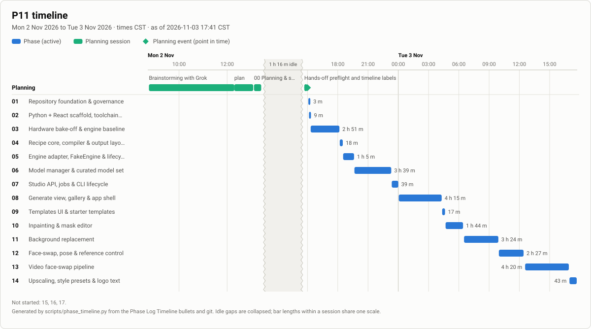
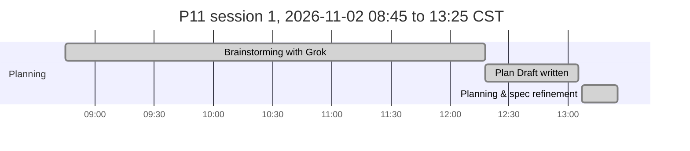
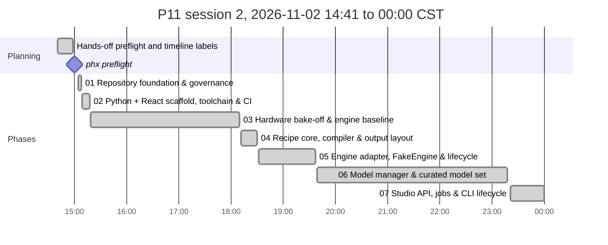

# P11: Project_1111 Implementation Plan

**Spec:** [`docs/P11_SPECIFICATION.md`](docs/P11_SPECIFICATION.md). **Decisions:** [`docs/P11_DECISIONS.md`](docs/P11_DECISIONS.md). **Agent rules:** [`CLAUDE.md`](CLAUDE.md). **Shared phase instructions:** [`prompts/P11_shared-instructions.md`](prompts/P11_shared-instructions.md)
**Last updated:** 2026-11-03 04:18 CST (Phase 08)

> ⚠️ **Mandatory:** every agent that works on this project keeps this file accurate. **Before doing any other work, set your phase to `🔄 In progress` and commit that change to `main`** (claim protocol: `prompts/P11_shared-instructions.md` §1a). Other agents read this table from `main`. At the end, set it to `✅ Complete` or `⛔ Blocked` and add a Phase Log entry. See `CLAUDE.md`.

## How to run a phase
Open Claude Code in `/home/nick/Work/project1111` and type one of:
- `/phase`: run the next eligible phase. It checks dependencies, tells you if you're on the wrong model, resumes an `In progress` phase, and asks about any open questions it needs.
- `/phase NN`: run a specific phase.
- `/phase status`: show progress and what's next, without doing any work.
- `/phase-add [after NN] <request or file>`: plan a new lettered phase (`07a`) from a change request. No product work, no claim.

**Optional hands-off runs (PhaseHypervisor):** `phx preflight /home/nick/Work/project1111` asks the foreseeable questions once, then `phx run /home/nick/Work/project1111` runs the remaining phases unattended through `/phase NN --auto`, honouring the Gate column. Manual `/phase` stays the standard way; you can switch between the two at any phase boundary, and `/phase` stops if a `phx` supervisor is running this plan.

The agent merges a completed phase into `main` and pushes it without asking (Nick's standing git authority); review its close-out summary.

Each phase is claimed by a `chore(plan): start phase NN` commit on `main` and runs in its own worktree, `../project1111-phase-NN`, so parallel sessions never share a checkout. `/phase status` flags any branch or worktree whose row is not `🔄 In progress`.

**Parallelism:**
- After **02**, phases **03** (bake-off, on the GPU) and **04** (recipe core, pure Python) can run in parallel. 03 owns `engine/`, `scripts/bench/`, `docs/P11_BENCHMARKS.md`; 04 owns `src/p11/recipe/`, `src/p11/templates/`, `src/p11/outputs/`.
- After **03** and **04**, **05** (engine adapter) and **06** (model manager) can run in parallel. 05 owns `src/p11/engine/`, `src/p11/gpu/`; 06 owns `src/p11/models/`, `models/manifest.toml`.
- After **07**, **08** (generate UI) and **15** (installer) can run in parallel.
- After **08**, **09** (templates UI), **10** (inpainting) and **12** (face/pose) can run in parallel; then **11** after 10, **13** after 12, **14** after 09. All of them add views under `frontend/src/features/` and routes under `src/p11/api/routes/`; they share `frontend/src/App.tsx` and the router, so merge one first and `git merge main` in the others.
- GPU work in parallel phases is serialized by the advisory GPU lock (spec R24, ADR-0014); expect GPU tests to wait.

**Gate column** (read only by PhaseHypervisor; manual `/phase` ignores it): `auto` = may run unattended; `review` = pause for Nick after it; `owner` = Nick starts it. Empty means `auto`.

**Status values:** ⬜ Not started · 🔄 In progress · ⛔ Blocked · ✅ Complete. Always write the icon **and** the word.

## Phases

| Phase | Phase Name | Phase Purpose | AI Model to Use | Depends on | Status | Prompt to Initiate This Phase | Gate |
|---|---|---|---|---|---|---|---|
| 00 | Planning & spec refinement | Review source docs, resolve decisions, write the spec, plan and prompts | Opus 5.5 (`claude-opus-5-5`) | none | ✅ Complete | n/a (planning session) | owner |
| 01 | Repository foundation & governance | MIT licence, README, SECURITY, CONTRIBUTING, CoC, CHANGELOG, notices, ignore files (weights, outputs, source notes), .github/, gitleaks pre-commit, docs skeleton, private GitHub repo | Sonnet 5.5 (`claude-sonnet-5-5`) | 00 | ✅ Complete | [`prompts/P11_phase-01-repo-foundation.md`](prompts/P11_phase-01-repo-foundation.md) | auto |
| 02 | Python + React scaffold, toolchain & CI | uv + CPython 3.12, `p11` package and Typer CLI skeleton, FastAPI `/healthz`, Vite React-TS skeleton built into the package, config & XDG paths, GPU lock helper, Makefile, lint/type/test/audit gates, CI | Sonnet 5.5 (`claude-sonnet-5-5`) | 01 | ✅ Complete | [`prompts/P11_phase-02-scaffold.md`](prompts/P11_phase-02-scaffold.md) | auto |
| 03 | Hardware bake-off & engine baseline | Pinned headless ComfyUI in its own uv env, sm_75 torch verification, benchmark harness, measure candidate models/presets/VRAM modes/thermals on the laptop, owner-rated contact sheet; confirm ADR-0002/0008/0009/0010, pick the default model set | Opus 5.5 (`claude-opus-5-5`) | 02 | ✅ Complete | [`prompts/P11_phase-03-bakeoff.md`](prompts/P11_phase-03-bakeoff.md) | auto |
| 04 | Recipe core, compiler & output layout | Recipe schema + versions/migrations, input slots, seed strategies, presets, pure recipe→ComfyUI graph compiler (generate, upscale chains), output paths, sidecar/PNG metadata, SQLite gallery index | Opus 5.5 (`claude-opus-5-5`) | 02 | ✅ Complete | [`prompts/P11_phase-04-recipe-core.md`](prompts/P11_phase-04-recipe-core.md) | auto |
| 05 | Engine adapter, FakeEngine & lifecycle | `Engine` protocol, ComfyUI client (queue, websocket progress, upload, fetch, interrupt, free memory), engine process supervisor, OOM handling, GPU telemetry, FakeEngine with parity tests | Opus 5.5 (`claude-opus-5-5`) | 03, 04 | ✅ Complete | [`prompts/P11_phase-05-engine-adapter.md`](prompts/P11_phase-05-engine-adapter.md) | auto |
| 06 | Model manager & curated model set | Verified manifest (URL, SHA-256, size, licence) from 03's picks, resumable verified downloader, licence acknowledgements, safetensors policy, user-added models, `p11 models` CLI | Opus 5.5 (`claude-opus-5-5`) | 03, 04 | ✅ Complete | [`prompts/P11_phase-06-model-manager.md`](prompts/P11_phase-06-model-manager.md) | auto |
| 07 | Studio API, jobs & CLI lifecycle | FastAPI JSON API, Host/Origin/token/CSP middleware, job queue with GPU lock and progress stream, upload validation, gallery API, `p11 serve/start/stop/status/open/doctor`, logging with redaction | Opus 5.5 (`claude-opus-5-5`) | 05, 06 | ✅ Complete | [`prompts/P11_phase-07-studio-api.md`](prompts/P11_phase-07-studio-api.md) | auto |
| 08 | Generate view, gallery & app shell | App shell, Simple/Advanced generate form, aspect/wallpaper presets, live progress, VRAM/thermal status bar, result actions, variations, gallery with compare/export, model switcher, keyboard shortcuts | Opus 5.5 (`claude-opus-5-5`) | 07 | ✅ Complete | [`prompts/P11_phase-08-generate-ui.md`](prompts/P11_phase-08-generate-ui.md) | auto |
| 09 | Templates UI & starter templates | Save as Template (≤ 3 actions), one-click apply, slot prompts, folders/tags/search, import/export, starter templates (photoreal wallpaper, logos, avatar) | Sonnet 5.5 (`claude-sonnet-5-5`) | 08 | ⬜ Not started | [`prompts/P11_phase-09-templates-ui.md`](prompts/P11_phase-09-templates-ui.md) | auto |
| 10 | Inpainting & mask editor | Canvas mask editor (brush, eraser, opacity, undo), photo upload as base, denoise presets, inpaint compile + run, recipe step | Opus 5.5 (`claude-opus-5-5`) | 08 | ⬜ Not started | [`prompts/P11_phase-10-inpainting.md`](prompts/P11_phase-10-inpainting.md) | auto |
| 11 | Background replacement | Subject segmentation, mask refinement with the editor, photo background upload, blend (colour match, edge feather, relight pass), one-click Replace Background, recipe step | Opus 5.5 (`claude-opus-5-5`) | 10 | ⬜ Not started | [`prompts/P11_phase-11-background.md`](prompts/P11_phase-11-background.md) | auto |
| 12 | Face-swap, pose & reference control | Face-swap engine decision (ADR-0011) with NSFW target guard, face restore, OpenPose upload/editor + Apply Pose, IP-Adapter style/character reference, recipe steps | Opus 5.5 (`claude-opus-5-5`) | 08 | ⬜ Not started | [`prompts/P11_phase-12-face-pose.md`](prompts/P11_phase-12-face-pose.md) | auto |
| 13 | Video face-swap pipeline | Probe/extract/swap/restore/stitch with audio, resumable batch job, thermal guard, cancel, scratch cleanup, Video view with progress and limits | Opus 5.5 (`claude-opus-5-5`) | 12 | ⬜ Not started | [`prompts/P11_phase-13-video-faceswap.md`](prompts/P11_phase-13-video-faceswap.md) | auto |
| 14 | Upscaling, style presets & logo text | Quality/speed upscale toggle, 3D-animated-avatar preset, text overlay step with bundled fonts, logo variations/batch, prompt defaults tuning, model manager UI | Sonnet 5.5 (`claude-sonnet-5-5`) | 09 | ⬜ Not started | [`prompts/P11_phase-14-quality-presets.md`](prompts/P11_phase-14-quality-presets.md) | auto |
| 15 | Installer, updates & Omarchy integration | `install.sh` (detect, confirm pacman, uv, engine, models, doctor), `uninstall.sh`, `p11 update`, desktop entry + app window, clean-install test in a container, user guide, OSMods write-up | Sonnet 5.5 (`claude-sonnet-5-5`) | 07 | ⬜ Not started | [`prompts/P11_phase-15-installer.md`](prompts/P11_phase-15-installer.md) | auto |
| 16 | Hardening, security review & QA | Threat model, scanners, guard-bypass tests, measured success criteria (time-to-first-image, action counts, per-preset times, OOM soak, thermal loop), accessibility, licence audit, close follow-ups | Opus 5.5 (`claude-opus-5-5`) | 09, 11, 13, 14, 15 | ⬜ Not started | [`prompts/P11_phase-16-hardening.md`](prompts/P11_phase-16-hardening.md) | auto |
| 17 | Release & publication | v1.0.0 changelog and tag, final report with timeline, private GitHub release **only with Nick's in-session confirmation** (repo stays private, H13) | Sonnet 5.5 (`claude-sonnet-5-5`) | 16 | ⬜ Not started | [`prompts/P11_phase-17-release.md`](prompts/P11_phase-17-release.md) | review |

## Timeline
Generated by `scripts/phase_timeline.py` from the Phase Log and git; refreshed on `main` at every close-out, block, resume and `/phase-add`. Do not edit between the markers.

<!-- phase-timeline:start (generated by scripts/phase_timeline.py; do not edit) -->


*Generated from the Phase Log Timeline bullets and git, as of 2026-11-03 00:00 CST. ≈ marks a time inferred from git or a heading. Idle gaps over 60 min start a new chart below and are collapsed in the image. Regenerate with `python3 scripts/phase_timeline.py --write`; do not edit by hand.*





| Phase | Name | Started | Finished | Merged | Active | Blocked | Claim |
|---|---|---|---|---|---:|---:|---|
| plan | Brainstorming with Grok | 2026-11-02 08:45 CST | 12:18 |  | 3 h 33 m |  | n/a |
| plan | Plan Draft written | 2026-11-02 12:18 CST | 13:05 |  | 47 m |  | n/a |
| 00 | Planning & spec refinement | 2026-11-02 13:07 CST | 13:25 |  | 18 m |  | n/a |
| plan | Hands-off preflight and timeline labels | 2026-11-02 14:41 CST | 14:59 |  | 18 m |  | n/a |
| plan | phx preflight | 2026-11-02 15:00 CST |  |  |  |  | n/a |
| 01 | Repository foundation & governance | 2026-11-02 15:05 CST | 15:08 | 15:08 | 3 m |  | `9f87dd5` |
| 02 | Python + React scaffold, toolchain & CI | 2026-11-02 15:09 CST | 15:18 | 15:18 | 9 m |  | `d55b209` |
| 03 | Hardware bake-off & engine baseline | 2026-11-02 15:19 CST | 18:10 | 18:10 | 2 h 51 m |  | `54750e3` |
| 04 | Recipe core, compiler & output layout | 2026-11-02 18:12 CST | 18:30 | 18:30 | 18 m |  | `53422fc` |
| 05 | Engine adapter, FakeEngine & lifecycle | 2026-11-02 18:32 CST | 19:37 | 19:37 | 1 h 5 m |  | `e36ab9a` |
| 06 | Model manager & curated model set | 2026-11-02 19:39 CST | 23:18 | 23:18 | 3 h 39 m |  | `bdbeccf` |
| 07 | Studio API, jobs & CLI lifecycle | 2026-11-02 23:21 CST | 2026-11-03 00:00 CST | 00:00 | 39 m |  | `6009af1` |

**Totals:** elapsed 15 h 15 m (first recorded start to 2026-11-03 00:00 CST) · active phase time 8 h 44 m (sum over phases) · blocked or paused 0 m · idle 1 h 16 m in 1 gap(s) over 60 min.

**Not started:** 08, 09, 10, 11, 12, 13, 14, 15, 16, 17.
<!-- phase-timeline:end -->

### Model rationale
- **Opus 5.5** (`/model claude-opus-5-5`) where a mistake is subtle, costly or hard to see:
  - the bake-off, where wrong measurements or a torch build that silently falls back to CPU would mislead every later phase (03);
  - the recipe compiler, whose graph output, migrations and metadata round-trips everything relies on (04);
  - the engine adapter, an async state machine over a websocket with OOM recovery and process supervision (05);
  - the model manager, which handles hashes, resumable downloads, licence flags and unsafe file formats (06);
  - the API security middleware, job queue and lifecycle (07);
  - the complex interactive UIs: the generate view and gallery (08), the canvas mask editor (10), segmentation and blending (11);
  - the face-swap guard and pose/reference control, where quality and the S5 boundary both matter (12);
  - the resumable, thermally guarded video job (13);
  - the security review and measured QA (16).
- **Sonnet 5.5** (`/model claude-sonnet-5-5`) for well-specified work: governance files (01), scaffolding and CI (02), CRUD-style template UI and template content (09), presets, text overlay and the model manager UI on an existing base (14), the installer and docs, which follow fixed rules in R15/S7 (15), and release packaging (17).
- New sessions start on Sonnet while `ANTHROPIC_MODEL` is set to it: switch with the `/model` command in each prompt header before running an Opus phase.

### Dependency graph
```
00 ─► 01 ─► 02 ─┬─► 03 (bake-off, GPU) ─┬─► 05 (engine adapter) ─┐
                └─► 04 (recipe core) ───┴─► 06 (model manager) ──┴─► 07 (Studio API)
                                                                       │
                     ┌─────────────────────────────────────────────────┤
                     ▼                                                 ▼
                    08 (generate UI) ─┬─► 09 (templates) ─► 14 (presets) ─┐   15 (installer)
                                      ├─► 10 (inpaint) ──► 11 (background)┤        │
                                      └─► 12 (face/pose) ► 13 (video) ────┤        │
                                                                          ▼        ▼
                                                                    16 (hardening/QA) ─► 17 (release)
```

### Definition of done (checked in the final phase)
- [ ] `./install.sh` on a clean Omarchy/Arch environment completes, runs `p11 doctor` green and opens the UI (spec R15; tested in a container and on the laptop).
- [ ] Time-to-first-image ≤ 5 min after the default-set download (R4), measured on the laptop.
- [ ] Every wallpaper preset (1920×1080, 2560×1440) generates without OOM 50 times in a row with the default model; per-preset times recorded in `docs/P11_BENCHMARKS.md`.
- [ ] Daily workflow ≤ 5 actions, Save as Template ≤ 3, re-run template 1 (Appendix B), measured by Playwright walkthroughs.
- [ ] Inpaint, background replace with photo, face-swap, pose and reference flows work end-to-end from Simple mode without docs.
- [ ] Video face-swap of a 30 s 1080p clip produces a usable file with original audio; resume after a killed process works.
- [ ] Generation has no content filter (A5); the face-swap NSFW guard (S5) blocks sexual targets in UI, API, templates and video, with tests.
- [ ] Security baseline S1–S10 verified in Phase 16 (localhost only, no telemetry egress observed, pinned engine/nodes, safetensors policy, secrets scan clean).
- [ ] THIRD_PARTY_NOTICES lists every engine component, node and model with licence flags; licence audit recorded.
- [ ] All docs current (README, user guide, ARCHITECTURE, SECURITY, CHANGELOG, OSMods entry); the timeline block generated.
- [ ] v1.0.0 GitHub release published on the private repo **only if** Nick confirmed it in-session; repo visibility unchanged (H13, ADR-0016).

## Owner questions
All answered in the hands-off preflight on 2026-11-02 14:57 CST (spec §11.5, §11.6 H1–H15; ADR-0015, ADR-0016). Phase prompts follow §11.6 instead of asking.

| # | Question | Status | Needed by |
|---|---|---|---|
| 1 | Download budget for the bake-off and the default install set | Decided 2026-11-02 14:57 CST: ≤ 100 GB bake-off candidates, default set ≤ 30 GB; Phase 15 reuses downloads (H1) (phx preflight). Used 2026-11-02 18:10 CST (Phase 03): 31.2 GB downloaded, default set 14.4 GB (ADR-0018), 16.9 GB kept | Phase 03 |
| 2 | GitHub repo owner/name | Decided 2026-11-02 14:57 CST: `antonizick/project1111`, private (name free at 2026-11-02 14:57 CST); MIT holder Nick Antonizick (H15) (phx preflight) | Phase 01 |
| 3 | Accounts for model hosts | Decided 2026-11-02 14:57 CST: login-free Hugging Face only; no tokens in the build; Civitai/gated = optional extras later (H2) (phx preflight). Applied 2026-11-02 23:09 CST (Phase 06): every manifest entry is login-free (validated for the `default` set); optional tokens go in `~/.config/p11/secrets.toml` (`0600`), sent only to their own host (ADR-0021) | Phase 06 |
| 4 | Face-swap test material | Decided 2026-11-02 14:57 CST: synthetic faces/clip; Nick's own from `~/Pictures/P11-test/` too if present; never blocks (H7) (phx preflight) | Phase 12 |
| 5 | Thermal pause threshold | Decided 2026-11-02 14:57 CST: 87 °C / 80 °C, Phase 13 may tune ±5 °C with an ADR (H9) (phx preflight). Measured 2026-11-02 18:10 CST (Phase 03): 10-min loop plateaus at 78–79 °C, power-capped (~68 W), no thermal throttling | Phase 13 |
| 6 | Prefix, architecture, publication/licence, source notes | Decided 2026-11-02 13:14 CST: P11; Studio over headless ComfyUI; private now, MIT; notes git-ignored (ADR-0001…0004) | Phase 00 |
| 7 | Restrictive model licences (non-commercial, OpenRAIL-M) | Decided 2026-11-02 14:57 CST: allowed for personal use, flagged everywhere, prefer permissive when comparable (H3) (phx preflight) | Phase 03 |
| 8 | Missing dev tools (shellcheck, gitleaks, bats, semgrep) | Decided 2026-11-02 14:57 CST: user-level pinned installs, no sudo/pacman (H4) (phx preflight) | Phase 01 |
| 9 | Who picks the default models (contact-sheet rating) | Decided 2026-11-02 14:57 CST: Phase 03 picks from measurements; Nick reviews at the Phase 17 pause (H5) (phx preflight) | Phase 03 |
| 10 | Engine switch if ComfyUI fails on the laptop | Decided 2026-11-02 14:57 CST: agent may switch when ComfyUI clearly fails a hard requirement and the fallback passes; ADR + prompt rewrites (H6) (phx preflight) | Phase 03 |
| 11 | Power profile during benchmarks (machine was in power-saver) | Decided 2026-11-02 14:57 CST: switch to performance for GPU runs only, restore after; block on battery (H8) (phx preflight) | Phase 03 |
| 12 | Review pauses (Gates) | Decided 2026-11-02 14:57 CST: `auto` for all phases except 17; 03/08/15/16 results reviewed at the 17 pause (H10) (phx preflight) | Phase 03 |
| 13 | Host changes in Phase 15 | Decided 2026-11-02 14:57 CST: desktop entry, Hyprland keybinding, shell indicator (supported user extension only, else follow-up), real install under Nick's HOME; all in OSMods (H11) (phx preflight) | Phase 15 |
| 14 | Phase 16 missed targets / open follow-ups | Decided 2026-11-02 14:57 CST: fix or record + defer non-security items; high/critical security must be fixed or block (H12) (phx preflight) | Phase 16 |
| 15 | v1.0.0 publication | Decided 2026-11-02 14:57 CST: private GitHub release after an in-session "go?"; repo stays private (H13, ADR-0016) (phx preflight) | Phase 17 |
| 16 | Starter template content | Decided 2026-11-02 14:57 CST: generic placeholders, no personal brand names (H14) (phx preflight) | Phase 09 |

## Phase Log
Newest entries at the bottom. Format: `### YYYY-MM-DD HH:MM TZ: Phase NN: <title> (<status>)` (timestamp from `date '+%Y-%m-%d %H:%M %Z'`, never a bare date). **The first bullet is always the Timeline:** `- **Timeline:** started <TS> (claim commit <hash>) · finished <TS> · merged <TS | not merged yet>` (add ` · blocked <TS> to <TS>` per `⛔` interval; *started* is the claim commit's time). Then bullets: built, deviations, follow-ups, tests.

### 2026-11-02 12:18 CST: Planning: Brainstorming with Grok (pre-planning)
- **Timeline:** started 2026-11-02 08:45 CST · finished 2026-11-02 12:18 CST
- Source: vault note `02 Projects/Work/project1111/Brainstorming Project 1111.md` (git-ignored, ADR-0004). Times are the note's own message stamps: Planning Step 1 at 08:45, the last exchange ("draft the full planning document") at 12:18; the file was last saved at 12:19.
- Outcome: requirements interview (capabilities, hardware, ease of use, content stance) that fed the Plan Draft.

### 2026-11-02 13:05 CST: Planning: Plan Draft written (pre-planning)
- **Timeline:** started 2026-11-02 12:18 CST · finished 2026-11-02 13:05 CST
- Source: vault note `02 Projects/Work/project1111/Plan Draft.md` (git-ignored, ADR-0004). Started = Grok's draft response at 12:18 in the brainstorm note; finished = the file saved to the vault (created 13:04, last modified 13:05).
- Outcome: Project_1111 Planning Document v1.0, the source of `docs/P11_SPECIFICATION.md` §1–10.

### 2026-11-02 13:25 CST: Phase 00: Planning & spec refinement (✅ Complete)
- **Timeline:** started 2026-11-02 13:07 CST · finished 2026-11-02 13:25 CST
- Read `Plan Draft.md` and `Brainstorming Project 1111.md` (vault, same folder as the repo) and inspected the laptop: RTX 2070 Mobile (TU106BM, 8 GB, ~1 GB used by the desktop), driver 615.78.08 nvidia-open, CUDA 13.4, Python 3.14.8, uv 0.13.0, node 26.8.1, Docker 29.9.2 with nvidia-container-toolkit, ffmpeg 9.0.2, 31 GB RAM, 592 GB free.
- Owner decisions: prefix P11; P11 Studio form UI over headless ComfyUI; private repo now, public at release with confirmation, MIT; source notes git-ignored (ADR-0001…0004).
- Planning constraint recorded: unfiltered generation, NSFW guard kept on face-swap and video face-swap (S5, ADR-0005).
- Refinements: separate uv Python (R1), Turing fp16/VAE/torch checks (R2), native-bucket + upscale wallpaper presets (R3), time-to-first-image measured after download (R4), ~7 GB VRAM budget (R5), recipes compiled to engine graphs (R6), pinned model manifest (R9, R10), installer without driver installs or unpinned curl|bash (R15, S7), trademark-free preset names (R17), deterministic logo text (R23), GPU lock (R24); security baseline S1–S10.
- Wrote the spec with amendments, 14 ADRs, this plan with 17 phases, shared instructions, 17 phase prompts, `CLAUDE.md`, `/phase`, `/phase-add`, the change-request template, the vault note and the timeline.
- Follow-ups: owner questions 1–5 have proposed defaults; each phase that needs one asks if it is still open.

### 2026-11-02 14:59 CST: Planning: Hands-off preflight and timeline labels
- **Timeline:** started 2026-11-02 14:41 CST · finished 2026-11-02 14:59 CST
- Pre-planning sessions added to the Phase Log (Brainstorming with Grok, Plan Draft written) so they appear in the generated timeline; the shared generator now labels Planning-lane bars with their titles (PhaseHypervisor `06b55dd`, copied byte for byte).
- Preflight for an unattended `phx run`: owner questions 1–5 decided and 7–16 added and decided; spec §11.5 updated and §11.6 H1–H15 added (amendments v1.2); ADR-0015 (pre-authorizations), ADR-0016 (v1.0.0 private release, amends ADR-0003); Gates 03, 08, 15, 16 → `auto`; prompts 01–03, 06, 08, 09, 12, 13, 15–17 and the shared instructions follow §11.6 instead of asking.
- Checked: `antonizick/project1111` is free, `gh` logged in, Docker with the NVIDIA runtime and the `docker` group, git `user.name` set; shellcheck, gitleaks, bats, semgrep missing (H4); power profile was `power-saver` on AC (H8).
- Expected stops in the run: Phase 17's release "go?", real failures, and anything outside §11.6.

### 2026-11-02 15:08 CST: Phase 01: Repository foundation & governance (✅ Complete)
- **Timeline:** started 2026-11-02 15:05 CST (claim commit 9f87dd5) · finished 2026-11-02 15:08 CST · merged 2026-11-02 15:08 CST
- **Model:** ran as claude-sonnet-5-5 (auto mode; plan lists Sonnet 5.5)
- Built: `LICENSE` (MIT, Nick Antonizick, 2026; text from choosealicense.com), `NOTICE`, `README.md`, `SECURITY.md`, `CONTRIBUTING.md`, `CODE_OF_CONDUCT.md` (Contributor Covenant 2.1 fetched from the official repo; contact = GitHub private advisory / @antonizick, no email), `CHANGELOG.md`, `THIRD_PARTY_NOTICES.md` skeleton, `.gitignore`, `.dockerignore`, `.editorconfig`, `.pre-commit-config.yaml`, `.github/` (CI with a gitleaks job, bug/feature templates, PR template, Dependabot for github-actions), `docs/P11_ARCHITECTURE.md`, `docs/P11_USER-GUIDE.md` outline, `docs/images/.gitkeep`.
- Tools (user level, no sudo): gitleaks 8.30.1 in `~/.local/bin` (SHA-256 verified), pre-commit via `uvx`; hook installed. Pinned: `pre-commit-hooks` v6.0.0, `actions/checkout` v7.0.1 at `3d3c42e5…` (all verified via `gh api` on 2026-11-02 15:08 CST). OSMods write-up: `P11 Dev Tools (gitleaks).md`.
- GitHub: private repo `https://github.com/antonizick/project1111` created (name was free), `main` pushed. Owner question 2 was already marked Decided.
- Deviations: gitleaks hook is a `language: system` local hook rather than the upstream hook repo with a rev pin (no Go needed; ADR-0017). The CI job installs the pinned gitleaks binary instead of using `gitleaks-action`.
- Tests: `pre-commit run --all-files` passes; `git check-ignore -v` reports both source notes, `x.safetensors` and `outputs/a.png` ignored; a 6 MB test file was refused by `check-added-large-files`; `git ls-files` has no weight/media/source-note files. CI result: green on first push (run 41525620854).
- Follow-ups: Phase 02 adds Python/frontend CI jobs, Dependabot pip/npm, and fills CONTRIBUTING setup commands.

### 2026-11-02 15:18 CST: Phase 02: Python + React scaffold, toolchain & CI (✅ Complete)
- **Timeline:** started 2026-11-02 15:09 CST (claim commit d55b209) · finished 2026-11-02 15:18 CST · merged 2026-11-02 15:18 CST
- **Model:** ran as claude-sonnet-5-5 (auto mode; plan lists Sonnet 5.5)
- Built: `p11` package (hatchling, `src/` layout, `uv.lock`, `.python-version` 3.12); `paths.py` (XDG + `P11_*_DIR` overrides, `ensure_private_dir` 0700), `config.py` (pydantic-settings, TOML + `P11_*` env, loopback-only host validator, ports 8111/8188, thermal placeholders 83/75 °C), `gpulock.py` (`gpu_lock(timeout, holder)` with holder JSON, `GpuLockTimeout` naming the holder), `cli.py` (`version`, `paths`, `serve`, stubs `start stop status open doctor models update`), `api/app.py` (`create_app()`, `/healthz`, static `web/`), empty documented packages; `frontend/` (Vite 8, React 19, TS strict, ESLint 10, Prettier, Vitest, Playwright smoke test) building into `src/p11/web/`; `Makefile`; CI `check` job (setup-node v7.1.0, setup-uv v10.3.3, SHA-pinned); Dependabot uv + npm; CONTRIBUTING, README, ARCHITECTURE package map, THIRD_PARTY_NOTICES, CHANGELOG; ADR-0008 P11 side Accepted. Versions and licences read from package metadata on 2026-11-02 15:18 CST.
- Deviations: none from the prompt. Details: dev-only `npm audit` reports 11 moderate findings (transitive minimatch in eslint tooling); `make audit` uses `--omit=dev` per the prompt and is clean. `make tools` skips the download when gitleaks 8.30.1 is already on `PATH`. The `scripts/` directory is excluded from ruff (PHX-owned script). CI triggers only on push to `main` and pull requests, so the branch was checked through a draft PR (#1).
- Tests: 16 pytest (paths, settings incl. non-loopback rejection and TOML cannot unlock host, GPU lock contention across two processes, `/healthz`, static serving, CLI) and 2 Vitest tests pass; Playwright smoke passes against `p11 serve`; `mypy --strict` clean. `make setup && make check` passes on a fresh clone; CI green on PR #1 (run 41526893070). `ss -ltnp` showed only `127.0.0.1:8111`; `uv run python` is 3.12.15; host Python untouched.
- Follow-ups: dev-tool npm audit findings to revisit in Phase 16 (eslint tooling update); `gpu` tests auto-skip when `nvidia-smi` is absent (Phase 03 may refine); Playwright Chromium lives in `~/.cache/ms-playwright` (OSMods note updated).

### 2026-11-02 18:10 CST: Phase 03: Hardware bake-off & engine baseline (✅ Complete)
- **Timeline:** started 2026-11-02 15:19 CST (claim commit 54750e3) · finished 2026-11-02 18:10 CST · merged 2026-11-02 18:10 CST
- **Model:** ran as claude-opus-5-5 (auto mode; plan lists Opus 5.5)
- Built: `scripts/engine_setup.sh` (idempotent; ComfyUI v0.43.0 `426f5ee` in `~/.local/share/p11/engine/`, own uv CPython 3.12.15 venv, `uv pip sync --require-hashes` from `engine/requirements.lock.txt`, model folders + `extra_model_paths.yaml`, sm_75 torch check), `engine/engine.lock.toml` (torch 2.14.1+cu130, launch flags `--listen 127.0.0.1 --offline --disable-all-custom-nodes --disable-auto-launch --disable-product-tips --preview-method none`), bench harness `scripts/bench/` (GPU lock, power profile switch with restore, nvidia-smi sampling, per-run JSON), `docs/P11_BENCHMARKS.md`, ADR-0018, ADR-0002/0008/0009/0010 confirmed, THIRD_PARTY_NOTICES (engine + picked models), ARCHITECTURE engine section; prompts 04, 05, 06, 13, 14 updated with the results.
- Results: ~256 runs, 0 OOM. Default set (14.4 GB): RealVisXL V5.0 Lightning (photoreal + avatar; 13.7 s native, 18.3 / 18.7 s at 1920×1080 / 2560×1440), Juggernaut XL v9 (Quality model, ~41 s per wallpaper), fp16-fix SDXL VAE, 4×NomosWebPhoto RealPLKSR. Wallpaper chain `model` by default (ADR-0010). 50/50 stability runs at 2560×1440 (median 17.7 s). Thermals: 78–79 °C plateau, power-limited. Dynamic VRAM default, `--disable-dynamic-vram --lowvram` as OOM retry. Desktop VRAM 1.07–1.14 GB.
- Acceptance: `engine_setup.sh` run twice → no changes, pinned versions, torch check OK on sm_75 (cuDNN 9.24); `ss -ltnp` → engine only on `127.0.0.1:8188`; a 1 s socket watcher saw no non-loopback engine connection from 15:39 to 18:08 CST; benchmarks cover 6 configurations × both presets; default-set ADR recorded.
- **For the owner's review (H5, H10):** contact sheet `~/.cache/p11/bench/contact-sheet.html` (16 prompts × 6 configurations) and avatar sheet `~/.cache/p11/bench/avatar-sheet.html`; raw JSON `~/.cache/p11/bench/runs/`.
- Deviations: no Forge-family engine was measured (Appendix A lists it "for comparison"; ComfyUI passed every hard requirement, so H6 gave no switch case) and no quantized larger model; avatars use an 896×1152 portrait bucket because 16:9 duplicated the character; the Quality chain is provisionally `latent` and Phase 14 confirms it against `both`. Rejected candidates were deleted: RealVisXL V5.0, DreamShaper XL v2 Turbo, SDXL-Lightning 4-step LoRA, 4x-UltraSharp (14.3 GB). Model weights and outputs are under `~/.local/share/p11/models/` and `~/.cache/p11/bench/` (not in git). The first `all.sh` run hit a bash syntax error at its very end because the script was edited while it ran (after its last stage; no data lost).
- Host: no OS changes (the power profile was switched to `performance` per stage and restored to `power-saver`, H8; all user-level paths).
- Tests: `make check` green (20 pytest incl. the bench schema test, 2 Vitest, ruff, mypy, gitleaks); `make gpu-test` 1 passed (512×512 non-black PNG from the pinned engine).
- Follow-ups: test `--fp16-vae` with the fp16-fix VAE for faster decodes (ADR-0009); measure a quantized larger model if Phase 14 wants more quality; ADR-0015/0016 are missing from the ADR index table in `docs/P11_DECISIONS.md` (pre-existing); the bench harness is superseded by `p11.engine` in Phase 05.

### 2026-11-02 18:30 CST: Phase 04: Recipe core, compiler & output layout (✅ Complete)
- **Timeline:** started 2026-11-02 18:12 CST (claim commit 53422fc) · finished 2026-11-02 18:30 CST · merged 2026-11-02 18:30 CST
- **Model:** ran as claude-opus-5-5 (auto mode; plan lists Opus 5.5)
- Built: `recipe/model.py` (schema v1: frozen Pydantic, discriminated `Step` union with all eight step types, slots incl. `mask`, seed strategies, `{{slot}}` placeholders cross-checked), `recipe/migrate.py` (version chain, future versions refused), `recipe/presets.py` (one table: 5 aspect presets with Phase 03 buckets/chains, 4 style presets), `recipe/registry.py` (`ModelRegistry` protocol + `PROVISIONAL_DEFAULT_SET` from ADR-0018), `recipe/compile.py` (pure compiler, one `EngineGraph` per step, `register_step`/`register_modifier`, slot validation, compile-time sampler/scheduler check against the pinned engine), `recipe/variations.py`, `outputs/layout.py`, `outputs/metadata.py` (`RunRecord`, sidecar, `iTXt` chunks edited in the byte stream, `strip_metadata`), `outputs/index.py` (SQLite + FTS5, migrations, `reindex`), `templates/store.py`; ADR-0019, ADR-0007 schema notes; ARCHITECTURE recipe-core section; prompts 05, 06, 07, 09, 10, 11, 12, 14 given the APIs they build on.
- Node names and inputs read from ComfyUI v0.43.0 `426f5ee` (`nodes.py`, `comfy_extras/nodes_upscale_model.py`, `comfy/samplers.py`) in the installed engine checkout, 2026-11-02 18:20 CST.
- Acceptance: `make check` green; coverage 99.5 % for `recipe/`, `outputs/`, `templates/` (gate ≥ 90 % added to `make test`); the golden `16:9 1920×1080 photoreal` graph was accepted by the real engine's `/prompt` and rendered a 1920×1080 non-flat image (`tests/gpu/test_compiled_graph_engine.py`, 35 s incl. engine start; output deleted); `test_pure_modules.py` shows no network imports in the three packages and no default roots in `outputs/`/`templates/`.
- Deviations: added slot kind `mask` (typed mask inputs for inpaint/manual background); `pose`/`reference` are modifier steps folded into the preceding generate graph rather than graphs of their own; the compiler returns engine graphs only, so text overlay (14) and any non-engine compositing (11) need a local-step extension (noted in those prompts); `Generate.aspect` defaults to the style's aspect. Added the missing ADR-0015/0016 rows to the ADR index (Phase 03 follow-up).
- Host: no OS changes. Dev dependency added: Hypothesis 6.170.14 (MPL-2.0, dev only).
- Tests: 171 unit tests (102 recipe incl. 20 golden graphs and Hypothesis round-trip/slug properties, outputs, templates, purity) + 2 Vitest; `make gpu-test` 2 passed (Phase 03 smoke + compiled-graph run).
- Follow-ups: Phase 06 replaces `PROVISIONAL_DEFAULT_SET` and confirms the SD 1.5 VAE's manifest ID (provisional `vae-ft-mse-840000`); Phase 05 moves the GPU test from `scripts/bench/engine.py` to `ComfyEngine`; the starlette `TestClient` httpx deprecation warning (pre-existing, Phase 02 tests) to revisit in Phase 07.

### 2026-11-02 19:37 CST: Phase 05: Engine adapter, FakeEngine & lifecycle (✅ Complete)
- **Timeline:** started 2026-11-02 18:32 CST (claim commit e36ab9a) · finished 2026-11-02 19:37 CST · merged 2026-11-02 19:37 CST
- **Model:** ran as claude-opus-5-5 (auto mode; plan lists Opus 5.5)
- Built: `engine/base.py` (`Engine` protocol incl. `restart(vram_mode)` and `vram_mode`, typed events and errors, `bind_inputs`, content-addressed `upload_name`), `engine/comfy.py` (`ComfyEngine` + `EngineConfig`; endpoints and messages read from ComfyUI v0.43.0 `426f5ee` `server.py`/`execution.py`/`main.py`/`protocol.py` on 2026-11-02 18:40 CST; version + loopback check at start; per-run websocket with a client-chosen `prompt_id`; outputs fetched via `/history` + `/view` and deleted from the engine scratch dir and history), `engine/process.py` (`ProcessSupervisor`: GPU lock for the process lifetime, pid file + `/proc` cmdline + port check, own session + `PR_SET_PDEATHSIG`, rotated `~/.cache/p11/logs/engine.log`, readiness poll, one restart after a crash then lock released, SIGTERM → SIGKILL), `engine/recovery.py` (`run_with_oom_retry`), `engine/fake.py` (`FakeEngine`, 34 known nodes verified at the pin), `engine/lockfile.py`, `create_engine()`, `p11 serve --fake`, `gpu/telemetry.py` (NVML via nvidia-ml-py 13.615.71 BSD-3-Clause, `nvidia-smi` fallback, ≤ 1 Hz `stream`, `ThermalGuard`); settings thermal defaults 87/80 °C (H9) with resume < pause; `scripts/bench/adapter.py`; ADR-0020; ARCHITECTURE engine section; BENCHMARKS adapter section; notes for prompts 07, 08, 10–13, 15, 16.
- Acceptance: 20/20 back-to-back `16:9-1920x1080` runs through `ComfyEngine` (median 16.59 s, peak VRAM 7.72 GB, max 77 °C); adapter overhead +3.5 % / −0.7 % depending on run order against the Phase 03 bench client in the same session (within noise, < 5 %); interrupt 0.52 s (3/3, limit 2 s); a forced OOM recovers in `--lowvram` when the pressure goes away and otherwise fails with the plain-English message; every gpu test asserts the engine pid is gone after `stop` and `ps` showed no engine or hog left; `ss` shows the engine only on `127.0.0.1:8188` and its log has no non-loopback URL (gpu test); `make check` green; `make gpu-test` 13 passed.
- Deviations: oversized latents do not OOM on this card at v0.43.0 (3072², 4096² ran past 240 s; batch 8 at 1024² finished in 93 s), so the real forced OOM uses a VRAM hog leaving 600 MiB (`tests/gpu/vram_hog.py`, ADR-0020); the low-VRAM mode stays on after a retry (Phase 07 may restart to dynamic when idle); `run()` also raises `EngineExecutionError` and `EngineInterrupted` besides the five listed errors; the protocol gained `restart(vram_mode)` and `vram_mode` for the retry; added a mock ComfyUI server (`tests/fixtures/mock_comfyui.py`) so the contract suite also runs `ComfyEngine` in CI without a GPU; the Phase 04 compiled-graph gpu test now runs through `ComfyEngine`; `scripts/bench/engine.py` is kept for bake-off reproducibility.
- Host: no OS changes (power profile switched to `performance` only during the adapter benchmark and restored to `power-saver`, H8). Runtime dependency added: nvidia-ml-py.
- Tests: 273 unit tests (102 new: contract suite × fake + mock ComfyUI, 13 supervisor tests with a dummy process, telemetry parser and ThermalGuard Hypothesis properties, ComfyEngine parsers/config, FakeEngine golden-graph runs) + 2 Vitest; coverage 97 % overall, `p11.engine` + `p11.gpu` 95 % (added to the ≥ 90 % gate); `make gpu-test` 13 passed (contract suite, two OOM tests, known-node and loopback/offline checks, Phase 03/04 smoke tests).
- Follow-ups: Phase 07 decides when to restart from `lowvram` back to `dynamic`; Phase 15 must ship `engine.lock.toml` to `~/.local/share/p11/engine/` for a non-repo install; the starlette `TestClient` httpx deprecation warning (Phase 07); the 3.5 % vs −0.7 % order effect suggests warm-GPU drift worth a counterbalanced soak in Phase 16.

### 2026-11-02 23:18 CST: Phase 06: Model manager & curated model set (✅ Complete)
- **Timeline:** started 2026-11-02 19:39 CST (claim commit bdbeccf) · finished 2026-11-02 23:18 CST · merged 2026-11-02 23:18 CST
- **Model:** ran as claude-opus-5-5 (auto mode; plan lists Opus 5.5)
- The session was paused from about 19:55 to 23:05 CST (no work in that span; resumed under the same claim).
- Built: `models/manifest.toml` (6 entries: default set `realvisxl5-lightning`, `juggernautxl9`, `sdxl-vae-fp16-fix`, `4x-nomos-webphoto-realplksr` = 14.41 GB; `full` adds `realisticvision6` + `vae-ft-mse-840000` = 16.87 GB), each URL pinned to the HF commit, revision/size/LFS SHA-256/licence tag re-read from the HF API and hashes recomputed with `sha256sum` (all match ADR-0018), licence URLs fetched, `# Checked 2026-11-02 19:42 CST` per entry. `src/p11/models/`: `manifest.py` (strict schema), `download.py` (HTTPS-only, manual redirects with per-host tokens, `.part` + Range resume, streaming SHA-256, backoff, disk check, per-host limit, `secrets.toml` `0600` check), `formats.py` (content sniffing, pickle refusal, safetensors kind/base detection), `state.py` (licences.toml, models.toml, hash cache), `registry.py` (`ModelManager`, `ManagerRegistry` for the compiler, join by hash, `--from` reuse, repair, `extra_model_paths.yaml`), `doctor.py` (`check()` → `p11.problems.Problem`), `cli.py` (`p11 models list|install|verify|add|remove|enable|disable|licences`, `--json`). ADR-0021.
- Acceptance: (1) empty temp models root with isolated config/cache/data dirs, `p11 models install default --accept-licences`: 4 downloaded, 14.4 GB, 23:06 to 23:15 CST (~27 MB/s from the HF CDN), all verified and registered; second run: 0 to fetch, 0 downloaded, 0.5 s. (2) one byte flipped in the VAE: `p11 models verify` → `BAD sdxl-vae-fp16-fix: corrupt (SHA-256 … does not match)`, exit 1; `install default` repaired it (334.6 MB) and `verify` → exit 0. (3) every entry has a verified URL, size, SHA-256 and licence with its check timestamp (test `test_every_entry_has_a_check_timestamp_comment`). The temp root (14.4 GB) was deleted afterwards; total downloads this phase ≈ 14.5 GB (bake-off + this ≈ 46 GB, under H1's 100 GB).
- Deviations: enable/disable and user models live in `~/.config/p11/models.toml`, not `config.toml` (P11 never rewrites the hand-edited file); schema additions `name`, `source`, `scale`, `licence.commercial_use`, `base = "any"`, kind `facedetect`; `PROVISIONAL_DEFAULT_SET` kept as the compiler tests' pure registry, asserted equal to the manifest; the `slow` real-download test is opt-in (`P11_NET_TESTS=1`) so `make check`/CI stay offline; plain http only through test-only switches (loopback). The ADR index gap noted by Phase 03 (ADR-0015/0016) no longer exists. All in ADR-0021.
- Host: no OS changes. User-level P11 files only: `~/.cache/p11/model-hashes.json` (hash cache for the real models dir, written by `p11 models list`). Nick's `~/.config/p11/` was not written (no licences accepted there yet: the first real `p11 models install` will ask, or the installer passes `--accept-licences`).
- Tests: `make check` green: 383 passed, 1 skipped (opt-in net test), coverage 97 % (`p11.models` 94–100 % per module); new: 32 downloader (local HTTP server: resume after cut connection, resume from an old `.part`, Range ignored, hash mismatch, oversize, redirect drops the token, retries/backoff, 401/403/404, disk full before and during), 18 manifest, 15 formats (crafted pickles protocols 2–5 and torch zip refused), 27 registry/licence/doctor, 14 CLI `--json`. Real net test passed (4xNomos, 29.6 MB via HF 302 → CDN). `gpu`: the compiled 1920×1080 wallpaper graph now resolves models through `ModelManager.registry()` and rendered on the pinned engine (1 passed, 31.5 s); no engine left running.
- Follow-ups: Phase 07 wires `p11.models.check()` into `p11 doctor` and `GET /api/models`; Phase 15 ships the manifest outside the repo (`~/.local/share/p11/manifest.toml`) and uses `--from` for the throw-away-HOME install; `p11 models install` downloads files one after another (the parallel `fetch_all` exists but the CLI keeps it serial for readable progress), revisit for many small face models in Phase 12; the httpx `iter_bytes` buffer means an interrupted transfer resumes from the last full 1 MiB chunk (correct, at most 1 MiB re-fetched).

### 2026-11-03 00:00 CST: Phase 07: Studio API, jobs & CLI lifecycle (✅ Complete)
- **Timeline:** started 2026-11-02 23:21 CST (claim commit 6009af1) · finished 2026-11-03 00:00 CST · merged 2026-11-03 00:00 CST
- **Model:** ran as claude-opus-5-5 (auto mode; plan lists Opus 5.5)
- Built: `api/security.py` (`SecurityMiddleware`: Host allowlist 421, Origin/`Sec-Fetch-Site` 403, token in `Authorization`/`X-P11-Token` or a read-only `HttpOnly; SameSite=Strict` cookie, 401; one-time launch codes; strict CSP + nosniff/no-referrer/DENY/COOP/CORP; body caps on `Content-Length` and streamed bodies, 413; websockets refused), `api/app.py` (factory with settings/session/port/paths, typed-error handlers → `{code, message, hint}`, access log without query strings, FastAPI OpenTelemetry hooks off, OpenAPI behind the token), `api/studio.py` (`Studio` container, sandbox paths for `--fake`, ≤ 1 Hz GPU events, demo gallery), `api/routes/` (session, jobs, SSE events, gallery/images, uploads, templates, presets, models, system), `jobs/` (`JobStore` SQLite with interrupted-job marking, `EventBus` with ordered IDs and replay, `Runner` chaining steps/batches/runs with saved+embedded+indexed outputs and parent links, `JobQueue` with one worker, lazy engine start, idle stop, low-VRAM reset, cancel, `ThermalWatch` pause; `errors.py` mapping), `media/` (Pillow/ffprobe validation, EXIF and video metadata stripping, `InputStore`), `lifecycle.py`, `doctor.py`, `logs.py`, `p11 serve/start/stop/status/open/doctor`, `python -m p11`; frontend `src/api/session.ts` + placeholder page with a working session; Playwright e2e on `p11 serve --fake` in temp dirs. ADR-0022; ARCHITECTURE Studio API section and data-location table; SECURITY local-service notes; user guide §1 (CLI, doctor problems); README; THIRD_PARTY_NOTICES (httpx2/httpcore2/truststore dev, ffmpeg); notes for prompts 08–16.
- Acceptance: (1) `p11 start` + `p11 open --print-url` on the laptop: the one-time link opens a session in headless Chromium (Playwright e2e: session active, fragment cleared, cookie works, link refused on reuse, no CSP violations); `curl` without the token → 401, with a foreign `Origin` → 403, foreign `Host` → 421; `ss -ltnp` shows the Studio only on `127.0.0.1:8111` and the engine only on `127.0.0.1:8188`; `studio.log` never contains the token or launch code (test). (2) Live Studio on the real engine (temp outputs/data, real models and GPU lock): a `16:9-1920x1080` wallpaper job via `POST /api/jobs` finished in ~36 s including the cold engine start, `GET /api/gallery` lists it at 1920×1080, and its PNG round-trips the submitted recipe; `p11 stop` left no engine process, both ports closed and the GPU lock empty; same flow in `tests/gpu/test_studio_api_gpu.py`. (3) `p11 doctor` on the laptop: all checks ok (GPU + driver 615.78.08, ComfyUI v0.43.0 pinned, torch 2.14.1+cu130 sm_75, default models, ports, 612 GB free, permissions), exit 0; with a hard-linked copy of the models where the VAE was renamed out of its folder: `ERROR Default model SDXL VAE fp16 fix … is not installed → Run p11 models install default`, exit 1 (real model files untouched). (4) `make check` and `make gpu-test` green.
- Deviations: `p11 open` was verified with a headless browser (`--print-url` + Playwright) and a mocked launcher rather than by opening a window on the desktop during the unattended run (the launch command detection `omarchy-launch-webapp` → Chromium `--app=` → `xdg-open` is unit-tested); the token reaches the browser as a one-time launch code that is traded for the token (the prompt's "token via URL fragment", hardened so the browser's argv only holds a spent code); uploads are raw request bodies, not multipart (no `python-multipart`); a job has a `count` (1–16 runs) for variations/batches; `p11 serve --fake` uses its own sandbox under `~/.cache/p11/fake/`; gallery index gained `since`/`until`/`search_count`; the FakeEngine now returns one image per batch item (parity with ComfyUI). All in ADR-0022.
- Host: no OS changes. User-level P11 data only: `chmod 700 ~/.local/share/p11` (was 755 since Phase 03's engine setup; `p11 doctor`'s own hint, and what the Studio does on its first start); gpu tests wrote the engine log/pid in `~/.cache/p11/` as before. Power profile left at `power-saver` (no benchmarks). Dev dependency added: httpx2 2.16.0 (BSD-3-Clause, with httpcore2 BSD-3-Clause and truststore MIT), which closes the Starlette `TestClient` httpx deprecation follow-up from Phases 02–05.
- Tests: `make check` green: 489 passed, 1 skipped (opt-in net test), coverage 97 % (new modules 89–100 %, gate now includes api/jobs/media/lifecycle/doctor/logs); ~110 new: 20 middleware, 22 media/uploads (synthetic JPEG with GPS, ffmpeg-made clip with a location tag), 24 jobs (chaining, batches, counts, slot uploads, gallery refs, cancel, OOM retry/failure, engine failures, restart-interrupted, thermal pause, idle stop, low-VRAM reset), 4 events incl. SSE ordering and `Last-Event-ID` resume over a real uvicorn server, 8 routes, 16 CLI incl. real start/status/open/stop, 13 doctor, 3 logging; Vitest 5; Playwright 2. `make gpu-test`: 14 passed (new: the API wallpaper job) in 7.5 min; no engine left running.
- Follow-ups: `tests/unit/test_gpulock.py` now shows a `fork()`-while-multithreaded DeprecationWarning because earlier tests leave TestClient/uvicorn threads (harmless; Phase 16 can switch those tests to `spawn`); Phase 08 decides how the UI surfaces `job.note` and the `paused` state; Phase 16 should review the in-memory image upload buffer (≤ 64 MiB) and consider rate-limiting launch-code minting; the CLI `serve` prints to stdout only (logs go to the file), which Phase 15's desktop entry may want to route.

### 2026-11-03 04:18 CST: Phase 08: Generate view, gallery & app shell (✅ Complete)
- **Timeline:** started 2026-11-03 00:03 CST (claim commit a702d75) · finished 2026-11-03 04:18 CST · merged 2026-11-03 04:18 CST
- **Model:** ran as claude-opus-5-5 (auto mode; plan lists Opus 5.5)
- Built (frontend, ADR-0023): app shell (`app/Shell.tsx`: left nav with "Coming in Phase NN" placeholders for Templates 09, Inpaint 10, Background 11, Face & Pose 12, Video 13, Models 14; top bar with connection, version, light/dark theme, `?`; status bar with engine state, queue, VRAM used/total, GPU temperature band 70/80/87 °C, current model); typed client `api/client.ts` + `api/types.ts`; `api/events.ts` (`EventSource` plus a rebuild with 1/2/5/10 s backoff); pure SSE-fed store `app/studio.tsx`; toasts with hints and actions; keyboard map (`Ctrl+Enter`, `Esc`, `V`, `T`, `G`, `?`) with a newest-wins handler stack; `Dialog` (focus trap) and `ZoomPan` (wheel/keys/drag, controllable for synced compare). Generate view: prompt, style chips, size presets, batch 1–4, Generate/Cancel, progress with stage (Generating/Refining from `title`), step, run i of n, ETA (Phase 03 baselines → observed rate), OOM/thermal `note`, previews when sent; Advanced drawer (model with family + default badge, LoRAs, negative, sampler/scheduler/steps/CFG with manifest defaults as placeholders, seed lock, upscale chain, reset); result panel (zoom/pan, metadata, Variations, Tweak prompt, Upscale ×2, Favourite, Download with strip metadata; Inpaint/Background/Face/Save as Template show their phase). Gallery: virtualized day-grouped grid with paging, search, template/model/favourites filters, detail view (prev/next, open as recipe with the seed locked), synced compare of 2+ images, bulk ZIP export, delete to trash, trash total + Empty trash with confirmation, empty states.
- Built (API, in scope to serve the UI): `POST /api/images/{id}/variations` (seed / prompt mutation via `p11.recipe.variations`), `DELETE /api/images/{id}` → `<data>/trash/`, `GET /api/trash`, `POST /api/trash/empty`, `GET /api/gallery/facets`, `POST /api/gallery/export` (ZIP), `model` gallery filter, SSE `deleted`, `/api/models` + `usable`/`family`/`defaults`/`vae`; `GalleryIndex.delete` clears children's parent link.
- Acceptance: (1) **Laptop, real engine** (2026-11-03 ~04:16 CST, `e2e/real-engine.spec.ts` against a real `p11 serve` on port 18311 with the installed engine/models and throw-away outputs/gallery, shared GPU lock): typed prompt + Ctrl+Enter in Simple mode → 1920 × 1080 photoreal image in 28.7 s from a cold engine; the status bar showed VRAM 4.3 / 8.0 GB and 56 °C live; the image appeared in the gallery. Studio stopped afterwards, no engine left, VRAM back to 1299 MiB. (2) **Action counts** (Playwright on `p11 serve --fake`): typed prompt → Generate (Ctrl+Enter) → Download = **2 actions** (Appendix B daily path ≤ 5; generate→download ≤ 3). The Background/Inpaint legs of Appendix B arrive with Phases 10/11. (3) **Network:** every walkthrough fails on any request outside `127.0.0.1:<port>` (data:/blob: allowed); none seen; no CSP violations. (4) `make check` green. Screenshots (FakeEngine images only): `docs/images/p11-generate.png`, `p11-gallery.png`, `p11-compare.png`.
- **For the owner's review (Phase 17 pause, H10):** look at the UI with `uv run p11 start && uv run p11 open` (or `p11 serve --fake`), the three screenshots, and the real-engine result above. Points to judge: Simple-mode layout, chip labels, the placement of later-phase buttons, and whether Download should strip metadata by default (it does).
- Deviations: Variations, bulk export, delete/trash, facets and model defaults needed small API additions (in Phase 08 rather than waiting for 16, ADR-0023). "Save as Template" and `T` show a "Phase 09" notice instead of a partial flow. Upscale ×2 uses the fixed `model` chain (Phase 14 adds the quality toggle). The status bar's "current model" is the model of this tab's last job (the engine reports no loaded model). Restore from trash is manual (move files back + reindex). The real-engine check ran under `power-saver` (not a benchmark; H8 applies to benchmarks).
- Host: no OS changes. New dev dependency `@axe-core/playwright` 4.14.0 (MPL-2.0, dev only; `npm audit --omit=dev` clean; the existing dev-only eslint/minimatch advisory is unchanged).
- Tests: `make check` green: 495 passed, 1 skipped, coverage 96.6 %; 6 new API tests (`test_api_gallery_actions.py`); frontend 28 Vitest tests (form ⇄ recipe, preset switching, manifest defaults, open-as-recipe, ETA, layout, keymap, reducer, SSE reconnect with fake timers, Generate and Gallery components with mocked API/SSE, error toasts); Playwright 6 (smoke ×2, generate→download with stripped metadata and the action count, Esc cancel, V variations → gallery search/compare/ZIP export/open as recipe, axe on Generate and Gallery) + the opt-in screenshot and real-engine specs.
- Follow-ups: trash restore button and a gallery "reindex" action (16); a Playwright walkthrough of the full Appendix B daily path once Background (11) and Inpaint (10) land (16); `make e2e` (Playwright) is neither in `make check` nor in CI; it ran locally here, Phase 16 may add a CI job with Chromium; the gallery refetches the first pages on every gallery change, fine at hundreds of images, revisit with keyset paging if a gallery reaches tens of thousands (16).
