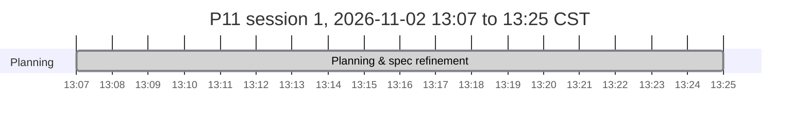

# P11: Project_1111 Implementation Plan

**Spec:** [`docs/P11_SPECIFICATION.md`](docs/P11_SPECIFICATION.md). **Decisions:** [`docs/P11_DECISIONS.md`](docs/P11_DECISIONS.md). **Agent rules:** [`CLAUDE.md`](CLAUDE.md). **Shared phase instructions:** [`prompts/P11_shared-instructions.md`](prompts/P11_shared-instructions.md)
**Last updated:** 2026-11-02 13:25 CST (Phase 00, planning)

> ⚠️ **Mandatory:** every agent that works on this project keeps this file accurate. **Before doing any other work, set your phase to `🔄 In progress` and commit that change to `main`** (claim protocol: `prompts/P11_shared-instructions.md` §1a). Other agents read this table from `main`. At the end, set it to `✅ Complete` or `⛔ Blocked` and add a Phase Log entry. See `CLAUDE.md`.

## How to run a phase
Open Claude Code in `/home/nick/Work/project1111` and type one of:
- `/phase`: run the next eligible phase. It checks dependencies, tells you if you're on the wrong model, resumes an `In progress` phase, and asks about any open questions it needs.
- `/phase NN`: run a specific phase.
- `/phase status`: show progress and what's next, without doing any work.
- `/phase-add [after NN] <request or file>`: plan a new lettered phase (`07a`) from a change request. No product work, no claim.

**Optional hands-off runs (PhaseHypervisor):** `phx preflight /home/nick/Work/project1111` asks the foreseeable questions once, then `phx run /home/nick/Work/project1111` runs the remaining phases unattended through `/phase NN --auto`, honouring the Gate column. Manual `/phase` stays the standard way; you can switch between the two at any phase boundary, and `/phase` stops if a `phx` supervisor is running this plan.

The agent merges a completed phase into `main` and pushes it without asking (Nick's standing git authority); review its close-out summary.

Each phase is claimed by a `chore(plan): start phase NN` commit on `main` and runs in its own worktree, `../project1111-phase-NN`, so parallel sessions never share a checkout. `/phase status` flags any branch or worktree whose row is not `🔄 In progress`.

**Parallelism:**
- After **02**, phases **03** (bake-off, on the GPU) and **04** (recipe core, pure Python) can run in parallel. 03 owns `engine/`, `scripts/bench/`, `docs/P11_BENCHMARKS.md`; 04 owns `src/p11/recipe/`, `src/p11/templates/`, `src/p11/outputs/`.
- After **03** and **04**, **05** (engine adapter) and **06** (model manager) can run in parallel. 05 owns `src/p11/engine/`, `src/p11/gpu/`; 06 owns `src/p11/models/`, `models/manifest.toml`.
- After **07**, **08** (generate UI) and **15** (installer) can run in parallel.
- After **08**, **09** (templates UI), **10** (inpainting) and **12** (face/pose) can run in parallel; then **11** after 10, **13** after 12, **14** after 09. All of them add views under `frontend/src/features/` and routes under `src/p11/api/routes/`; they share `frontend/src/App.tsx` and the router, so merge one first and `git merge main` in the others.
- GPU work in parallel phases is serialized by the advisory GPU lock (spec R24, ADR-0014); expect GPU tests to wait.

**Gate column** (read only by PhaseHypervisor; manual `/phase` ignores it): `auto` = may run unattended; `review` = pause for Nick after it; `owner` = Nick starts it. Empty means `auto`.

**Status values:** ⬜ Not started · 🔄 In progress · ⛔ Blocked · ✅ Complete. Always write the icon **and** the word.

## Phases

| Phase | Phase Name | Phase Purpose | AI Model to Use | Depends on | Status | Prompt to Initiate This Phase | Gate |
|---|---|---|---|---|---|---|---|
| 00 | Planning & spec refinement | Review source docs, resolve decisions, write the spec, plan and prompts | Opus 5.5 (`claude-opus-5-5`) | none | ✅ Complete | n/a (planning session) | owner |
| 01 | Repository foundation & governance | MIT licence, README, SECURITY, CONTRIBUTING, CoC, CHANGELOG, notices, ignore files (weights, outputs, source notes), .github/, gitleaks pre-commit, docs skeleton, private GitHub repo | Sonnet 5.5 (`claude-sonnet-5-5`) | 00 | ⬜ Not started | [`prompts/P11_phase-01-repo-foundation.md`](prompts/P11_phase-01-repo-foundation.md) | auto |
| 02 | Python + React scaffold, toolchain & CI | uv + CPython 3.12, `p11` package and Typer CLI skeleton, FastAPI `/healthz`, Vite React-TS skeleton built into the package, config & XDG paths, GPU lock helper, Makefile, lint/type/test/audit gates, CI | Sonnet 5.5 (`claude-sonnet-5-5`) | 01 | ⬜ Not started | [`prompts/P11_phase-02-scaffold.md`](prompts/P11_phase-02-scaffold.md) | auto |
| 03 | Hardware bake-off & engine baseline | Pinned headless ComfyUI in its own uv env, sm_75 torch verification, benchmark harness, measure candidate models/presets/VRAM modes/thermals on the laptop, owner-rated contact sheet; confirm ADR-0002/0008/0009/0010, pick the default model set | Opus 5.5 (`claude-opus-5-5`) | 02 | ⬜ Not started | [`prompts/P11_phase-03-bakeoff.md`](prompts/P11_phase-03-bakeoff.md) | review |
| 04 | Recipe core, compiler & output layout | Recipe schema + versions/migrations, input slots, seed strategies, presets, pure recipe→ComfyUI graph compiler (generate, upscale chains), output paths, sidecar/PNG metadata, SQLite gallery index | Opus 5.5 (`claude-opus-5-5`) | 02 | ⬜ Not started | [`prompts/P11_phase-04-recipe-core.md`](prompts/P11_phase-04-recipe-core.md) | auto |
| 05 | Engine adapter, FakeEngine & lifecycle | `Engine` protocol, ComfyUI client (queue, websocket progress, upload, fetch, interrupt, free memory), engine process supervisor, OOM handling, GPU telemetry, FakeEngine with parity tests | Opus 5.5 (`claude-opus-5-5`) | 03, 04 | ⬜ Not started | [`prompts/P11_phase-05-engine-adapter.md`](prompts/P11_phase-05-engine-adapter.md) | auto |
| 06 | Model manager & curated model set | Verified manifest (URL, SHA-256, size, licence) from 03's picks, resumable verified downloader, licence acknowledgements, safetensors policy, user-added models, `p11 models` CLI | Opus 5.5 (`claude-opus-5-5`) | 03, 04 | ⬜ Not started | [`prompts/P11_phase-06-model-manager.md`](prompts/P11_phase-06-model-manager.md) | auto |
| 07 | Studio API, jobs & CLI lifecycle | FastAPI JSON API, Host/Origin/token/CSP middleware, job queue with GPU lock and progress stream, upload validation, gallery API, `p11 serve/start/stop/status/open/doctor`, logging with redaction | Opus 5.5 (`claude-opus-5-5`) | 05, 06 | ⬜ Not started | [`prompts/P11_phase-07-studio-api.md`](prompts/P11_phase-07-studio-api.md) | auto |
| 08 | Generate view, gallery & app shell | App shell, Simple/Advanced generate form, aspect/wallpaper presets, live progress, VRAM/thermal status bar, result actions, variations, gallery with compare/export, model switcher, keyboard shortcuts | Opus 5.5 (`claude-opus-5-5`) | 07 | ⬜ Not started | [`prompts/P11_phase-08-generate-ui.md`](prompts/P11_phase-08-generate-ui.md) | review |
| 09 | Templates UI & starter templates | Save as Template (≤ 3 actions), one-click apply, slot prompts, folders/tags/search, import/export, starter templates (photoreal wallpaper, logos, avatar) | Sonnet 5.5 (`claude-sonnet-5-5`) | 08 | ⬜ Not started | [`prompts/P11_phase-09-templates-ui.md`](prompts/P11_phase-09-templates-ui.md) | auto |
| 10 | Inpainting & mask editor | Canvas mask editor (brush, eraser, opacity, undo), photo upload as base, denoise presets, inpaint compile + run, recipe step | Opus 5.5 (`claude-opus-5-5`) | 08 | ⬜ Not started | [`prompts/P11_phase-10-inpainting.md`](prompts/P11_phase-10-inpainting.md) | auto |
| 11 | Background replacement | Subject segmentation, mask refinement with the editor, photo background upload, blend (colour match, edge feather, relight pass), one-click Replace Background, recipe step | Opus 5.5 (`claude-opus-5-5`) | 10 | ⬜ Not started | [`prompts/P11_phase-11-background.md`](prompts/P11_phase-11-background.md) | auto |
| 12 | Face-swap, pose & reference control | Face-swap engine decision (ADR-0011) with NSFW target guard, face restore, OpenPose upload/editor + Apply Pose, IP-Adapter style/character reference, recipe steps | Opus 5.5 (`claude-opus-5-5`) | 08 | ⬜ Not started | [`prompts/P11_phase-12-face-pose.md`](prompts/P11_phase-12-face-pose.md) | auto |
| 13 | Video face-swap pipeline | Probe/extract/swap/restore/stitch with audio, resumable batch job, thermal guard, cancel, scratch cleanup, Video view with progress and limits | Opus 5.5 (`claude-opus-5-5`) | 12 | ⬜ Not started | [`prompts/P11_phase-13-video-faceswap.md`](prompts/P11_phase-13-video-faceswap.md) | auto |
| 14 | Upscaling, style presets & logo text | Quality/speed upscale toggle, 3D-animated-avatar preset, text overlay step with bundled fonts, logo variations/batch, prompt defaults tuning, model manager UI | Sonnet 5.5 (`claude-sonnet-5-5`) | 09 | ⬜ Not started | [`prompts/P11_phase-14-quality-presets.md`](prompts/P11_phase-14-quality-presets.md) | auto |
| 15 | Installer, updates & Omarchy integration | `install.sh` (detect, confirm pacman, uv, engine, models, doctor), `uninstall.sh`, `p11 update`, desktop entry + app window, clean-install test in a container, user guide, OSMods write-up | Sonnet 5.5 (`claude-sonnet-5-5`) | 07 | ⬜ Not started | [`prompts/P11_phase-15-installer.md`](prompts/P11_phase-15-installer.md) | review |
| 16 | Hardening, security review & QA | Threat model, scanners, guard-bypass tests, measured success criteria (time-to-first-image, action counts, per-preset times, OOM soak, thermal loop), accessibility, licence audit, close follow-ups | Opus 5.5 (`claude-opus-5-5`) | 09, 11, 13, 14, 15 | ⬜ Not started | [`prompts/P11_phase-16-hardening.md`](prompts/P11_phase-16-hardening.md) | review |
| 17 | Release & publication | v1.0.0 changelog and tag, final report with timeline, GitHub publication **only with Nick's in-session confirmation** | Sonnet 5.5 (`claude-sonnet-5-5`) | 16 | ⬜ Not started | [`prompts/P11_phase-17-release.md`](prompts/P11_phase-17-release.md) | review |

## Timeline
Generated by `scripts/phase_timeline.py` from the Phase Log and git; refreshed on `main` at every close-out, block, resume and `/phase-add`. Do not edit between the markers.

<!-- phase-timeline:start (generated by scripts/phase_timeline.py; do not edit) -->


*Generated from the Phase Log Timeline bullets and git, as of 2026-11-02 13:25 CST. ≈ marks a time inferred from git or a heading. Idle gaps over 60 min start a new chart below and are collapsed in the image. Regenerate with `python3 scripts/phase_timeline.py --write`; do not edit by hand.*



| Phase | Name | Started | Finished | Merged | Active | Blocked | Claim |
|---|---|---|---|---|---:|---:|---|
| 00 | Planning & spec refinement | 2026-11-02 13:07 CST | 13:25 |  | 18 m |  | n/a |

**Totals:** elapsed 18 m (first recorded start to 2026-11-02 13:25 CST) · active phase time < 1 m (sum over phases) · blocked or paused 0 m · idle 0 m in 0 gap(s) over 60 min.

**Not started:** 01, 02, 03, 04, 05, 06, 07, 08, 09, 10, 11, 12, 13, 14, 15, 16, 17.
<!-- phase-timeline:end -->

### Model rationale
- **Opus 5.5** (`/model claude-opus-5-5`) where a mistake is subtle, costly or hard to see:
  - the bake-off, where wrong measurements or a torch build that silently falls back to CPU would mislead every later phase (03);
  - the recipe compiler, whose graph output, migrations and metadata round-trips everything relies on (04);
  - the engine adapter, an async state machine over a websocket with OOM recovery and process supervision (05);
  - the model manager, which handles hashes, resumable downloads, licence flags and unsafe file formats (06);
  - the API security middleware, job queue and lifecycle (07);
  - the complex interactive UIs: the generate view and gallery (08), the canvas mask editor (10), segmentation and blending (11);
  - the face-swap guard and pose/reference control, where quality and the S5 boundary both matter (12);
  - the resumable, thermally guarded video job (13);
  - the security review and measured QA (16).
- **Sonnet 5.5** (`/model claude-sonnet-5-5`) for well-specified work: governance files (01), scaffolding and CI (02), CRUD-style template UI and template content (09), presets, text overlay and the model manager UI on an existing base (14), the installer and docs, which follow fixed rules in R15/S7 (15), and release packaging (17).
- New sessions start on Sonnet while `ANTHROPIC_MODEL` is set to it: switch with the `/model` command in each prompt header before running an Opus phase.

### Dependency graph
```
00 ─► 01 ─► 02 ─┬─► 03 (bake-off, GPU) ─┬─► 05 (engine adapter) ─┐
                └─► 04 (recipe core) ───┴─► 06 (model manager) ──┴─► 07 (Studio API)
                                                                       │
                     ┌─────────────────────────────────────────────────┤
                     ▼                                                 ▼
                    08 (generate UI) ─┬─► 09 (templates) ─► 14 (presets) ─┐   15 (installer)
                                      ├─► 10 (inpaint) ──► 11 (background)┤        │
                                      └─► 12 (face/pose) ► 13 (video) ────┤        │
                                                                          ▼        ▼
                                                                    16 (hardening/QA) ─► 17 (release)
```

### Definition of done (checked in the final phase)
- [ ] `./install.sh` on a clean Omarchy/Arch environment completes, runs `p11 doctor` green and opens the UI (spec R15; tested in a container and on the laptop).
- [ ] Time-to-first-image ≤ 5 min after the default-set download (R4), measured on the laptop.
- [ ] Every wallpaper preset (1920×1080, 2560×1440) generates without OOM 50 times in a row with the default model; per-preset times recorded in `docs/P11_BENCHMARKS.md`.
- [ ] Daily workflow ≤ 5 actions, Save as Template ≤ 3, re-run template 1 (Appendix B), measured by Playwright walkthroughs.
- [ ] Inpaint, background replace with photo, face-swap, pose and reference flows work end-to-end from Simple mode without docs.
- [ ] Video face-swap of a 30 s 1080p clip produces a usable file with original audio; resume after a killed process works.
- [ ] Generation has no content filter (A5); the face-swap NSFW guard (S5) blocks sexual targets in UI, API, templates and video, with tests.
- [ ] Security baseline S1–S10 verified in Phase 16 (localhost only, no telemetry egress observed, pinned engine/nodes, safetensors policy, secrets scan clean).
- [ ] THIRD_PARTY_NOTICES lists every engine component, node and model with licence flags; licence audit recorded.
- [ ] All docs current (README, user guide, ARCHITECTURE, SECURITY, CHANGELOG, OSMods entry); the timeline block generated.
- [ ] Repo public and v1.0.0 published **only if** Nick confirmed it in-session.

## Owner questions
| # | Question | Status / proposed default | Needed by |
|---|---|---|---|
| 1 | Download budget for the bake-off and the default install set | Open. Proposed default: ≤ 60 GB for 03's candidates; default install set ≤ 20 GB | Phase 03 |
| 2 | GitHub repo owner/name | Open. Proposed default: `antonizick/project1111`, private | Phase 01 |
| 3 | Accounts for model hosts (Hugging Face login, Civitai) | Open. Proposed default: only login-free Hugging Face downloads in the default set; login/Civitai models optional with an owner-supplied token (S9) | Phase 06 |
| 4 | Face-swap test material | Open. Proposed default: Nick's own photo and short clip at `~/Pictures/P11-test/` (outside the repo); automated tests use synthetic/public-domain faces only | Phase 12 |
| 5 | Thermal pause threshold for long jobs | Open. Proposed default: pause at 87 °C, resume at 80 °C, adjusted to 03's measured throttle point | Phase 13 |
| 6 | Prefix, architecture, publication/licence, source notes | Decided 2026-11-02 13:14 CST: P11; Studio over headless ComfyUI; private now, public at release, MIT; notes git-ignored (ADR-0001…0004) | Phase 00 |

## Phase Log
Newest entries at the bottom. Format: `### YYYY-MM-DD HH:MM TZ: Phase NN: <title> (<status>)` (timestamp from `date '+%Y-%m-%d %H:%M %Z'`, never a bare date). **The first bullet is always the Timeline:** `- **Timeline:** started <TS> (claim commit <hash>) · finished <TS> · merged <TS | not merged yet>` (add ` · blocked <TS> to <TS>` per `⛔` interval; *started* is the claim commit's time). Then bullets: built, deviations, follow-ups, tests.

### 2026-11-02 13:25 CST: Phase 00: Planning & spec refinement (✅ Complete)
- **Timeline:** started 2026-11-02 13:07 CST · finished 2026-11-02 13:25 CST
- Read `Plan Draft.md` and `Brainstorming Project 1111.md` (vault, same folder as the repo) and inspected the laptop: RTX 2070 Mobile (TU106BM, 8 GB, ~1 GB used by the desktop), driver 615.78.08 nvidia-open, CUDA 13.4, Python 3.14.8, uv 0.13.0, node 26.8.1, Docker 29.9.2 with nvidia-container-toolkit, ffmpeg 9.0.2, 31 GB RAM, 592 GB free.
- Owner decisions: prefix P11; P11 Studio form UI over headless ComfyUI; private repo now, public at release with confirmation, MIT; source notes git-ignored (ADR-0001…0004).
- Planning constraint recorded: unfiltered generation, NSFW guard kept on face-swap and video face-swap (S5, ADR-0005).
- Refinements: separate uv Python (R1), Turing fp16/VAE/torch checks (R2), native-bucket + upscale wallpaper presets (R3), time-to-first-image measured after download (R4), ~7 GB VRAM budget (R5), recipes compiled to engine graphs (R6), pinned model manifest (R9, R10), installer without driver installs or unpinned curl|bash (R15, S7), trademark-free preset names (R17), deterministic logo text (R23), GPU lock (R24); security baseline S1–S10.
- Wrote the spec with amendments, 14 ADRs, this plan with 17 phases, shared instructions, 17 phase prompts, `CLAUDE.md`, `/phase`, `/phase-add`, the change-request template, the vault note and the timeline.
- Follow-ups: owner questions 1–5 have proposed defaults; each phase that needs one asks if it is still open.
