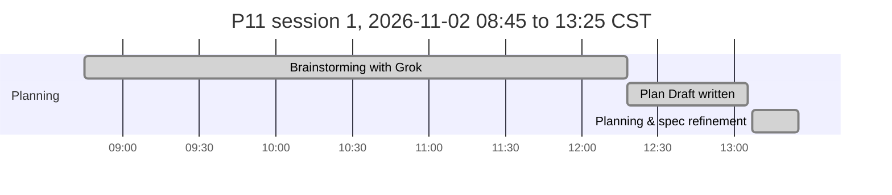
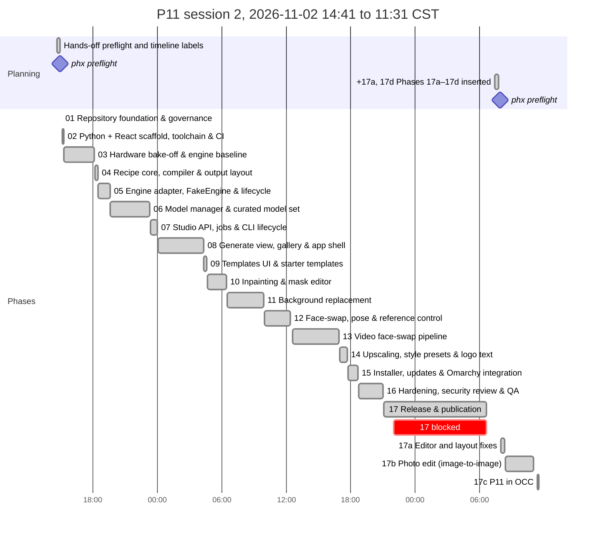

# P11: Project_1111 Implementation Plan

**Spec:** [`docs/P11_SPECIFICATION.md`](docs/P11_SPECIFICATION.md). **Decisions:** [`docs/P11_DECISIONS.md`](docs/P11_DECISIONS.md). **Agent rules:** [`CLAUDE.md`](CLAUDE.md). **Shared phase instructions:** [`prompts/P11_shared-instructions.md`](prompts/P11_shared-instructions.md)
**Last updated:** 2026-11-04 11:30 CST (Phase 17c complete)

> ⚠️ **Mandatory:** every agent that works on this project keeps this file accurate. **Before doing any other work, set your phase to `🔄 In progress` and commit that change to `main`** (claim protocol: `prompts/P11_shared-instructions.md` §1a). Other agents read this table from `main`. At the end, set it to `✅ Complete` or `⛔ Blocked` and add a Phase Log entry. See `CLAUDE.md`.

## How to run a phase
Open Claude Code in `/home/nick/Work/project1111` and type one of:
- `/phase`: run the next eligible phase. It checks dependencies, tells you if you're on the wrong model, resumes an `In progress` phase, and asks about any open questions it needs.
- `/phase NN`: run a specific phase.
- `/phase status`: show progress and what's next, without doing any work.
- `/phase-add [after NN] <request or file>`: plan a new lettered phase (`07a`) from a change request. No product work, no claim.

**Optional hands-off runs (PhaseHypervisor):** `phx preflight /home/nick/Work/project1111` asks the foreseeable questions once, then `phx run /home/nick/Work/project1111` runs the remaining phases unattended through `/phase NN --auto`, honouring the Gate column. Manual `/phase` stays the standard way; you can switch between the two at any phase boundary, and `/phase` stops if a `phx` supervisor is running this plan.

The agent merges a completed phase into `main` and pushes it without asking (Nick's standing git authority); review its close-out summary.

Each phase is claimed by a `chore(plan): start phase NN` commit on `main` and runs in its own worktree, `../project1111-phase-NN`, so parallel sessions never share a checkout. `/phase status` flags any branch or worktree whose row is not `🔄 In progress`.

**Parallelism:**
- After **02**, phases **03** (bake-off, on the GPU) and **04** (recipe core, pure Python) can run in parallel. 03 owns `engine/`, `scripts/bench/`, `docs/P11_BENCHMARKS.md`; 04 owns `src/p11/recipe/`, `src/p11/templates/`, `src/p11/outputs/`.
- After **03** and **04**, **05** (engine adapter) and **06** (model manager) can run in parallel. 05 owns `src/p11/engine/`, `src/p11/gpu/`; 06 owns `src/p11/models/`, `models/manifest.toml`.
- After **07**, **08** (generate UI) and **15** (installer) can run in parallel.
- After **08**, **09** (templates UI), **10** (inpainting) and **12** (face/pose) can run in parallel; then **11** after 10, **13** after 12, **14** after 09. All of them add views under `frontend/src/features/` and routes under `src/p11/api/routes/`; they share `frontend/src/App.tsx` and the router, so merge one first and `git merge main` in the others.
- GPU work in parallel phases is serialized by the advisory GPU lock (spec R24, ADR-0014); expect GPU tests to wait.
- After **17** (v1.0.0 feedback round), **17a** (editor and layout fixes), **17b** (photo edit) and **17c** (P11 in OCC) can run in parallel; merge 17a first (17a and 17b both touch `frontend/src/app/theme.css` and the Generate/Inpaint/Background views), then `git merge main` in the others. **17d** (release v1.0.1) waits for all three. 17c's Open button depends on OCC phase 10a (`~/Work/OCC_OmarchyControlCenter`), which is not a P11 dependency.

**Gate column** (read only by PhaseHypervisor; manual `/phase` ignores it): `auto` = may run unattended; `review` = pause for Nick after it; `owner` = Nick starts it. Empty means `auto`.

**Status values:** ⬜ Not started · 🔄 In progress · ⛔ Blocked · ✅ Complete. Always write the icon **and** the word.

## Phases

| Phase | Phase Name | Phase Purpose | AI Model to Use | Depends on | Status | Prompt to Initiate This Phase | Gate |
|---|---|---|---|---|---|---|---|
| 00 | Planning & spec refinement | Review source docs, resolve decisions, write the spec, plan and prompts | Opus 5.5 (`claude-opus-5-5`) | none | ✅ Complete | n/a (planning session) | owner |
| 01 | Repository foundation & governance | MIT licence, README, SECURITY, CONTRIBUTING, CoC, CHANGELOG, notices, ignore files (weights, outputs, source notes), .github/, gitleaks pre-commit, docs skeleton, private GitHub repo | Sonnet 5.5 (`claude-sonnet-5-5`) | 00 | ✅ Complete | [`prompts/P11_phase-01-repo-foundation.md`](prompts/P11_phase-01-repo-foundation.md) | auto |
| 02 | Python + React scaffold, toolchain & CI | uv + CPython 3.12, `p11` package and Typer CLI skeleton, FastAPI `/healthz`, Vite React-TS skeleton built into the package, config & XDG paths, GPU lock helper, Makefile, lint/type/test/audit gates, CI | Sonnet 5.5 (`claude-sonnet-5-5`) | 01 | ✅ Complete | [`prompts/P11_phase-02-scaffold.md`](prompts/P11_phase-02-scaffold.md) | auto |
| 03 | Hardware bake-off & engine baseline | Pinned headless ComfyUI in its own uv env, sm_75 torch verification, benchmark harness, measure candidate models/presets/VRAM modes/thermals on the laptop, owner-rated contact sheet; confirm ADR-0002/0008/0009/0010, pick the default model set | Opus 5.5 (`claude-opus-5-5`) | 02 | ✅ Complete | [`prompts/P11_phase-03-bakeoff.md`](prompts/P11_phase-03-bakeoff.md) | auto |
| 04 | Recipe core, compiler & output layout | Recipe schema + versions/migrations, input slots, seed strategies, presets, pure recipe→ComfyUI graph compiler (generate, upscale chains), output paths, sidecar/PNG metadata, SQLite gallery index | Opus 5.5 (`claude-opus-5-5`) | 02 | ✅ Complete | [`prompts/P11_phase-04-recipe-core.md`](prompts/P11_phase-04-recipe-core.md) | auto |
| 05 | Engine adapter, FakeEngine & lifecycle | `Engine` protocol, ComfyUI client (queue, websocket progress, upload, fetch, interrupt, free memory), engine process supervisor, OOM handling, GPU telemetry, FakeEngine with parity tests | Opus 5.5 (`claude-opus-5-5`) | 03, 04 | ✅ Complete | [`prompts/P11_phase-05-engine-adapter.md`](prompts/P11_phase-05-engine-adapter.md) | auto |
| 06 | Model manager & curated model set | Verified manifest (URL, SHA-256, size, licence) from 03's picks, resumable verified downloader, licence acknowledgements, safetensors policy, user-added models, `p11 models` CLI | Opus 5.5 (`claude-opus-5-5`) | 03, 04 | ✅ Complete | [`prompts/P11_phase-06-model-manager.md`](prompts/P11_phase-06-model-manager.md) | auto |
| 07 | Studio API, jobs & CLI lifecycle | FastAPI JSON API, Host/Origin/token/CSP middleware, job queue with GPU lock and progress stream, upload validation, gallery API, `p11 serve/start/stop/status/open/doctor`, logging with redaction | Opus 5.5 (`claude-opus-5-5`) | 05, 06 | ✅ Complete | [`prompts/P11_phase-07-studio-api.md`](prompts/P11_phase-07-studio-api.md) | auto |
| 08 | Generate view, gallery & app shell | App shell, Simple/Advanced generate form, aspect/wallpaper presets, live progress, VRAM/thermal status bar, result actions, variations, gallery with compare/export, model switcher, keyboard shortcuts | Opus 5.5 (`claude-opus-5-5`) | 07 | ✅ Complete | [`prompts/P11_phase-08-generate-ui.md`](prompts/P11_phase-08-generate-ui.md) | auto |
| 09 | Templates UI & starter templates | Save as Template (≤ 3 actions), one-click apply, slot prompts, folders/tags/search, import/export, starter templates (photoreal wallpaper, logos, avatar) | Sonnet 5.5 (`claude-sonnet-5-5`) | 08 | ✅ Complete | [`prompts/P11_phase-09-templates-ui.md`](prompts/P11_phase-09-templates-ui.md) | auto |
| 10 | Inpainting & mask editor | Canvas mask editor (brush, eraser, opacity, undo), photo upload as base, denoise presets, inpaint compile + run, recipe step | Opus 5.5 (`claude-opus-5-5`) | 08 | ✅ Complete | [`prompts/P11_phase-10-inpainting.md`](prompts/P11_phase-10-inpainting.md) | auto |
| 11 | Background replacement | Subject segmentation, mask refinement with the editor, photo background upload, blend (colour match, edge feather, relight pass), one-click Replace Background, recipe step | Opus 5.5 (`claude-opus-5-5`) | 10 | ✅ Complete | [`prompts/P11_phase-11-background.md`](prompts/P11_phase-11-background.md) | auto |
| 12 | Face-swap, pose & reference control | Face-swap engine decision (ADR-0011) with NSFW target guard, face restore, OpenPose upload/editor + Apply Pose, IP-Adapter style/character reference, recipe steps | Opus 5.5 (`claude-opus-5-5`) | 08 | ✅ Complete | [`prompts/P11_phase-12-face-pose.md`](prompts/P11_phase-12-face-pose.md) | auto |
| 13 | Video face-swap pipeline | Probe/extract/swap/restore/stitch with audio, resumable batch job, thermal guard, cancel, scratch cleanup, Video view with progress and limits | Opus 5.5 (`claude-opus-5-5`) | 12 | ✅ Complete | [`prompts/P11_phase-13-video-faceswap.md`](prompts/P11_phase-13-video-faceswap.md) | auto |
| 14 | Upscaling, style presets & logo text | Quality/speed upscale toggle, 3D-animated-avatar preset, text overlay step with bundled fonts, logo variations/batch, prompt defaults tuning, model manager UI | Sonnet 5.5 (`claude-sonnet-5-5`) | 09 | ✅ Complete | [`prompts/P11_phase-14-quality-presets.md`](prompts/P11_phase-14-quality-presets.md) | auto |
| 15 | Installer, updates & Omarchy integration | `install.sh` (detect, confirm pacman, uv, engine, models, doctor), `uninstall.sh`, `p11 update`, desktop entry + app window, clean-install test in a container, user guide, OSMods write-up | Sonnet 5.5 (`claude-sonnet-5-5`) | 07 | ✅ Complete | [`prompts/P11_phase-15-installer.md`](prompts/P11_phase-15-installer.md) | auto |
| 16 | Hardening, security review & QA | Threat model, scanners, guard-bypass tests, measured success criteria (time-to-first-image, action counts, per-preset times, OOM soak, thermal loop), accessibility, licence audit, close follow-ups | Opus 5.5 (`claude-opus-5-5`) | 09, 11, 13, 14, 15 | ✅ Complete | [`prompts/P11_phase-16-hardening.md`](prompts/P11_phase-16-hardening.md) | auto |
| 17 | Release & publication | v1.0.0 changelog and tag, final report with timeline, private GitHub release **only with Nick's in-session confirmation** (repo stays private, H13) | Sonnet 5.5 (`claude-sonnet-5-5`) | 16 | ✅ Complete | [`prompts/P11_phase-17-release.md`](prompts/P11_phase-17-release.md) | review |
| 17a | Editor and layout fixes | Inpaint brush leaves its stroke while drawing, Background mask overlay aligned with the image, Face & Pose view sized and scrollable; real-browser regression checks | Opus 5.5 (`claude-opus-5-5`) | 17 | ✅ Complete | [`prompts/P11_phase-17a-ui-fixes.md`](prompts/P11_phase-17a-ui-fixes.md) | auto |
| 17b | Photo edit (image-to-image) | Start from a photo on the Generate tab: upload, prompt, strength presets, SDXL img2img compile, template slot, S5 guard on edits of uploaded photos showing a face (ADR-0038) | Opus 5.5 (`claude-opus-5-5`) | 17 | ✅ Complete | [`prompts/P11_phase-17b-photo-edit.md`](prompts/P11_phase-17b-photo-edit.md) | auto |
| 17c | P11 in OCC | P11 Studio card in the Omarchy Control Center (transient `p11 serve`, health, busy flag on `/healthz`, logs, External match), Open via OCC `open_exec` once OCC 10a lands (ADR-0039), OSMods | Sonnet 5.5 (`claude-sonnet-5-5`) | 17 | ✅ Complete | [`prompts/P11_phase-17c-occ-service.md`](prompts/P11_phase-17c-occ-service.md) | auto |
| 17d | Release v1.0.1 | Pre-flight, version 1.0.1, changelog, tag and GitHub release without an in-session go (ADR-0040), visibility unchanged, post-release check, hand-off for Nick's test | Sonnet 5.5 (`claude-sonnet-5-5`) | 17a, 17b, 17c | 🔄 In progress | [`prompts/P11_phase-17d-release-1-0-1.md`](prompts/P11_phase-17d-release-1-0-1.md) | auto |

## Timeline
Generated by `scripts/phase_timeline.py` from the Phase Log and git; refreshed on `main` at every close-out, block, resume and `/phase-add`. Do not edit between the markers.

<!-- phase-timeline:start (generated by scripts/phase_timeline.py; do not edit) -->


*Generated from the Phase Log Timeline bullets and git, as of 2026-11-04 11:31 CST. ≈ marks a time inferred from git or a heading. Idle gaps over 60 min start a new chart below and are collapsed in the image. Regenerate with `python3 scripts/phase_timeline.py --write`; do not edit by hand.*





| Phase | Name | Started | Finished | Merged | Active | Blocked | Claim |
|---|---|---|---|---|---:|---:|---|
| plan | Brainstorming with Grok | 2026-11-02 08:45 CST | 12:18 |  | 3 h 33 m |  | n/a |
| plan | Plan Draft written | 2026-11-02 12:18 CST | 13:05 |  | 47 m |  | n/a |
| 00 | Planning & spec refinement | 2026-11-02 13:07 CST | 13:25 |  | 18 m |  | n/a |
| plan | Hands-off preflight and timeline labels | 2026-11-02 14:41 CST | 14:59 |  | 18 m |  | n/a |
| plan | phx preflight | 2026-11-02 15:00 CST |  |  |  |  | n/a |
| +17a, 17d | Phases 17a–17d inserted | 2026-11-04 07:25 CST | 07:47 |  | 22 m |  | n/a |
| plan | phx preflight | 2026-11-04 07:54 CST |  |  |  |  | n/a |
| 01 | Repository foundation & governance | 2026-11-02 15:05 CST | 15:08 | 15:08 | 3 m |  | `9f87dd5` |
| 02 | Python + React scaffold, toolchain & CI | 2026-11-02 15:09 CST | 15:18 | 15:18 | 9 m |  | `d55b209` |
| 03 | Hardware bake-off & engine baseline | 2026-11-02 15:19 CST | 18:10 | 18:10 | 2 h 51 m |  | `54750e3` |
| 04 | Recipe core, compiler & output layout | 2026-11-02 18:12 CST | 18:30 | 18:30 | 18 m |  | `53422fc` |
| 05 | Engine adapter, FakeEngine & lifecycle | 2026-11-02 18:32 CST | 19:37 | 19:37 | 1 h 5 m |  | `e36ab9a` |
| 06 | Model manager & curated model set | 2026-11-02 19:39 CST | 23:18 | 23:18 | 3 h 39 m |  | `bdbeccf` |
| 07 | Studio API, jobs & CLI lifecycle | 2026-11-02 23:21 CST | 2026-11-03 00:00 CST | 00:00 | 39 m |  | `6009af1` |
| 08 | Generate view, gallery & app shell | 2026-11-03 00:03 CST | 04:18 | 04:18 | 4 h 15 m |  | `a702d75` |
| 09 | Templates UI & starter templates | 2026-11-03 04:21 CST | 04:38 | 04:38 | 17 m |  | `0515720` |
| 10 | Inpainting & mask editor | 2026-11-03 04:41 CST | 06:25 | 06:25 | 1 h 44 m |  | `5e1064b` |
| 11 | Background replacement | 2026-11-03 06:31 CST | 09:55 | 09:55 | 3 h 24 m |  | `89dbdf8` |
| 12 | Face-swap, pose & reference control | 2026-11-03 09:58 CST | 12:25 | 12:25 | 2 h 27 m |  | `3e1ff86` |
| 13 | Video face-swap pipeline | 2026-11-03 12:34 CST | 16:54 | 16:54 | 4 h 20 m |  | `5f38c9b` |
| 14 | Upscaling, style presets & logo text | 2026-11-03 16:58 CST | 17:41 | 17:41 | 43 m |  | `0a15840` |
| 15 | Installer, updates & Omarchy integration | 2026-11-03 17:45 CST | 18:42 | 18:40 | 57 m |  | `7bb52d8` |
| 16 | Hardening, security review & QA | 2026-11-03 18:46 CST | 21:00 | 21:00 | 2 h 14 m |  | `3d4afd8` |
| 17 | Release & publication | 2026-11-03 21:04 CST | 2026-11-04 06:39 CST | 06:39 | 58 m | 8 h 37 m | `5c2ba2a` |
| 17a | Editor and layout fixes | 2026-11-04 07:59 CST | 08:18 | 08:18 | 19 m |  | `c8b01db` |
| 17b | Photo edit (image-to-image) | 2026-11-04 08:22 CST | 11:02 | 11:02 | 2 h 40 m |  | `1f66dbc` |
| 17c | P11 in OCC | 2026-11-04 11:21 CST | 11:30 | 11:31 | 9 m |  | `432f7f9` |

**Totals:** elapsed 2 d 2 h (first recorded start to 2026-11-04 11:31 CST) · active phase time 1 d 9 h (sum over phases) · blocked or paused 8 h 37 m · idle 1 h 16 m in 1 gap(s) over 60 min.

**Not started:** 17d.
<!-- phase-timeline:end -->

### Model rationale
- **Opus 5.5** (`/model claude-opus-5-5`) where a mistake is subtle, costly or hard to see:
  - the bake-off, where wrong measurements or a torch build that silently falls back to CPU would mislead every later phase (03);
  - the recipe compiler, whose graph output, migrations and metadata round-trips everything relies on (04);
  - the engine adapter, an async state machine over a websocket with OOM recovery and process supervision (05);
  - the model manager, which handles hashes, resumable downloads, licence flags and unsafe file formats (06);
  - the API security middleware, job queue and lifecycle (07);
  - the complex interactive UIs: the generate view and gallery (08), the canvas mask editor (10), segmentation and blending (11);
  - the face-swap guard and pose/reference control, where quality and the S5 boundary both matter (12);
  - the resumable, thermally guarded video job (13);
  - the security review and measured QA (16).
  - the v1.0.0 feedback round's canvas compositing and layout fixes, which jsdom tests cannot see (17a), and image-to-image with the S5 rule for uploaded photos (17b).
- **Sonnet 5.5** (`/model claude-sonnet-5-5`) for well-specified work: governance files (01), scaffolding and CI (02), CRUD-style template UI and template content (09), presets, text overlay and the model manager UI on an existing base (14), the installer and docs, which follow fixed rules in R15/S7 (15), and release packaging (17); the OCC service block and a small health field (17c) and the v1.0.1 release (17d).
- New sessions start on Sonnet while `ANTHROPIC_MODEL` is set to it: switch with the `/model` command in each prompt header before running an Opus phase.

### Dependency graph
```
00 ─► 01 ─► 02 ─┬─► 03 (bake-off, GPU) ─┬─► 05 (engine adapter) ─┐
                └─► 04 (recipe core) ───┴─► 06 (model manager) ──┴─► 07 (Studio API)
                                                                       │
                     ┌─────────────────────────────────────────────────┤
                     ▼                                                 ▼
                    08 (generate UI) ─┬─► 09 (templates) ─► 14 (presets) ─┐   15 (installer)
                                      ├─► 10 (inpaint) ──► 11 (background)┤        │
                                      └─► 12 (face/pose) ► 13 (video) ────┤        │
                                                                          ▼        ▼
                                                                    16 (hardening/QA) ─► 17 (release)
                                                                                           │
                              ┌───────────────────────────────┬────────────────────────────┤
                              ▼                               ▼                            ▼
                     17a (editor/layout fixes)       17b (photo edit)      17c (P11 in OCC) ◄┄ OCC 10a (open_exec, Open button only)
                              └───────────────────────────────┴──────────────┬─────────────┘
                                                                             ▼
                                                                    17d (release v1.0.1)
```

### Definition of done (checked in the final phase)
- [x] `./install.sh` on a clean Omarchy/Arch environment completes, runs `p11 doctor` green and opens the UI (spec R15; tested in a container and on the laptop).
- [x] Time-to-first-image ≤ 5 min after the default-set download (R4), measured on the laptop.
- [x] Every wallpaper preset (1920×1080, 2560×1440) generates without OOM 50 times in a row with the default model; per-preset times recorded in `docs/P11_BENCHMARKS.md`.
- [x] Daily workflow ≤ 5 actions, Save as Template ≤ 3, re-run template 1 (Appendix B), measured by Playwright walkthroughs.
- [x] Inpaint, background replace with photo, face-swap, pose and reference flows work end-to-end from Simple mode without docs.
- [x] Video face-swap of a 30 s 1080p clip produces a usable file with original audio; resume after a killed process works.
- [x] Generation has no content filter (A5); the face-swap NSFW guard (S5) blocks sexual targets in UI, API, templates and video, with tests.
- [x] Security baseline S1–S10 verified in Phase 16 (localhost only, no telemetry egress observed, pinned engine/nodes, safetensors policy, secrets scan clean).
- [x] THIRD_PARTY_NOTICES lists every engine component, node and model with licence flags; licence audit recorded.
- [x] All docs current (README, user guide, ARCHITECTURE, SECURITY, CHANGELOG, OSMods entry); the timeline block generated.
- [x] v1.0.0 GitHub release published on the private repo after Nick's "Go" (owner question 17, 2026-11-04 06:38 CST); repo visibility unchanged (still PRIVATE, see Phase 17 log 2026-11-04 06:39 CST).

Checked by Phase 16 (2026-11-03): evidence in `docs/P11_BENCHMARKS.md` → Success criteria, `docs/P11_THREAT-MODEL.md` and `docs/P11_PUBLICATION-READINESS.md`. The last item is Phase 17's.

### Deferred follow-ups (Phase 16, H12)
Non-security items that were not closed in Phase 16, each with its reason; listed for Nick's review at the Phase 17 pause. No security item is deferred.

| From | Item | Why deferred |
|---|---|---|
| 03 | Try `--fp16-vae` with the fp16-fix VAE for faster decodes | tuning; current decodes fit the budget (no OOM in 100 + 105 runs) |
| 03, 14 | A quantized larger model; the by-eye `latent` vs `both` comparison | quality judgement needs the owner's eye; `latent` kept on time and memory (ADR-0010) |
| 06 | Parallel downloads in `p11 models install` | the serial path works; a speed nicety |
| 08 | Trash restore button; gallery "reindex"; keyset paging for very large galleries | new features (out of Phase 16's scope); paging is fine at hundreds of images |
| 09 | Pick an earlier gallery image for a slot; Edit writes back to its template; Undo-delete keeps the slug; a Templates screenshot in the guide | new features / doc images |
| 10 | Colour matching in inpaint `stitch` for face seams; outpainting | quality features |
| 11 | Matte-aware feather for thin structures; foreground-colour estimation for hair wisps; engine `RemoveBackground` if the 8–12 s CPU mask feels slow | quality features |
| 12 | "Preload the control model" setting (first pose run 61 s vs 13 s warm); click-the-face overlay in the Face view | features |
| 13 | CUDA onnxruntime for faster Good-quality video (~7 s/frame on the CPU; needs a dependency and licence check); videos in the gallery; motion-compensated smoothing; the full 4 h Good row | features; the Good row is projected from measured frames |
| 14 | 3D-avatar prompt/negative/LoRA tuning and consistency across seeds; the 10-prompt defaults review; exact-text check with a real-engine logo generation | need the owner's eye on images (the text path is unit- and FakeEngine-tested) |
| 15 | Omarchy shell status indicator (H11 c allows skipping); the one-liner URL and `p11 update` against a real tag (Phase 17 makes the tag); first-ever torch download time; AUR package | Phase 17 / features |
| 17b | **Instruction-edit model** ("make him wear…", literal edit instructions; ADR-0038 follow-up). Candidates checked at Hugging Face 2026-11-04 08:44 CST: **FLUX.1 Kontext [dev]** (`black-forest-labs/FLUX.1-Kontext-dev`, 12B, FLUX.1 [dev] Non-Commercial licence, gated; bf16 needs ~24 GB, so 8 GB means a GGUF quant: `QuantStack/FLUX.1-Kontext-dev-GGUF` Q4_K_M 6.93 GB / Q3_K_M 5.37 GB plus T5/CLIP/VAE, needs the ComfyUI-GGUF custom node, S3 ADR); **Qwen-Image-Edit** (`Qwen/Qwen-Image-Edit`, 20B, Apache-2.0; too large for 8 GB without heavy quantization and offload); **CosXL Edit** (`stabilityai/cosxl`, SDXL-based, Stability Non-Commercial Research Community licence, gated; fits 8 GB; the pinned ComfyUI has the core `InstructPixToPixConditioning` node it needs) | needs a model choice, a licence acknowledgement, a download beyond the budget and possibly a custom node (owner decision); plain img2img covers the requested examples |
| 16 | Vitest specs with Testing Library's 1 s `findBy` timeout fail under heavy CPU load (seen while the GPU soak ran; 94/94 when idle) | test robustness; raise the timeout if CI shows it |
| 17c | **Open on the OCC P11 card** needs OCC phase 10a (`open_exec`), which was `⬜ Not started` when 17c ran (2026-11-04 11:21 CST). The P11 block carries the commented line `open_exec = ["~/.local/bin/p11", "open"]`; when OCC 10a is ✅ on OCC `main`, uncomment it and relaunch OCC. Until then use `Super + Alt + I` or `p11 open`. Recorded in ADR-0039 and OSMods `P11 in OCC` | OCC 10a is Nick's run; 17c must not block on it (owner question 20) |

## Owner questions
All answered in the hands-off preflight on 2026-11-02 14:57 CST (spec §11.5, §11.6 H1–H15; ADR-0015, ADR-0016). Phase prompts follow §11.6 instead of asking.

| # | Question | Status | Needed by |
|---|---|---|---|
| 1 | Download budget for the bake-off and the default install set | Decided 2026-11-02 14:57 CST: ≤ 100 GB bake-off candidates, default set ≤ 30 GB; Phase 15 reuses downloads (H1) (phx preflight). Used 2026-11-02 18:10 CST (Phase 03): 31.2 GB downloaded, default set 14.4 GB (ADR-0018), 16.9 GB kept | Phase 03 |
| 2 | GitHub repo owner/name | Decided 2026-11-02 14:57 CST: `antonizick/project1111`, private (name free at 2026-11-02 14:57 CST); MIT holder Nick Antonizick (H15) (phx preflight) | Phase 01 |
| 3 | Accounts for model hosts | Decided 2026-11-02 14:57 CST: login-free Hugging Face only; no tokens in the build; Civitai/gated = optional extras later (H2) (phx preflight). Applied 2026-11-02 23:09 CST (Phase 06): every manifest entry is login-free (validated for the `default` set); optional tokens go in `~/.config/p11/secrets.toml` (`0600`), sent only to their own host (ADR-0021) | Phase 06 |
| 4 | Face-swap test material | Decided 2026-11-02 14:57 CST: synthetic faces/clip; Nick's own from `~/Pictures/P11-test/` too if present; never blocks (H7) (phx preflight) | Phase 12 |
| 5 | Thermal pause threshold | Decided 2026-11-02 14:57 CST: 87 °C / 80 °C, Phase 13 may tune ±5 °C with an ADR (H9) (phx preflight). Measured 2026-11-02 18:10 CST (Phase 03): 10-min loop plateaus at 78–79 °C, power-capped (~68 W), no thermal throttling. Kept 2026-11-03 16:55 CST (Phase 13): the video job is CPU work, GPU peak 58 °C over a 30 s 1080p run, so 87/80 °C stands untuned (no ADR needed) | Phase 13 |
| 6 | Prefix, architecture, publication/licence, source notes | Decided 2026-11-02 13:14 CST: P11; Studio over headless ComfyUI; private now, MIT; notes git-ignored (ADR-0001…0004) | Phase 00 |
| 7 | Restrictive model licences (non-commercial, OpenRAIL-M) | Decided 2026-11-02 14:57 CST: allowed for personal use, flagged everywhere, prefer permissive when comparable (H3) (phx preflight) | Phase 03 |
| 8 | Missing dev tools (shellcheck, gitleaks, bats, semgrep) | Decided 2026-11-02 14:57 CST: user-level pinned installs, no sudo/pacman (H4) (phx preflight) | Phase 01 |
| 9 | Who picks the default models (contact-sheet rating) | Decided 2026-11-02 14:57 CST: Phase 03 picks from measurements; Nick reviews at the Phase 17 pause (H5) (phx preflight) | Phase 03 |
| 10 | Engine switch if ComfyUI fails on the laptop | Decided 2026-11-02 14:57 CST: agent may switch when ComfyUI clearly fails a hard requirement and the fallback passes; ADR + prompt rewrites (H6) (phx preflight) | Phase 03 |
| 11 | Power profile during benchmarks (machine was in power-saver) | Decided 2026-11-02 14:57 CST: switch to performance for GPU runs only, restore after; block on battery (H8) (phx preflight) | Phase 03 |
| 12 | Review pauses (Gates) | Decided 2026-11-02 14:57 CST: `auto` for all phases except 17; 03/08/15/16 results reviewed at the 17 pause (H10) (phx preflight) | Phase 03 |
| 13 | Host changes in Phase 15 | Decided 2026-11-02 14:57 CST: desktop entry, Hyprland keybinding, shell indicator (supported user extension only, else follow-up), real install under Nick's HOME; all in OSMods (H11) (phx preflight) | Phase 15 |
| 14 | Phase 16 missed targets / open follow-ups | Decided 2026-11-02 14:57 CST: fix or record + defer non-security items; high/critical security must be fixed or block (H12) (phx preflight) | Phase 16 |
| 15 | v1.0.0 publication | Decided 2026-11-02 14:57 CST: private GitHub release after an in-session "go?"; repo stays private (H13, ADR-0016) (phx preflight) | Phase 17 |
| 16 | Starter template content | Decided 2026-11-02 14:57 CST: generic placeholders, no personal brand names (H14) (phx preflight) | Phase 09 |
| 17 | Release go? for v1.0.0 | Answered 2026-11-04 06:38 CST: Go. Publish to GitHub public Repo | Phase 17 |
| 18 | Release v1.0.1 without asking? | Decided 2026-11-04 07:43 CST: yes, tag and publish the GitHub release with no in-session go; Nick tests right after; visibility unchanged (ADR-0040) | Phase 17d |
| 19 | 17b: edit of an uploaded photo when the `face` model set is missing | Decided 2026-11-04 07:54 CST: refuse before queueing with the `p11 models install face` hint, as ADR-0038 says; the installer and `default` set are not changed (ADR-0041) (phx preflight) | Phase 17b |
| 20 | 17c: OCC phase 10a (`open_exec`) is not started; the card's Open | Decided 2026-11-04 07:54 CST: Nick runs OCC 10a (OCC Gate already `auto`); 17c adds a live `open_exec = ["~/.local/bin/p11", "open"]` if OCC 10a is ✅ on OCC `main` when 17c runs, otherwise the commented line plus a follow-up; 17c does not block on it (ADR-0041) (phx preflight) | Phase 17c |
| 21 | Make `antonizick/project1111` public after v1.0.1? | Answered 2026-11-04 07:57 CST: Yes, make the repository public | after 17d (Nick, by hand) |
| 22 | Gates for 17a–17d | Decided 2026-11-04 07:54 CST: `auto` for all four; 17d no longer pauses after the release (Nick tests on his own); the plan's Gate column overrides the `Gate: review` line in the 17d prompt header (ADR-0041) (phx preflight) | Phase 17d |

## Phase Log
Newest entries at the bottom. Format: `### YYYY-MM-DD HH:MM TZ: Phase NN: <title> (<status>)` (timestamp from `date '+%Y-%m-%d %H:%M %Z'`, never a bare date). **The first bullet is always the Timeline:** `- **Timeline:** started <TS> (claim commit <hash>) · finished <TS> · merged <TS | not merged yet>` (add ` · blocked <TS> to <TS>` per `⛔` interval; *started* is the claim commit's time). Then bullets: built, deviations, follow-ups, tests.

### 2026-11-02 12:18 CST: Planning: Brainstorming with Grok (pre-planning)
- **Timeline:** started 2026-11-02 08:45 CST · finished 2026-11-02 12:18 CST
- Source: vault note `02 Projects/Work/project1111/Brainstorming Project 1111.md` (git-ignored, ADR-0004). Times are the note's own message stamps: Planning Step 1 at 08:45, the last exchange ("draft the full planning document") at 12:18; the file was last saved at 12:19.
- Outcome: requirements interview (capabilities, hardware, ease of use, content stance) that fed the Plan Draft.

### 2026-11-02 13:05 CST: Planning: Plan Draft written (pre-planning)
- **Timeline:** started 2026-11-02 12:18 CST · finished 2026-11-02 13:05 CST
- Source: vault note `02 Projects/Work/project1111/Plan Draft.md` (git-ignored, ADR-0004). Started = Grok's draft response at 12:18 in the brainstorm note; finished = the file saved to the vault (created 13:04, last modified 13:05).
- Outcome: Project_1111 Planning Document v1.0, the source of `docs/P11_SPECIFICATION.md` §1–10.

### 2026-11-02 13:25 CST: Phase 00: Planning & spec refinement (✅ Complete)
- **Timeline:** started 2026-11-02 13:07 CST · finished 2026-11-02 13:25 CST
- Read `Plan Draft.md` and `Brainstorming Project 1111.md` (vault, same folder as the repo) and inspected the laptop: RTX 2070 Mobile (TU106BM, 8 GB, ~1 GB used by the desktop), driver 615.78.08 nvidia-open, CUDA 13.4, Python 3.14.8, uv 0.13.0, node 26.8.1, Docker 29.9.2 with nvidia-container-toolkit, ffmpeg 9.0.2, 31 GB RAM, 592 GB free.
- Owner decisions: prefix P11; P11 Studio form UI over headless ComfyUI; private repo now, public at release with confirmation, MIT; source notes git-ignored (ADR-0001…0004).
- Planning constraint recorded: unfiltered generation, NSFW guard kept on face-swap and video face-swap (S5, ADR-0005).
- Refinements: separate uv Python (R1), Turing fp16/VAE/torch checks (R2), native-bucket + upscale wallpaper presets (R3), time-to-first-image measured after download (R4), ~7 GB VRAM budget (R5), recipes compiled to engine graphs (R6), pinned model manifest (R9, R10), installer without driver installs or unpinned curl|bash (R15, S7), trademark-free preset names (R17), deterministic logo text (R23), GPU lock (R24); security baseline S1–S10.
- Wrote the spec with amendments, 14 ADRs, this plan with 17 phases, shared instructions, 17 phase prompts, `CLAUDE.md`, `/phase`, `/phase-add`, the change-request template, the vault note and the timeline.
- Follow-ups: owner questions 1–5 have proposed defaults; each phase that needs one asks if it is still open.

### 2026-11-02 14:59 CST: Planning: Hands-off preflight and timeline labels
- **Timeline:** started 2026-11-02 14:41 CST · finished 2026-11-02 14:59 CST
- Pre-planning sessions added to the Phase Log (Brainstorming with Grok, Plan Draft written) so they appear in the generated timeline; the shared generator now labels Planning-lane bars with their titles (PhaseHypervisor `06b55dd`, copied byte for byte).
- Preflight for an unattended `phx run`: owner questions 1–5 decided and 7–16 added and decided; spec §11.5 updated and §11.6 H1–H15 added (amendments v1.2); ADR-0015 (pre-authorizations), ADR-0016 (v1.0.0 private release, amends ADR-0003); Gates 03, 08, 15, 16 → `auto`; prompts 01–03, 06, 08, 09, 12, 13, 15–17 and the shared instructions follow §11.6 instead of asking.
- Checked: `antonizick/project1111` is free, `gh` logged in, Docker with the NVIDIA runtime and the `docker` group, git `user.name` set; shellcheck, gitleaks, bats, semgrep missing (H4); power profile was `power-saver` on AC (H8).
- Expected stops in the run: Phase 17's release "go?", real failures, and anything outside §11.6.

### 2026-11-02 15:08 CST: Phase 01: Repository foundation & governance (✅ Complete)
- **Timeline:** started 2026-11-02 15:05 CST (claim commit 9f87dd5) · finished 2026-11-02 15:08 CST · merged 2026-11-02 15:08 CST
- **Model:** ran as claude-sonnet-5-5 (auto mode; plan lists Sonnet 5.5)
- Built: `LICENSE` (MIT, Nick Antonizick, 2026; text from choosealicense.com), `NOTICE`, `README.md`, `SECURITY.md`, `CONTRIBUTING.md`, `CODE_OF_CONDUCT.md` (Contributor Covenant 2.1 fetched from the official repo; contact = GitHub private advisory / @antonizick, no email), `CHANGELOG.md`, `THIRD_PARTY_NOTICES.md` skeleton, `.gitignore`, `.dockerignore`, `.editorconfig`, `.pre-commit-config.yaml`, `.github/` (CI with a gitleaks job, bug/feature templates, PR template, Dependabot for github-actions), `docs/P11_ARCHITECTURE.md`, `docs/P11_USER-GUIDE.md` outline, `docs/images/.gitkeep`.
- Tools (user level, no sudo): gitleaks 8.30.1 in `~/.local/bin` (SHA-256 verified), pre-commit via `uvx`; hook installed. Pinned: `pre-commit-hooks` v6.0.0, `actions/checkout` v7.0.1 at `3d3c42e5…` (all verified via `gh api` on 2026-11-02 15:08 CST). OSMods write-up: `P11 Dev Tools (gitleaks).md`.
- GitHub: private repo `https://github.com/antonizick/project1111` created (name was free), `main` pushed. Owner question 2 was already marked Decided.
- Deviations: gitleaks hook is a `language: system` local hook rather than the upstream hook repo with a rev pin (no Go needed; ADR-0017). The CI job installs the pinned gitleaks binary instead of using `gitleaks-action`.
- Tests: `pre-commit run --all-files` passes; `git check-ignore -v` reports both source notes, `x.safetensors` and `outputs/a.png` ignored; a 6 MB test file was refused by `check-added-large-files`; `git ls-files` has no weight/media/source-note files. CI result: green on first push (run 41525620854).
- Follow-ups: Phase 02 adds Python/frontend CI jobs, Dependabot pip/npm, and fills CONTRIBUTING setup commands.

### 2026-11-02 15:18 CST: Phase 02: Python + React scaffold, toolchain & CI (✅ Complete)
- **Timeline:** started 2026-11-02 15:09 CST (claim commit d55b209) · finished 2026-11-02 15:18 CST · merged 2026-11-02 15:18 CST
- **Model:** ran as claude-sonnet-5-5 (auto mode; plan lists Sonnet 5.5)
- Built: `p11` package (hatchling, `src/` layout, `uv.lock`, `.python-version` 3.12); `paths.py` (XDG + `P11_*_DIR` overrides, `ensure_private_dir` 0700), `config.py` (pydantic-settings, TOML + `P11_*` env, loopback-only host validator, ports 8111/8188, thermal placeholders 83/75 °C), `gpulock.py` (`gpu_lock(timeout, holder)` with holder JSON, `GpuLockTimeout` naming the holder), `cli.py` (`version`, `paths`, `serve`, stubs `start stop status open doctor models update`), `api/app.py` (`create_app()`, `/healthz`, static `web/`), empty documented packages; `frontend/` (Vite 8, React 19, TS strict, ESLint 10, Prettier, Vitest, Playwright smoke test) building into `src/p11/web/`; `Makefile`; CI `check` job (setup-node v7.1.0, setup-uv v10.3.3, SHA-pinned); Dependabot uv + npm; CONTRIBUTING, README, ARCHITECTURE package map, THIRD_PARTY_NOTICES, CHANGELOG; ADR-0008 P11 side Accepted. Versions and licences read from package metadata on 2026-11-02 15:18 CST.
- Deviations: none from the prompt. Details: dev-only `npm audit` reports 11 moderate findings (transitive minimatch in eslint tooling); `make audit` uses `--omit=dev` per the prompt and is clean. `make tools` skips the download when gitleaks 8.30.1 is already on `PATH`. The `scripts/` directory is excluded from ruff (PHX-owned script). CI triggers only on push to `main` and pull requests, so the branch was checked through a draft PR (#1).
- Tests: 16 pytest (paths, settings incl. non-loopback rejection and TOML cannot unlock host, GPU lock contention across two processes, `/healthz`, static serving, CLI) and 2 Vitest tests pass; Playwright smoke passes against `p11 serve`; `mypy --strict` clean. `make setup && make check` passes on a fresh clone; CI green on PR #1 (run 41526893070). `ss -ltnp` showed only `127.0.0.1:8111`; `uv run python` is 3.12.15; host Python untouched.
- Follow-ups: dev-tool npm audit findings to revisit in Phase 16 (eslint tooling update); `gpu` tests auto-skip when `nvidia-smi` is absent (Phase 03 may refine); Playwright Chromium lives in `~/.cache/ms-playwright` (OSMods note updated).

### 2026-11-02 18:10 CST: Phase 03: Hardware bake-off & engine baseline (✅ Complete)
- **Timeline:** started 2026-11-02 15:19 CST (claim commit 54750e3) · finished 2026-11-02 18:10 CST · merged 2026-11-02 18:10 CST
- **Model:** ran as claude-opus-5-5 (auto mode; plan lists Opus 5.5)
- Built: `scripts/engine_setup.sh` (idempotent; ComfyUI v0.43.0 `426f5ee` in `~/.local/share/p11/engine/`, own uv CPython 3.12.15 venv, `uv pip sync --require-hashes` from `engine/requirements.lock.txt`, model folders + `extra_model_paths.yaml`, sm_75 torch check), `engine/engine.lock.toml` (torch 2.14.1+cu130, launch flags `--listen 127.0.0.1 --offline --disable-all-custom-nodes --disable-auto-launch --disable-product-tips --preview-method none`), bench harness `scripts/bench/` (GPU lock, power profile switch with restore, nvidia-smi sampling, per-run JSON), `docs/P11_BENCHMARKS.md`, ADR-0018, ADR-0002/0008/0009/0010 confirmed, THIRD_PARTY_NOTICES (engine + picked models), ARCHITECTURE engine section; prompts 04, 05, 06, 13, 14 updated with the results.
- Results: ~256 runs, 0 OOM. Default set (14.4 GB): RealVisXL V5.0 Lightning (photoreal + avatar; 13.7 s native, 18.3 / 18.7 s at 1920×1080 / 2560×1440), Juggernaut XL v9 (Quality model, ~41 s per wallpaper), fp16-fix SDXL VAE, 4×NomosWebPhoto RealPLKSR. Wallpaper chain `model` by default (ADR-0010). 50/50 stability runs at 2560×1440 (median 17.7 s). Thermals: 78–79 °C plateau, power-limited. Dynamic VRAM default, `--disable-dynamic-vram --lowvram` as OOM retry. Desktop VRAM 1.07–1.14 GB.
- Acceptance: `engine_setup.sh` run twice → no changes, pinned versions, torch check OK on sm_75 (cuDNN 9.24); `ss -ltnp` → engine only on `127.0.0.1:8188`; a 1 s socket watcher saw no non-loopback engine connection from 15:39 to 18:08 CST; benchmarks cover 6 configurations × both presets; default-set ADR recorded.
- **For the owner's review (H5, H10):** contact sheet `~/.cache/p11/bench/contact-sheet.html` (16 prompts × 6 configurations) and avatar sheet `~/.cache/p11/bench/avatar-sheet.html`; raw JSON `~/.cache/p11/bench/runs/`.
- Deviations: no Forge-family engine was measured (Appendix A lists it "for comparison"; ComfyUI passed every hard requirement, so H6 gave no switch case) and no quantized larger model; avatars use an 896×1152 portrait bucket because 16:9 duplicated the character; the Quality chain is provisionally `latent` and Phase 14 confirms it against `both`. Rejected candidates were deleted: RealVisXL V5.0, DreamShaper XL v2 Turbo, SDXL-Lightning 4-step LoRA, 4x-UltraSharp (14.3 GB). Model weights and outputs are under `~/.local/share/p11/models/` and `~/.cache/p11/bench/` (not in git). The first `all.sh` run hit a bash syntax error at its very end because the script was edited while it ran (after its last stage; no data lost).
- Host: no OS changes (the power profile was switched to `performance` per stage and restored to `power-saver`, H8; all user-level paths).
- Tests: `make check` green (20 pytest incl. the bench schema test, 2 Vitest, ruff, mypy, gitleaks); `make gpu-test` 1 passed (512×512 non-black PNG from the pinned engine).
- Follow-ups: test `--fp16-vae` with the fp16-fix VAE for faster decodes (ADR-0009); measure a quantized larger model if Phase 14 wants more quality; ADR-0015/0016 are missing from the ADR index table in `docs/P11_DECISIONS.md` (pre-existing); the bench harness is superseded by `p11.engine` in Phase 05.

### 2026-11-02 18:30 CST: Phase 04: Recipe core, compiler & output layout (✅ Complete)
- **Timeline:** started 2026-11-02 18:12 CST (claim commit 53422fc) · finished 2026-11-02 18:30 CST · merged 2026-11-02 18:30 CST
- **Model:** ran as claude-opus-5-5 (auto mode; plan lists Opus 5.5)
- Built: `recipe/model.py` (schema v1: frozen Pydantic, discriminated `Step` union with all eight step types, slots incl. `mask`, seed strategies, `{{slot}}` placeholders cross-checked), `recipe/migrate.py` (version chain, future versions refused), `recipe/presets.py` (one table: 5 aspect presets with Phase 03 buckets/chains, 4 style presets), `recipe/registry.py` (`ModelRegistry` protocol + `PROVISIONAL_DEFAULT_SET` from ADR-0018), `recipe/compile.py` (pure compiler, one `EngineGraph` per step, `register_step`/`register_modifier`, slot validation, compile-time sampler/scheduler check against the pinned engine), `recipe/variations.py`, `outputs/layout.py`, `outputs/metadata.py` (`RunRecord`, sidecar, `iTXt` chunks edited in the byte stream, `strip_metadata`), `outputs/index.py` (SQLite + FTS5, migrations, `reindex`), `templates/store.py`; ADR-0019, ADR-0007 schema notes; ARCHITECTURE recipe-core section; prompts 05, 06, 07, 09, 10, 11, 12, 14 given the APIs they build on.
- Node names and inputs read from ComfyUI v0.43.0 `426f5ee` (`nodes.py`, `comfy_extras/nodes_upscale_model.py`, `comfy/samplers.py`) in the installed engine checkout, 2026-11-02 18:20 CST.
- Acceptance: `make check` green; coverage 99.5 % for `recipe/`, `outputs/`, `templates/` (gate ≥ 90 % added to `make test`); the golden `16:9 1920×1080 photoreal` graph was accepted by the real engine's `/prompt` and rendered a 1920×1080 non-flat image (`tests/gpu/test_compiled_graph_engine.py`, 35 s incl. engine start; output deleted); `test_pure_modules.py` shows no network imports in the three packages and no default roots in `outputs/`/`templates/`.
- Deviations: added slot kind `mask` (typed mask inputs for inpaint/manual background); `pose`/`reference` are modifier steps folded into the preceding generate graph rather than graphs of their own; the compiler returns engine graphs only, so text overlay (14) and any non-engine compositing (11) need a local-step extension (noted in those prompts); `Generate.aspect` defaults to the style's aspect. Added the missing ADR-0015/0016 rows to the ADR index (Phase 03 follow-up).
- Host: no OS changes. Dev dependency added: Hypothesis 6.170.14 (MPL-2.0, dev only).
- Tests: 171 unit tests (102 recipe incl. 20 golden graphs and Hypothesis round-trip/slug properties, outputs, templates, purity) + 2 Vitest; `make gpu-test` 2 passed (Phase 03 smoke + compiled-graph run).
- Follow-ups: Phase 06 replaces `PROVISIONAL_DEFAULT_SET` and confirms the SD 1.5 VAE's manifest ID (provisional `vae-ft-mse-840000`); Phase 05 moves the GPU test from `scripts/bench/engine.py` to `ComfyEngine`; the starlette `TestClient` httpx deprecation warning (pre-existing, Phase 02 tests) to revisit in Phase 07.

### 2026-11-02 19:37 CST: Phase 05: Engine adapter, FakeEngine & lifecycle (✅ Complete)
- **Timeline:** started 2026-11-02 18:32 CST (claim commit e36ab9a) · finished 2026-11-02 19:37 CST · merged 2026-11-02 19:37 CST
- **Model:** ran as claude-opus-5-5 (auto mode; plan lists Opus 5.5)
- Built: `engine/base.py` (`Engine` protocol incl. `restart(vram_mode)` and `vram_mode`, typed events and errors, `bind_inputs`, content-addressed `upload_name`), `engine/comfy.py` (`ComfyEngine` + `EngineConfig`; endpoints and messages read from ComfyUI v0.43.0 `426f5ee` `server.py`/`execution.py`/`main.py`/`protocol.py` on 2026-11-02 18:40 CST; version + loopback check at start; per-run websocket with a client-chosen `prompt_id`; outputs fetched via `/history` + `/view` and deleted from the engine scratch dir and history), `engine/process.py` (`ProcessSupervisor`: GPU lock for the process lifetime, pid file + `/proc` cmdline + port check, own session + `PR_SET_PDEATHSIG`, rotated `~/.cache/p11/logs/engine.log`, readiness poll, one restart after a crash then lock released, SIGTERM → SIGKILL), `engine/recovery.py` (`run_with_oom_retry`), `engine/fake.py` (`FakeEngine`, 34 known nodes verified at the pin), `engine/lockfile.py`, `create_engine()`, `p11 serve --fake`, `gpu/telemetry.py` (NVML via nvidia-ml-py 13.615.71 BSD-3-Clause, `nvidia-smi` fallback, ≤ 1 Hz `stream`, `ThermalGuard`); settings thermal defaults 87/80 °C (H9) with resume < pause; `scripts/bench/adapter.py`; ADR-0020; ARCHITECTURE engine section; BENCHMARKS adapter section; notes for prompts 07, 08, 10–13, 15, 16.
- Acceptance: 20/20 back-to-back `16:9-1920x1080` runs through `ComfyEngine` (median 16.59 s, peak VRAM 7.72 GB, max 77 °C); adapter overhead +3.5 % / −0.7 % depending on run order against the Phase 03 bench client in the same session (within noise, < 5 %); interrupt 0.52 s (3/3, limit 2 s); a forced OOM recovers in `--lowvram` when the pressure goes away and otherwise fails with the plain-English message; every gpu test asserts the engine pid is gone after `stop` and `ps` showed no engine or hog left; `ss` shows the engine only on `127.0.0.1:8188` and its log has no non-loopback URL (gpu test); `make check` green; `make gpu-test` 13 passed.
- Deviations: oversized latents do not OOM on this card at v0.43.0 (3072², 4096² ran past 240 s; batch 8 at 1024² finished in 93 s), so the real forced OOM uses a VRAM hog leaving 600 MiB (`tests/gpu/vram_hog.py`, ADR-0020); the low-VRAM mode stays on after a retry (Phase 07 may restart to dynamic when idle); `run()` also raises `EngineExecutionError` and `EngineInterrupted` besides the five listed errors; the protocol gained `restart(vram_mode)` and `vram_mode` for the retry; added a mock ComfyUI server (`tests/fixtures/mock_comfyui.py`) so the contract suite also runs `ComfyEngine` in CI without a GPU; the Phase 04 compiled-graph gpu test now runs through `ComfyEngine`; `scripts/bench/engine.py` is kept for bake-off reproducibility.
- Host: no OS changes (power profile switched to `performance` only during the adapter benchmark and restored to `power-saver`, H8). Runtime dependency added: nvidia-ml-py.
- Tests: 273 unit tests (102 new: contract suite × fake + mock ComfyUI, 13 supervisor tests with a dummy process, telemetry parser and ThermalGuard Hypothesis properties, ComfyEngine parsers/config, FakeEngine golden-graph runs) + 2 Vitest; coverage 97 % overall, `p11.engine` + `p11.gpu` 95 % (added to the ≥ 90 % gate); `make gpu-test` 13 passed (contract suite, two OOM tests, known-node and loopback/offline checks, Phase 03/04 smoke tests).
- Follow-ups: Phase 07 decides when to restart from `lowvram` back to `dynamic`; Phase 15 must ship `engine.lock.toml` to `~/.local/share/p11/engine/` for a non-repo install; the starlette `TestClient` httpx deprecation warning (Phase 07); the 3.5 % vs −0.7 % order effect suggests warm-GPU drift worth a counterbalanced soak in Phase 16.

### 2026-11-02 23:18 CST: Phase 06: Model manager & curated model set (✅ Complete)
- **Timeline:** started 2026-11-02 19:39 CST (claim commit bdbeccf) · finished 2026-11-02 23:18 CST · merged 2026-11-02 23:18 CST
- **Model:** ran as claude-opus-5-5 (auto mode; plan lists Opus 5.5)
- The session was paused from about 19:55 to 23:05 CST (no work in that span; resumed under the same claim).
- Built: `models/manifest.toml` (6 entries: default set `realvisxl5-lightning`, `juggernautxl9`, `sdxl-vae-fp16-fix`, `4x-nomos-webphoto-realplksr` = 14.41 GB; `full` adds `realisticvision6` + `vae-ft-mse-840000` = 16.87 GB), each URL pinned to the HF commit, revision/size/LFS SHA-256/licence tag re-read from the HF API and hashes recomputed with `sha256sum` (all match ADR-0018), licence URLs fetched, `# Checked 2026-11-02 19:42 CST` per entry. `src/p11/models/`: `manifest.py` (strict schema), `download.py` (HTTPS-only, manual redirects with per-host tokens, `.part` + Range resume, streaming SHA-256, backoff, disk check, per-host limit, `secrets.toml` `0600` check), `formats.py` (content sniffing, pickle refusal, safetensors kind/base detection), `state.py` (licences.toml, models.toml, hash cache), `registry.py` (`ModelManager`, `ManagerRegistry` for the compiler, join by hash, `--from` reuse, repair, `extra_model_paths.yaml`), `doctor.py` (`check()` → `p11.problems.Problem`), `cli.py` (`p11 models list|install|verify|add|remove|enable|disable|licences`, `--json`). ADR-0021.
- Acceptance: (1) empty temp models root with isolated config/cache/data dirs, `p11 models install default --accept-licences`: 4 downloaded, 14.4 GB, 23:06 to 23:15 CST (~27 MB/s from the HF CDN), all verified and registered; second run: 0 to fetch, 0 downloaded, 0.5 s. (2) one byte flipped in the VAE: `p11 models verify` → `BAD sdxl-vae-fp16-fix: corrupt (SHA-256 … does not match)`, exit 1; `install default` repaired it (334.6 MB) and `verify` → exit 0. (3) every entry has a verified URL, size, SHA-256 and licence with its check timestamp (test `test_every_entry_has_a_check_timestamp_comment`). The temp root (14.4 GB) was deleted afterwards; total downloads this phase ≈ 14.5 GB (bake-off + this ≈ 46 GB, under H1's 100 GB).
- Deviations: enable/disable and user models live in `~/.config/p11/models.toml`, not `config.toml` (P11 never rewrites the hand-edited file); schema additions `name`, `source`, `scale`, `licence.commercial_use`, `base = "any"`, kind `facedetect`; `PROVISIONAL_DEFAULT_SET` kept as the compiler tests' pure registry, asserted equal to the manifest; the `slow` real-download test is opt-in (`P11_NET_TESTS=1`) so `make check`/CI stay offline; plain http only through test-only switches (loopback). The ADR index gap noted by Phase 03 (ADR-0015/0016) no longer exists. All in ADR-0021.
- Host: no OS changes. User-level P11 files only: `~/.cache/p11/model-hashes.json` (hash cache for the real models dir, written by `p11 models list`). Nick's `~/.config/p11/` was not written (no licences accepted there yet: the first real `p11 models install` will ask, or the installer passes `--accept-licences`).
- Tests: `make check` green: 383 passed, 1 skipped (opt-in net test), coverage 97 % (`p11.models` 94–100 % per module); new: 32 downloader (local HTTP server: resume after cut connection, resume from an old `.part`, Range ignored, hash mismatch, oversize, redirect drops the token, retries/backoff, 401/403/404, disk full before and during), 18 manifest, 15 formats (crafted pickles protocols 2–5 and torch zip refused), 27 registry/licence/doctor, 14 CLI `--json`. Real net test passed (4xNomos, 29.6 MB via HF 302 → CDN). `gpu`: the compiled 1920×1080 wallpaper graph now resolves models through `ModelManager.registry()` and rendered on the pinned engine (1 passed, 31.5 s); no engine left running.
- Follow-ups: Phase 07 wires `p11.models.check()` into `p11 doctor` and `GET /api/models`; Phase 15 ships the manifest outside the repo (`~/.local/share/p11/manifest.toml`) and uses `--from` for the throw-away-HOME install; `p11 models install` downloads files one after another (the parallel `fetch_all` exists but the CLI keeps it serial for readable progress), revisit for many small face models in Phase 12; the httpx `iter_bytes` buffer means an interrupted transfer resumes from the last full 1 MiB chunk (correct, at most 1 MiB re-fetched).

### 2026-11-03 00:00 CST: Phase 07: Studio API, jobs & CLI lifecycle (✅ Complete)
- **Timeline:** started 2026-11-02 23:21 CST (claim commit 6009af1) · finished 2026-11-03 00:00 CST · merged 2026-11-03 00:00 CST
- **Model:** ran as claude-opus-5-5 (auto mode; plan lists Opus 5.5)
- Built: `api/security.py` (`SecurityMiddleware`: Host allowlist 421, Origin/`Sec-Fetch-Site` 403, token in `Authorization`/`X-P11-Token` or a read-only `HttpOnly; SameSite=Strict` cookie, 401; one-time launch codes; strict CSP + nosniff/no-referrer/DENY/COOP/CORP; body caps on `Content-Length` and streamed bodies, 413; websockets refused), `api/app.py` (factory with settings/session/port/paths, typed-error handlers → `{code, message, hint}`, access log without query strings, FastAPI OpenTelemetry hooks off, OpenAPI behind the token), `api/studio.py` (`Studio` container, sandbox paths for `--fake`, ≤ 1 Hz GPU events, demo gallery), `api/routes/` (session, jobs, SSE events, gallery/images, uploads, templates, presets, models, system), `jobs/` (`JobStore` SQLite with interrupted-job marking, `EventBus` with ordered IDs and replay, `Runner` chaining steps/batches/runs with saved+embedded+indexed outputs and parent links, `JobQueue` with one worker, lazy engine start, idle stop, low-VRAM reset, cancel, `ThermalWatch` pause; `errors.py` mapping), `media/` (Pillow/ffprobe validation, EXIF and video metadata stripping, `InputStore`), `lifecycle.py`, `doctor.py`, `logs.py`, `p11 serve/start/stop/status/open/doctor`, `python -m p11`; frontend `src/api/session.ts` + placeholder page with a working session; Playwright e2e on `p11 serve --fake` in temp dirs. ADR-0022; ARCHITECTURE Studio API section and data-location table; SECURITY local-service notes; user guide §1 (CLI, doctor problems); README; THIRD_PARTY_NOTICES (httpx2/httpcore2/truststore dev, ffmpeg); notes for prompts 08–16.
- Acceptance: (1) `p11 start` + `p11 open --print-url` on the laptop: the one-time link opens a session in headless Chromium (Playwright e2e: session active, fragment cleared, cookie works, link refused on reuse, no CSP violations); `curl` without the token → 401, with a foreign `Origin` → 403, foreign `Host` → 421; `ss -ltnp` shows the Studio only on `127.0.0.1:8111` and the engine only on `127.0.0.1:8188`; `studio.log` never contains the token or launch code (test). (2) Live Studio on the real engine (temp outputs/data, real models and GPU lock): a `16:9-1920x1080` wallpaper job via `POST /api/jobs` finished in ~36 s including the cold engine start, `GET /api/gallery` lists it at 1920×1080, and its PNG round-trips the submitted recipe; `p11 stop` left no engine process, both ports closed and the GPU lock empty; same flow in `tests/gpu/test_studio_api_gpu.py`. (3) `p11 doctor` on the laptop: all checks ok (GPU + driver 615.78.08, ComfyUI v0.43.0 pinned, torch 2.14.1+cu130 sm_75, default models, ports, 612 GB free, permissions), exit 0; with a hard-linked copy of the models where the VAE was renamed out of its folder: `ERROR Default model SDXL VAE fp16 fix … is not installed → Run p11 models install default`, exit 1 (real model files untouched). (4) `make check` and `make gpu-test` green.
- Deviations: `p11 open` was verified with a headless browser (`--print-url` + Playwright) and a mocked launcher rather than by opening a window on the desktop during the unattended run (the launch command detection `omarchy-launch-webapp` → Chromium `--app=` → `xdg-open` is unit-tested); the token reaches the browser as a one-time launch code that is traded for the token (the prompt's "token via URL fragment", hardened so the browser's argv only holds a spent code); uploads are raw request bodies, not multipart (no `python-multipart`); a job has a `count` (1–16 runs) for variations/batches; `p11 serve --fake` uses its own sandbox under `~/.cache/p11/fake/`; gallery index gained `since`/`until`/`search_count`; the FakeEngine now returns one image per batch item (parity with ComfyUI). All in ADR-0022.
- Host: no OS changes. User-level P11 data only: `chmod 700 ~/.local/share/p11` (was 755 since Phase 03's engine setup; `p11 doctor`'s own hint, and what the Studio does on its first start); gpu tests wrote the engine log/pid in `~/.cache/p11/` as before. Power profile left at `power-saver` (no benchmarks). Dev dependency added: httpx2 2.16.0 (BSD-3-Clause, with httpcore2 BSD-3-Clause and truststore MIT), which closes the Starlette `TestClient` httpx deprecation follow-up from Phases 02–05.
- Tests: `make check` green: 489 passed, 1 skipped (opt-in net test), coverage 97 % (new modules 89–100 %, gate now includes api/jobs/media/lifecycle/doctor/logs); ~110 new: 20 middleware, 22 media/uploads (synthetic JPEG with GPS, ffmpeg-made clip with a location tag), 24 jobs (chaining, batches, counts, slot uploads, gallery refs, cancel, OOM retry/failure, engine failures, restart-interrupted, thermal pause, idle stop, low-VRAM reset), 4 events incl. SSE ordering and `Last-Event-ID` resume over a real uvicorn server, 8 routes, 16 CLI incl. real start/status/open/stop, 13 doctor, 3 logging; Vitest 5; Playwright 2. `make gpu-test`: 14 passed (new: the API wallpaper job) in 7.5 min; no engine left running.
- Follow-ups: `tests/unit/test_gpulock.py` now shows a `fork()`-while-multithreaded DeprecationWarning because earlier tests leave TestClient/uvicorn threads (harmless; Phase 16 can switch those tests to `spawn`); Phase 08 decides how the UI surfaces `job.note` and the `paused` state; Phase 16 should review the in-memory image upload buffer (≤ 64 MiB) and consider rate-limiting launch-code minting; the CLI `serve` prints to stdout only (logs go to the file), which Phase 15's desktop entry may want to route.

### 2026-11-03 04:18 CST: Phase 08: Generate view, gallery & app shell (✅ Complete)
- **Timeline:** started 2026-11-03 00:03 CST (claim commit a702d75) · finished 2026-11-03 04:18 CST · merged 2026-11-03 04:18 CST
- **Model:** ran as claude-opus-5-5 (auto mode; plan lists Opus 5.5)
- Built (frontend, ADR-0023): app shell (`app/Shell.tsx`: left nav with "Coming in Phase NN" placeholders for Templates 09, Inpaint 10, Background 11, Face & Pose 12, Video 13, Models 14; top bar with connection, version, light/dark theme, `?`; status bar with engine state, queue, VRAM used/total, GPU temperature band 70/80/87 °C, current model); typed client `api/client.ts` + `api/types.ts`; `api/events.ts` (`EventSource` plus a rebuild with 1/2/5/10 s backoff); pure SSE-fed store `app/studio.tsx`; toasts with hints and actions; keyboard map (`Ctrl+Enter`, `Esc`, `V`, `T`, `G`, `?`) with a newest-wins handler stack; `Dialog` (focus trap) and `ZoomPan` (wheel/keys/drag, controllable for synced compare). Generate view: prompt, style chips, size presets, batch 1–4, Generate/Cancel, progress with stage (Generating/Refining from `title`), step, run i of n, ETA (Phase 03 baselines → observed rate), OOM/thermal `note`, previews when sent; Advanced drawer (model with family + default badge, LoRAs, negative, sampler/scheduler/steps/CFG with manifest defaults as placeholders, seed lock, upscale chain, reset); result panel (zoom/pan, metadata, Variations, Tweak prompt, Upscale ×2, Favourite, Download with strip metadata; Inpaint/Background/Face/Save as Template show their phase). Gallery: virtualized day-grouped grid with paging, search, template/model/favourites filters, detail view (prev/next, open as recipe with the seed locked), synced compare of 2+ images, bulk ZIP export, delete to trash, trash total + Empty trash with confirmation, empty states.
- Built (API, in scope to serve the UI): `POST /api/images/{id}/variations` (seed / prompt mutation via `p11.recipe.variations`), `DELETE /api/images/{id}` → `<data>/trash/`, `GET /api/trash`, `POST /api/trash/empty`, `GET /api/gallery/facets`, `POST /api/gallery/export` (ZIP), `model` gallery filter, SSE `deleted`, `/api/models` + `usable`/`family`/`defaults`/`vae`; `GalleryIndex.delete` clears children's parent link.
- Acceptance: (1) **Laptop, real engine** (2026-11-03 ~04:16 CST, `e2e/real-engine.spec.ts` against a real `p11 serve` on port 18311 with the installed engine/models and throw-away outputs/gallery, shared GPU lock): typed prompt + Ctrl+Enter in Simple mode → 1920 × 1080 photoreal image in 28.7 s from a cold engine; the status bar showed VRAM 4.3 / 8.0 GB and 56 °C live; the image appeared in the gallery. Studio stopped afterwards, no engine left, VRAM back to 1299 MiB. (2) **Action counts** (Playwright on `p11 serve --fake`): typed prompt → Generate (Ctrl+Enter) → Download = **2 actions** (Appendix B daily path ≤ 5; generate→download ≤ 3). The Background/Inpaint legs of Appendix B arrive with Phases 10/11. (3) **Network:** every walkthrough fails on any request outside `127.0.0.1:<port>` (data:/blob: allowed); none seen; no CSP violations. (4) `make check` green. Screenshots (FakeEngine images only): `docs/images/p11-generate.png`, `p11-gallery.png`, `p11-compare.png`.
- **For the owner's review (Phase 17 pause, H10):** look at the UI with `uv run p11 start && uv run p11 open` (or `p11 serve --fake`), the three screenshots, and the real-engine result above. Points to judge: Simple-mode layout, chip labels, the placement of later-phase buttons, and whether Download should strip metadata by default (it does).
- Deviations: Variations, bulk export, delete/trash, facets and model defaults needed small API additions (in Phase 08 rather than waiting for 16, ADR-0023). "Save as Template" and `T` show a "Phase 09" notice instead of a partial flow. Upscale ×2 uses the fixed `model` chain (Phase 14 adds the quality toggle). The status bar's "current model" is the model of this tab's last job (the engine reports no loaded model). Restore from trash is manual (move files back + reindex). The real-engine check ran under `power-saver` (not a benchmark; H8 applies to benchmarks).
- Host: no OS changes. New dev dependency `@axe-core/playwright` 4.14.0 (MPL-2.0, dev only; `npm audit --omit=dev` clean; the existing dev-only eslint/minimatch advisory is unchanged).
- Tests: `make check` green: 495 passed, 1 skipped, coverage 96.6 %; 6 new API tests (`test_api_gallery_actions.py`); frontend 28 Vitest tests (form ⇄ recipe, preset switching, manifest defaults, open-as-recipe, ETA, layout, keymap, reducer, SSE reconnect with fake timers, Generate and Gallery components with mocked API/SSE, error toasts); Playwright 6 (smoke ×2, generate→download with stripped metadata and the action count, Esc cancel, V variations → gallery search/compare/ZIP export/open as recipe, axe on Generate and Gallery) + the opt-in screenshot and real-engine specs.
- Follow-ups: trash restore button and a gallery "reindex" action (16); a Playwright walkthrough of the full Appendix B daily path once Background (11) and Inpaint (10) land (16); `make e2e` (Playwright) is neither in `make check` nor in CI; it ran locally here, Phase 16 may add a CI job with Chromium; the gallery refetches the first pages on every gallery change, fine at hundreds of images, revisit with keyset paging if a gallery reaches tens of thousands (16).

### 2026-11-03 04:38 CST: Phase 09: Templates UI & starter templates (✅ Complete)
- **Timeline:** started 2026-11-03 04:21 CST (claim commit 0515720) · finished 2026-11-03 04:38 CST · merged 2026-11-03 04:38 CST
- **Model:** ran as claude-sonnet-5-5 (auto mode; plan lists Sonnet 5.5)
- Built (ADR-0024): **Save as Template** (result panel, gallery detail, shortcut T): `POST /api/templates/from-image` over the pure `p11.templates.capture.capture_template(RunRecord, …)` (slots kept, bound text becomes the default, `source_image` becomes a `source` slot, prompt becomes a slot only on request, bound photos never copied, whole `steps` chain kept, fixed or random seed); **Templates view** (folders, tag filter, search over name/tag/folder/prompt, cards with the last output via the new `last_image` field, Run, Inputs…, Edit (opens the recipe in Generate with slot defaults filled), Duplicate, Rename, Move, Export/Import `.p11template.json`, Delete with Undo); **slot form** (`RunDialog`: text, photo by picker or drag-and-drop through `/api/uploads`, remember per template); **Ctrl+K palette** and last-five chips in Generate (`TemplateBar`); **six starter templates** in `templates/starter/` installed once by `p11 serve` (`install_starters`, marker `.starter-installed.json`, so deleted starters stay deleted).
- Acceptance: (1) **Action counts** (Playwright, FakeEngine, Appendix B): Save as Template **2**, re-run from the Templates view **1** (the re-run's generate steps equal the original image's, compared through `/api/images/{id}/recipe`), run with one image slot **3** (Inputs…, choose photo, Run). (2) **Laptop, real engine** (2026-11-03 04:38 CST, `p11 serve` with throw-away config/outputs/gallery and the real engine and models, power profile left on power-saver, AC connected): all six starters installed on first start and each produced a sensible image: avatar 896×1152 30.0 s (includes the cold engine start), indie game logo 1024² 12 s, software logo dark 12 s, software logo light 12 s, wallpaper 1080p 1920×1080 18 s, wallpaper 1440p 2560×1440 18 s. Outputs and a contact sheet are kept locally in `~/.cache/p11/phase09-starter-runs/` (not committed); the engine was stopped afterwards (no engine process left).
- Deviations: (a) the logo starters have **no `TextOverlay` step** (prompt task 6): the compiler rejects `text_overlay` until Phase 14, so the step would make the templates fail. They are tagged `mark-only`, the card says so, and Phase 14's prompt now tells it to add the step and a `logo_text` slot. The recipe schema has no description field, hence the tag (ADR-0024). (b) The avatar starter's `face` slot is optional and unused until Phase 12 (prompt says so; Phase 12's prompt now tells it to bind a `face_swap` step). (c) "Prompts tuned on the default model on the laptop": the six prompts were run once on RealVisXL V5.0 Lightning and judged acceptable; no further tuning rounds (Phase 14 re-tunes, per its prompt).
- Host: no OS changes. No new dependencies. `make check` green.
- Tests: 506 passed, 1 skipped, 14 gpu deselected; coverage 96.6 %; 11 new Python tests (`tests/unit/test_templates_capture.py`: slot inference, starters install once/never return/validity, from-image route, re-run reproduces the recipe, malformed and future-version imports refused); frontend 38 Vitest tests (10 new: slots, bindings, remembered inputs, recents, fuzzy search, Templates view run/slot form/undo/import, Save dialog, Ctrl+K); Playwright `e2e/templates.spec.ts` 3 tests incl. axe on the Templates view and the network guard.
- Follow-ups: (1) **Pre-existing e2e failure, not caused by this phase:** `e2e/daily.spec.ts` "Esc cancels a running batch" and "variations from the result (V)…" fail on a clean `main` build (checked in a temporary worktree of `main`): the job card stays at "Waiting in the queue" while step progress arrives, so the expected "Generating ·" text never shows. Looks like a job-state event ordering issue between the SSE `job` and `progress` events or a cold-start race; Phase 16 should diagnose it (a failed Esc test also leaves a 4×60-step batch running and slows the next specs in the same run). (2) Picking an earlier gallery image for an image slot (only upload today). (3) Edit opens Generate but cannot write back to the template (Save as Template makes a new one). (4) Restoring a deleted template through Undo re-creates it, with a possibly different slug (the gallery filter follows the slug). (5) A screenshot of the Templates view for the user guide (Phase 15/16 refresh the doc images).

### 2026-11-03 06:25 CST: Phase 10: Inpainting & mask editor (✅ Complete)
- **Timeline:** started 2026-11-03 04:41 CST (claim commit `5e1064b`) · finished 2026-11-03 06:25 CST · merged 2026-11-03 06:25 CST
- **Model:** ran as claude-opus-5-5 (auto mode; plan lists Opus 5.5); the close-out resumed as xiaomi/mimo-v2.6-pro after a session restart
- Built: the **mask editor** `frontend/src/features/mask-editor/` (brush/eraser, size `[`/`]`, hardness, opacity, feather preview, invert, clear, undo/redo, wheel/pinch zoom, space- or middle-drag pan, pen pressure; image-sized mask canvas under a CSS transform with dirty-box recompositing per stroke; greyscale PNG export at image resolution) and the **Inpaint view** `frontend/src/features/inpaint/` (result/gallery/upload sources via `NavProvider.edit`, prompt prefilled, Subtle fix / Change / Replace, "only masked area at full resolution", Advanced denoise/mask blur/padding/steps/seed, Keep editing, Save as Template). Backend: the `inpaint` step compiler `src/p11/recipe/steps/inpaint.py` (core nodes only: `LoadImageMask` → `InpaintModelConditioning` with noise mask → `KSampler` → `VAEDecode` → `ImageCompositeMasked`; registers on import of `p11.recipe.compile`), `MaskPrep` on `EngineGraph.prep` with P11-side mask growth/blur and crop-and-stitch in `src/p11/media/inpaint.py` (unmasked pixels stay byte-identical), `inline` `GraphInput`s, `input.mask` refusal for an empty mask at submit, and template capture of a fixed mask (`Inpaint.mask_png`, compacted greyscale PNG) or a `mask` slot (uploaded as `kind=mask`). Presets tuned on the laptop (70 runs, `scripts/bench/inpaint_tune.py`): Subtle fix **0.4**, Change **0.65**, Replace **0.85**, blur 12 px, grow 8 px, padding 48 px, crop on (`docs/P11_BENCHMARKS.md` → Inpainting). Docs: ADR-0025, user guide §5, architecture → Inpainting and the mask editor, CHANGELOG, README/SECURITY, later prompts 11/12/14/16.
- Acceptance: 70/70 tuning runs and the `gpu` test inpaint a 1920×1080 result with each preset without OOM (peak 7.7 GB, GPU 77 °C) and unmasked pixels outside the blend band are byte-identical; the result is a child in the gallery (`parent_id`); a template saved from an inpaint chain re-runs end to end with the mask kept (gpu test + Playwright); mask editor timing recorded (2560×1440: 241 moves, draw 0.24 ms average / 4.9 ms max, frames median and p95 16.7 ms = 60 fps); the inpaint path is 4 actions (Inpaint → mask stroke → Apply → Download).
- Deviations from the prompt: the Phase 04 `Inpaint` fields grew **additively** (optional `mask_png`, `mask_blur_px`, `crop`, `padding_px`, `sampler`; `mask_slot` optional) instead of a schema v2 + migration, since every older v1 document still validates and no stored recipe could contain an inpaint step before this phase (ADR-0025). No inpaint-specific model was added (task 6 was conditional: the base model with a noise mask passed every preset on 8 GB, so `models/manifest.toml` is unchanged). Pinned strengths are `denoise_preset` values (`subtle|balanced|major`) whose UI labels are Subtle fix / Change / Replace. An inline mask decode is capped at 40 MP (imported templates are untrusted input).
- Follow-ups: a replaced face can show a soft seam where skin tones differ (optional colour matching in `stitch`, or a larger mask blur); outpainting stays out of scope (follow-up if wanted); Phase 11 should give the mask editor an `initialMask` prop instead of forking it (noted in its prompt); `e2e/daily.spec.ts` still has the pre-existing failure logged in Phase 09 (Phase 16 follow-up); ADR-0015/0016 are still missing from the ADR index table (pre-existing, Phase 03).
- Tests: `make check` green (537 pytest `-m "not gpu and not e2e"` with coverage 96.65 %, 51 Vitest, ruff, mypy strict, gitleaks); `make gpu-test` 15 passed (7 m 53 s) including `tests/gpu/test_inpaint_gpu.py`; Playwright `e2e/inpaint.spec.ts` 2 passed (action count 4, 2560×1440 frame timing, mask at image resolution, template re-run); 28 unit tests for the step, geometry (Hypothesis), prepare/stitch, capture and the API path. No OS changes (the power profile was switched to `performance` for the GPU runs and restored, H8).

### 2026-11-03 09:55 CST: Phase 11: Background replacement (✅ Complete)
- **Timeline:** started 2026-11-03 06:31 CST (claim commit `89dbdf8`) · finished 2026-11-03 09:55 CST · merged 2026-11-03 09:55 CST
- **Model:** ran as claude-opus-5-5 (auto mode; plan lists Opus 5.5); the first part of the session ran as xiaomi/mimo-v2.6-pro until a session restart at 09:22 CST
- Built: **segmentation** `src/p11/media/segment.py` (BiRefNet ONNX on the CPU through ONNX Runtime 1.31.1, MIT; `Segmenters` resolves manifest IDs and caches sessions with the CPU arena off; `StubSegmenter` for `--fake`/tests; plain-English "install it with `p11 models install …`"), manifest entries `birefnet-lite` (**default set**, 224 MB) and `birefnet` (`full`, 973 MB), both verified at Hugging Face and hash-pinned; **compositing** `src/p11/media/composite.py` (cover/contain fit and subject placement, LAB colour match with the tint limited to 35 %, edge decontamination against a local estimate of the old background, inward feather, drop shadow, RGBA output for colour/transparent, seam band for harmonize); **local-step driver** (`compile()` → `PlanItem = EngineGraph | LocalStep`, `register_plan_step`, `GraphInput` `local` sources, the runner runs local ops in a worker thread and saves only a step's last item; ADR-0027) and the `replace_background` step `src/p11/recipe/steps/background.py` (local composite + optional harmonize tail = the Phase 10 inpaint graph over the seam band with crop-and-stitch); additive `ReplaceBackground` fields; `POST /api/background/mask` and `/preview`; template capture `mask: auto|slot|fixed` (auto = re-segment each run); **Background view** `frontend/src/features/background/` (auto-mask with spinner and overlay, Refine via `MaskEditor.initialMask`, Photo / Describe / Colour-transparent, Harmonize Off/Light/Strong, colour match, feather, shadow, Advanced fit/position/size, live server preview, Keep editing, Save as Template with "Find the subject each time"); tuning script `scripts/bench/background_tune.py`. Docs: ADR-0026, ADR-0027, user guide §6, architecture → Background replacement, benchmarks, THIRD_PARTY_NOTICES, SECURITY (ONNX policy), README, CHANGELOG; prompts 12 and 14 updated (`initialMask`, the local-step pattern for `text_overlay`, segmentation for transparent logo export).
- Acceptance: (1) **Laptop, real engine** (`tests/gpu/test_background_gpu.py`): a P11-generated 1024² product subject gets a photo background in **one Apply on the defaults** (auto-mask, colour match, Harmonize Light) in **22.6 s** (local 13.3 s + engine 8.2 s), no OOM (tuning: 20/20 harmonize runs, peak 7.7 GB, ≤ 68 °C); 100 % crops of the defaults show no halo on the mug body/handle or the portrait's hair edge (crops kept locally in `~/.cache/p11/phase11/`, results in `~/.cache/p11/bench/background/`). (2) **Template with a background slot re-runs on a new subject**: saved with `mask: auto`, slots `bg` + `source`, re-run on a second generated subject (gpu test). (3) Licences: both added models MIT, commercial use yes, recorded in the manifest, THIRD_PARTY_NOTICES and ADR-0026. Segmentation IoU 0.979 on a synthetic fixture with exact ground truth (threshold 0.85). Playwright: Appendix B background path **4 actions** (≤ 5).
- Deviations: (a) **the default set grew 14.41 → 14.63 GB** with `birefnet-lite` (prompt: "never silently into default"; done loudly: manifest notes, ADR-0026, here, owner review) because the daily workflow in Appendix B includes background replacement. (b) Segmentation runs in P11 on the **CPU** (not engine, not GPU): ~9.7 s per 1024² mask, 0 VRAM; the engine-side core nodes are the recorded fallback (ADR-0026). (c) The prompt's "relight pass" is the harmonize tail over the seam band only (Light 0.25 / Strong 0.45), not a whole-image pass. (d) `compile()`'s return type changed to plan items (ADR-0027). (e) A chroma-key ground truth was tried for IoU and rejected (the generator renders green rooms, not flat screens); a synthetic fixture is used instead. (f) Colour match was re-formulated after tuning (full LAB transfer turned a red mug brown), and the feather made inward after a halo at 100 %; both recorded in the benchmarks.
- Host: no OS changes. User-level P11 data only: `birefnet-lite` and `birefnet` in `~/.local/share/p11/models/segmentation/` (1.2 GB; this phase downloaded ≈ 2.8 GB incl. 1.6 GB of candidates, deleted at the end; cumulative ≈ 49 GB < H1's 100 GB). Power profile switched to `performance` for the GPU tuning stages and restored to `power-saver` (H8). Runtime dependencies added: onnxruntime 1.31.1 (MIT), numpy 2.5.4 (BSD-3-Clause).
- Tests: `make check` green (575 passed, 1 skipped; coverage 96 %; 60 Vitest; ruff, mypy strict, gitleaks); new: 17 composite, 4 segment-adapter, 13 step/schema/golden, 4 runner/API tests, 1 relight golden graph, Vitest for the background recipe and the mask editor's seed entry; `make gpu-test` 16/17 then the failing test passed on re-run (see follow-ups), the two new background gpu tests passed; Playwright `e2e/background.spec.ts` 3 passed (daily path 4 actions, Refine seeded with the auto-mask, Describe), full suite: only the pre-existing `daily.spec.ts` Esc failure and the templates test it knocks over (Phase 09 follow-up); `inpaint.spec.ts` now scopes "Upload photo" to the Inpaint form.
- **For the owner's review (Phase 17 pause):** the default-set growth (+224 MB `birefnet-lite`), the CPU mask time (~8–12 s with a spinner), and the colour-match/harmonize look: `~/.cache/p11/bench/background/grids/*.jpg` and `results/*harm-*.png`.
- Follow-ups: (1) `tests/gpu/test_engine_contract_gpu.py::test_oom_recovers_after_pressure_is_relieved` failed once with comfy-aimdo's `RuntimeError: VRAM grow failed` (not classified as OOM by `is_oom_message`) and passed on re-run: Phase 16 should treat that message as OOM and soak the test. (2) Thin structures (chair spindles) lose some opacity at the default feather (feather 0 keeps them); a matte-aware feather could follow. (3) A few old-background specks remain inside soft hair wisps (the matte's own colour); a foreground-colour estimation pass (e.g. multilevel FG estimation) could remove them. (4) The CPU mask takes ~8–12 s; if it feels slow, switch to the engine's core `RemoveBackground` nodes (ADR-0026 fallback). (5) `daily.spec.ts` Esc failure still pre-existing (Phase 16).

### 2026-11-03 12:25 CST: Phase 12: Face-swap, pose & reference control (✅ Complete)
- **Timeline:** started 2026-11-03 09:58 CST (claim commit `3e1ff86`) · finished 2026-11-03 12:25 CST · merged 2026-11-03 12:25 CST
- **Model:** ran as claude-opus-5-5 (auto mode; plan lists Opus 5.5); the session restarted twice and the work continued as xiaomi/mimo-v2.6-pro
- Built: **faces** `src/p11/media/faces.py` (YuNet detection + 5 landmarks through OpenCV's `FaceDetectorYN` at two sizes with NMS, ArcFace w600k-r50 512-d embedding, `inswapper_128` swap, GFPGAN v1.4 restore; Umeyama similarity alignment to the ArcFace 112 / FFHQ 512 templates, feathered box-mask paste-back, `FaceKit` with cached ONNX sessions and a stub kit for `--fake`) and the `face_swap`/`face_restore` `LocalStep`s (`recipe/steps/face_swap.py`); **the S5 guard** `src/p11/media/nsfw.py` (Marqo ViT-tiny 384 + Freepik EVA02 448, both hash-pinned, either refusing is enough, thresholds as module constants, fail closed, checked on the target and on the result and at submit time); **pose** `src/p11/media/pose.py` (DWPose YOLOX-L + RTMPose-l on the CPU, COCO-wholebody → OpenPose-18 mapping, OpenPose-18 renderer with the standard limb colours) and `src/p11/media/control.py` (pose/depth/canny/reference transforms as `GraphInput.transform`), with `recipe/steps/pose.py` driving the core `ControlNetLoader` → `SetUnionControlNetType` → `ControlNetApplyAdvanced` on ControlNet-Union SDXL ProMax; **reference** `recipe/steps/reference.py` + P11's own node pack `engine/custom_nodes/p11_ipadapter/` (Perceiver resampler projection over CLIP-ViT-H penultimate states and an attn2 patch on all 70 cross-attention layers, layer widths verified against the checkpoint); **UI** `frontend/src/features/face/FaceView.tsx` (four tools) and `features/pose-editor/` (SVG joint dragging, mirror, five stock poses), a real **Face** action on results and gallery detail, and `POST /api/face/detect`, `/api/pose/extract`, `/api/pose/render`; **13 hash-pinned models** in the new `face` (1.43 GB) and `control` (7.23 GB) sets with licences and `# Checked` stamps. ADR-0028…0032 (ADR-0011 decided in ADR-0028), spec §11.7, ARCHITECTURE/SECURITY/user guide §7/THIRD_PARTY_NOTICES/CHANGELOG, and the Phase 13 and 15 prompts briefed with what they need.
- Acceptance (laptop, `tests/gpu/test_face_pose_gpu.py`, synthetic material only — H7; `~/Pictures/P11-test/` does not exist on this machine): face swap of one generated portrait onto another looks convincing at 100 % (crops kept in `~/.cache/p11/face-pose/`), 2.4 s for the swap and 3.9 s with GFPGAN on the CPU, no VRAM; Apply Pose generates a figure that stands where the skeleton stood (mean joint distance **0.061** of the picture, asserted < 0.2); Reference keeps one look across four seeds (12.7 s per generation warm, 24.8 s the first); the guard classifies a portrait in 0.7 s and refuses unsafe targets from the job runner, the API, a template run and the submit-time check (`tests/unit/test_steps_face_pose.py`), with a grep test proving no switch exists. Everything the face path uses is licensed and flagged: the two InsightFace models are non-commercial research only and need `--accept-licences`.
- Deviations: (a) **no ReActor node and no FaceFusion dependency** — P11's own CPU pipeline instead (ADR-0028: ReActor is third-party custom-node code with an unpinned run-time model download; FaceFusion is a second application to supervise); (b) new manifest kinds `classifier`, `preprocess`, `clipvision` and sets `face`/`control` (ADR-0032), and additive schema fields `FaceSwap.blend`, `Pose.control` plus a `face_restore` step type (no version bump); (c) the depth control ships Depth Anything V2 Small (99 MB) rather than nothing, so Depth is a real Advanced option; (d) the IP-Adapter **face-ID** variant is not shipped (it needs an InsightFace embedding model, non-commercial) — `ip-adapter-plus-face-sdxl` covers the character case; (e) a custom node is added after all (ADR-0031): ComfyUI v0.43.0 has **no** IP-Adapter support, so P11's own MIT-licensed pack is the only one loaded, with its SHA-256 pinned in `engine/engine.lock.toml` and checked by `engine_setup.sh`.
- Host: no OS changes. **One fix while verifying:** `p11 doctor` reported that `~/.config/p11` was `755` (P11's own state writer used a plain `mkdir`), so the licence acknowledgements inside were listable by other users; the directory is now `0700` and `p11.models.state._atomic_write` creates it that way (CHANGELOG → Fixed). User-level P11 data only: 13 models installed to `~/.local/share/p11/models/` (8.7 GB; cumulative downloads ≈ 58 GB, under H1's 100 GB) and the `p11_ipadapter` pack copied into `~/.local/share/p11/engine/ComfyUI/custom_nodes/`. The power profile stayed on `power-saver` (no bench harness runs; H8). Scratch kept out of the repo: `~/.cache/p11/face-pose/` (results, measurements), `~/.cache/p11/phase12/` (candidate downloads, prototyping crops).
- Tests: `make check` green (636 passed, 1 skipped; ruff, mypy `--strict`, frontend lint/typecheck/79 Vitest, pip-audit, npm audit, gitleaks); `make gpu-test` 22 passed (17 m 16 s), including the five new face/pose/reference tests. New: 40 unit tests (`test_media_faces.py` guard/geometry/steps, `test_media_pose_control.py` pose model and control maps, `test_steps_face_pose.py` compiler goldens + guard at four entry points + FakeEngine jobs, `test_ipadapter_node.py` the node pack and its pinned digest), 79 Vitest (pose model: stock poses, mirror, hit testing, serialisation; face recipe builders), Playwright `e2e/face.spec.ts` 4 tests (tools, consent notice, pose editor with mirror, reference mode).
- **For the owner's review (Phase 17 pause):** the face/pose/reference results in `~/.cache/p11/face-pose/` (contact sheet `sheet.jpg`, swap source/target/result, four reference seeds, pose result) and the two InsightFace **non-commercial** model entries — they are needed for face swap, so confirm the personal-use acknowledgement is what you want (`p11 models licences`).
- Follow-ups: (1) the pose generation's first run is 61 s (cold engine + loading the 2.5 GB ControlNet) versus ~13 s warm; if that matters, a "preload the control model" setting could warm it earlier. (2) The face swap's `target_face_index` is a list of detected faces; a click-the-face overlay in the UI would be nicer than the dropdown (the API returns the boxes). (3) `p11 doctor` does not yet report the `face`/`control` sets as optional-but-missing (Phase 15/16). (4) The guard's two-classifier OR rule can still miss something; the video phase should sample frames rather than trust one per clip. (5) `tests/gpu/test_face_pose_gpu.py` writes its measurements to `~/.cache/p11/face-pose/`; Phase 16's success-criteria run can fold them into `docs/P11_BENCHMARKS.md`'s tables.

### 2026-11-03 16:54 CST: Phase 13: Video face-swap pipeline (✅ Complete)
- **Timeline:** started 2026-11-03 12:34 CST (claim commit `5f38c9b`) · finished 2026-11-03 16:54 CST · merged 2026-11-03 16:54 CST (`d425a09`)
- **Model:** ran as claude-opus-5-5 (auto mode; plan lists Opus 5.5); the first session was stopped by the supervisor at 14:26 CST and the work resumed in a second session
- Built: **media layer** `src/p11/media/ffmpeg.py` (ffprobe parsing with VFR, rotation, audio streams and odd sizes; PNG frame extraction into `~/.cache/p11/jobs/<job>/frames/` `0700`; H.264 yuv420p stitch at the source fps with the audio copied when it fits MP4, else AAC; argument lists only, S8; system ffmpeg n9.0.2); **pipeline** `src/p11/jobs/video.py` (probe → extract → sampled S5 pre-pass (≈1 fps + scene changes) → per-frame `run_face_swap` with auto-largest or clicked target followed by box overlap → optional GFPGAN → optional temporal smoothing → stitch; progress saved after every frame in `<job>.json`, resume at the first unfinished frame guarded by the spec hash, user cancel purges scratch unless "keep frames", shutdown never purges; `JobControl.checkpoint(long=True)` between frames for cancel and the thermal pause); **jobs** `jobs.db` migration v2 (`kind`, `spec`), `JobQueue.submit_video`/`resume_video`; **API** `src/p11/api/routes/video.py` (submit, list with `resumable`, detail, resume, Range-served result file); R13 limits (60 s / 1080p) warn with an estimate and need `confirm_limits`; output `.mp4` + sidecar in the R7 layout; **UI** `frontend/src/features/video/VideoView.tsx` (clip + face upload, target face picked on the first frame, Fast/Good, trim, smoothing, keep frames, limit confirmation, frames done/total with ETA and GPU temperature, "Paused: the GPU is at N °C", Cancel/Resume, result player and Download); `p11 doctor` checks ffmpeg/ffprobe. ADR-0033 (pipeline, resume model), ADR-0034 (guard on every frame); ARCHITECTURE, SECURITY, user guide (Video face-swap, limits, consent notice), README, CHANGELOG, BENCHMARKS; Phase 15 and 16 prompts briefed.
- **Guard choice (S5, stated as the Phase 12 results asked):** every swapped frame is checked twice (target and result) inside `run_face_swap`, plus a sampled pre-pass that refuses a bad clip before any swapping; a refusal stops the whole clip and deletes its scratch. No switch exists. Residual risk: the two fixed-threshold classifiers can miss a frame (ADR-0034).
- Acceptance (laptop; synthetic material only, H7: `~/Pictures/P11-test/` does not exist): (1) **30 s 1920x1080 30 fps clip** → watchable 1280x720 30.0 s MP4 with the original AAC track at Fast, 2.75 s per frame; this run was itself killed at frame 45 (its host session ended), marked `job.interrupted` at the next start and **resumed** to all 900 frames. (2) **Kill/resume on the real service**: `SIGKILL` of `p11 serve` at frame 3 → restart → Resume finished all 40 frames; **cancel cleans scratch** (no frames left). (3) **Thermal**: with 50/45 °C the job paused on its first batch and resumed below 45 °C (`tests/gpu/test_video_gpu.py`). (4) **Guard on every job**, no switch (unit tests stub an NSFW frame: pre-pass and mid-clip refusals stop the job). Good at 1080p measured **6.9 s per frame** over 484 frames (run cut by the harness's 1-hour wait, now 4 h; projected ≈ 1 h 45 min for 30 s). Temporal smoothing: flicker proxy source 1.955, plain swap 1.985, smoothed 1.761 (off by default).
- Owner question 5: kept at 87 / 80 °C, no tuning and no ADR — the video job is CPU work and the GPU peaked at 58 °C over the 30 s run (H9 allows ±5 °C only with a reason).
- Deviations: (a) the prompt's "through the engine (or FaceFusion CLI)" is superseded by ADR-0028: frames go through P11's CPU face path, and a video job holds no GPU lock (it uses no GPU) while the single queue worker still serialises jobs (ADR-0033); (b) the guard checks **every** frame rather than "every Nth plus scene changes" — sampling is kept only as a fail-fast pre-pass (ADR-0034); (c) finished videos are not in the gallery index (image-only in v1); (d) the Good benchmark is a partial run (484/900 frames), stated in `docs/P11_BENCHMARKS.md`.
- Host: no OS changes. The power profile was `performance` during the bench runs and restored to `power-saver` (H8). Scratch only under `~/.cache/p11/bench/video/` (material, the Fast result MP4, measurements); kept frames from the bench runs were deleted.
- Tests: `make check` green (673 passed, 1 skipped; ruff, mypy `--strict`, frontend lint/typecheck/83 Vitest, pip-audit, npm audit, gitleaks); `make gpu-test` **24 passed** (22 m 10 s), including the two new video tests; Playwright `e2e/video.spec.ts` 3 tests + `face.spec.ts` 4 passed. New: `test_media_ffmpeg.py` 15 (probe fixtures VFR/rotated/no-audio/odd sizes, command builders with no shell), `test_jobs_video.py` 16 (resume at the right frame without duplicates, guard refusals, thermal pause/resume with fake telemetry, FakeEngine e2e on an ffmpeg test-source clip, smoothing, spec hash), doctor ffmpeg checks, 4 Vitest.
- Follow-ups: (1) Good at 1080p is ~7 s a frame on the CPU; a GPU (CUDA) onnxruntime provider for the face models could cut it a lot (Phase 16 or later; needs a dependency and licence check). (2) Finished videos are not in the gallery; a video entry type would make them browsable (post-v1). (3) Phase 16's success-criteria run can rerun `video_bench.py good` to completion (now 4 h wait) for the full Good row. (4) The smoothing blend also damps real motion in the face box; a motion-compensated blend would be better if users want it on.

### 2026-11-03 17:41 CST: Phase 14: Upscaling, style presets & logo text (✅ Complete)
- **Timeline:** started 2026-11-03 16:58 CST (claim commit `0a15840`) · finished 2026-11-03 17:41 CST · merged 2026-11-03 17:41 CST (merge hash in the final message)
- **Model:** ran as claude-sonnet-5-5 (auto mode; plan lists Sonnet 5.5)
- Built: **Upscale** dialog (×1.5, ×2, to 1920x1080 / 2560x1440; Speed `model` chain or Quality `latent` chain) and a Speed/Quality toggle in Generate (`Generate.quality`); **text overlay** (`recipe/steps/text_overlay.py`, `media/text.py`; Pillow, five bundled OFL fonts in `assets/fonts/` with licence texts and a hash-pinned `fonts.json`, auto-fit, multi-line, alignment, anchor or drag-to-place, letter spacing, gradient, outline, shadow, "let the model try the text") with `GET /api/text/fonts` and a live `POST /api/text/preview`; **Text & logo** dialog with 6 logo variations and a **logo pack** ZIP (`media/logo.py`, `POST /api/images/{id}/logo-export`: transparent PNGs at 512/256/128/64/32 + `favicon.ico`, segmentation cut-out else border-colour key); logo starters now carry a `logo_text` slot and lost the `mark-only` tag, the avatar starter has its optional face swap (an optional slot left empty skips the step); **Models page** over `/api/models/plan|install|verify|add|licences|operations`, `POST /api/models/{id}/enabled`, `DELETE /api/models/{id}` with licence dialog, live download progress and SSE `models`/`models-changed`. ADR-0035; ADR-0010 confirmed with measurements. Docs: ARCHITECTURE, USER-GUIDE §10, BENCHMARKS, THIRD_PARTY_NOTICES (fonts), CHANGELOG; Phase 16 prompt briefed.
- Acceptance: both upscale modes ran at both wallpaper sizes without OOM (warm, performance profile, `tests/gpu/test_quality_upscale_gpu.py`): Speed 15.8 s / 16.5 s, Quality 34.9 s / 76.6 s at 1920x1080 / 2560x1440. Playwright: the logo starter with text slot "ACME 42" saves a generate + text_overlay chain; the Models page installs a fixture model from a loopback server after the licence dialog, then verifies it. Text layout is unit-tested for auto-fit, no clipping, multi-line, alignment, anchors and drag placement.
- **Not done (stated plainly):** (1) the by-eye `latent` vs `both` comparison (ADR-0010 keeps `latent` on time and memory); (2) the 3D-avatar prompt/negative/LoRA tuning and the consistency-across-seeds check (the avatar preset is unchanged apart from the starter's optional face swap; no LoRA was added); (3) the 10-prompt before/after review of photoreal, avatar and logo defaults; (4) the exact-text acceptance on the real engine was verified through the FakeEngine job and the unit-tested renderer, not with a real-engine logo generation. These are follow-ups for Phase 16 or a `/phase-add`.
- Deviations: the Result region is not shown when a template is run from the Templates view, so the e2e polls the gallery API instead; a test-only `P11_ALLOW_LOOPBACK_MANIFEST=1` hook lets the manifest and downloader use `http://127.0.0.1` (ADR-0035).
- Host: no OS changes. The power profile was `performance` during the GPU run and restored to `power-saver` (H8). No engine process left running.
- Tests: `make check` green (700 passed, 1 skipped, coverage 91 %; ruff, mypy `--strict`, frontend lint/typecheck, 93 Vitest, pip-audit, npm audit, gitleaks); `make gpu-test` was not run in full: only the new `test_quality_upscale_gpu.py` (2 passed, 4 m 53 s). Playwright full run: 21 passed, 2 skipped, 2 failed (`daily.spec.ts` known since Phase 09, and `templates.spec.ts:24`); `background.spec.ts:46` failed in one full run and passed in the next. Each passes alone, and the same set failed without Phase 14's new spec, so they look order-dependent on shared server state; one `VideoView` Vitest failed once under load and passed on re-run.
- Follow-ups: the not-done items above; Phase 16 should fix the order-dependent e2e specs and re-run action counts for logo-with-text and Models install; old users must delete their logo starters to get the new ones (user guide says so).

### 2026-11-03 18:42 CST: Phase 15: Installer, updates & Omarchy integration (✅ Complete)
- **Timeline:** started 2026-11-03 17:45 CST (claim commit `7bb52d8`) · finished 2026-11-03 18:42 CST · merged 2026-11-03 18:40 CST (merge `f7047af`)
- **Model:** ran as claude-sonnet-5-5 (auto mode; plan lists Sonnet 5.5)
- Built: **`install.sh`** (ShellCheck-clean; `--dry-run --yes --models --accept-licences --prefix --keybinding --no-desktop --skip-engine`; `P11_MODELS_FROM` reuses downloads): OS/driver detection (driver ≥ 580 for CUDA 13, verified in NVIDIA's release notes; explains and stops, never installs drivers), pacman list + ask (`git ffmpeg curl diffutils xdg-utils`, `nodejs npm` only to build the UI, `uv` if the distro has it), pinned+checksummed uv fallback, `0700` dirs, UI build, editable `uv tool install` on Python 3.12, `scripts/engine_setup.sh`, model sets with sizes (licences never auto-accepted; the InsightFace pair needs the owner's own answer), `p11 doctor`, desktop entry + icon (`assets/desktop/`), opt-in Hyprland binding; idempotent via `~/.local/share/p11/install-state` ("Nothing to do"); refuses a pipe without a `vX.Y.Z` tag (`P11_INSTALL_TAG`). **`uninstall.sh` / `p11 uninstall`**, **`p11 update`** (`p11.updater`: clean-tree check, tag fetch, CHANGELOG diff, `--to`, `--dry-run`, re-runs the installer). ShellCheck 0.11.0 in `make tools`/`make lint`. ADR-0036. Docs: USER-GUIDE §11, README, SECURITY, ARCHITECTURE, THIRD_PARTY_NOTICES, BENCHMARKS, CHANGELOG, OSMods write-up `P11 Installer and Desktop Entry` + README.
- Acceptance: container (stock `archlinux:base`, `--gpus all`): `install.sh --yes --models none`, doctor (GPU/torch checks pass), second run "Nothing to do", FakeEngine smoke, uninstall: `CLEAN-INSTALL-OK`. Throw-away HOME with the default set (models reused, H1): install 147 s (wheels from the uv cache), **first image 43.1 s** after install (R4 ≤ 5 min), second run "Nothing to do", doctor "All good"; recorded in `docs/P11_BENCHMARKS.md`. The script runs `sudo` only for the listed pacman packages and asks first (unit-tested with a fake pacman/sudo; `--dry-run` never calls them). Desktop entry opened the P11 app window (class `brave-127.0.0.1__-Default`) via `gtk-launch p11`.
- **For the owner's review (H10):** (1) read `./install.sh --dry-run` once before trusting it on another machine; (2) the real install under your HOME is done (`~/.local/bin/p11`, engine and models in `~/.local/share/p11`, desktop entry, **Super+Alt+I** appended to `~/.config/hypr/bindings.lua`, backup `bindings.lua.bak.p11.*`); (3) the app is the checkout `~/Work/project1111` (editable install, ADR-0036): moving it needs a re-run of `./install.sh`; (4) `p11 update` only follows `vX.Y.Z` tags, so it does nothing until Phase 17 tags v1.0.0.
- Deviations: the container image pre-installs the pacman packages because `--gpus all` injects `/usr/lib/libGLX_indirect.so.0`, which makes pacman fail on mesa (container artefact; the pacman path is covered by the fake-pacman tests); `diffutils` joined the package list after the container showed `cmp` is missing on stock Arch (used by `engine_setup.sh` and `install.sh`); the desktop entry runs `p11 open` (which already starts the Studio) instead of `p11 start && p11 open`; no config/template migration step in `p11 update` beyond the loaders' own migrations; the real install is an editable install of the checkout rather than copying lock/manifest files to `~/.local/share/p11` (so Phase 05/06/12 non-repo notes do not apply).
- **Not done (stated plainly):** (1) no P11 status indicator in the Omarchy shell (a user plugin under `~/.config/omarchy/plugins/` is possible; H11 c allows skipping) — follow-up; (2) the one-liner URL is untested (repo is private; needs a tag, Phase 17); (3) `make gpu-test` was not run in full (no engine code changed; the real engine ran in the container torch check and the first-image run); (4) the throw-away run reused the uv cache, so a first-ever torch download time is unmeasured; (5) no AUR package.
- Host: OSMods write-up `P11 Installer and Desktop Entry.md` + README updated. Power profile set to `performance` for the timing run and restored to `power-saver` (H8). No engine process left running; throw-away HOME deleted.
- Tests: `make check` green (718 passed, 1 skipped, coverage 91 %; ruff, mypy `--strict`, ShellCheck, 93 Vitest, pip-audit, npm audit, gitleaks); new: `tests/unit/test_install_scripts.py` (11), `tests/unit/test_updater.py` (8), `tests/install/run.sh` (container, local).
- Follow-ups: Phase 16 re-runs `tests/install/run.sh` and the throw-away-HOME timing on the finished set, checks `--models face` / `control` (`p11 doctor` sees the Reference tool's models) and the licence prompt flow; shell status indicator; Phase 17 tags v1.0.0 so `p11 update` and the one-liner have a tag.

### 2026-11-03 21:00 CST: Phase 16: Hardening, security review & QA (✅ Complete)
- **Timeline:** started 2026-11-03 18:46 CST (claim commit `3d4afd8`) · finished 2026-11-03 21:00 CST · merged 2026-11-03 21:00 CST (merge `0f69274`)
- **Model:** ran as claude-opus-5-5 (auto mode; plan lists Opus 5.5)
- Built: `docs/P11_THREAT-MODEL.md` (assets, four trust boundaries, 16 threats with mitigation, Phase 16 evidence and residual risk; live checks; S5 path-by-path review; scanner triage) and `docs/P11_PUBLICATION-READINESS.md` (no blocker for the private v1.0.0). `scripts/bench/qa.py` (presets, 50-run soaks, 30-min mixed soak with RSS/VRAM sampling, thermal loop, all through the Studio API on the real engine). Regression tests: `tests/unit/test_hardening.py`, `test_likeness_guard.py` (12), `test_upload_fuzz.py` with a synthetic fuzz corpus (`tests/fixtures/fuzz/`, 24 crafted images, 10 crafted videos, 430 seeded mutations), `e2e/a11y.spec.ts`, action counts for logo-with-text and Models install. A CI job runs the Playwright suite. `p11 doctor` names the optional `face`/`control` sets.
- **Security findings, all fixed (none open):** (1) **S5 gap, high**: a face reference (IP-Adapter Plus Face in `character`/`face` mode, the face adapter in `style` mode, or a user adapter), any step after a face swap in the same recipe, and later edits of swapped or face-referenced gallery images produced likeness pictures without the guard; now guarded (ADR-0037: pure rule `p11.recipe.likeness`, `EngineGraph.likeness`, `RunRecord.likeness` sidecar flag, fail closed). (2) Low: a non-ASCII token/launch code raised `TypeError` in `hmac.compare_digest` → 500; now 401. (3) Low: launch codes uncapped → at most 16. (4) Low: `engine.log` was created `0644` (inside a `0700` dir) → `0600`. (5) Dev-only moderate: 11 npm advisories (minimatch < 11.0.1 via eslint) → `overrides` minimatch 11.0.4, `npm audit` 0. Residual risks documented: engine port without auth (T6), a likeness picture re-uploaded with metadata stripped (T8), classifier misses.
- **S1–S10 verified:** S1 listeners 127.0.0.1 only; egress watcher (1 Hz, `ss -tunp`) over 19:00–20:15 CST soaks, thermal and mixed session, engine included from 19:34: 0 non-loopback sockets; Playwright network guard on every spec. S2 live curl against `p11 serve --fake`: no token 401, rebinding Host 421, foreign Origin POST 403, cross-site read 403, cookie-only POST 401, non-ASCII token 401, websocket 403, full CSP + `nosniff`/`no-referrer`/`DENY`. S3 engine `426f5ee` clean = lock, node pack digest = lock, torch 2.14.1+cu130 = lock, `uv sync --locked`/`npm ci`. S4 pickle refusal tests. S5 §5 of the threat model. S6 dirs `0700`, studio.log has no prompts/tokens. S7 container install + ShellCheck. S8 fuzz. S9 secrets file `0600`, token redaction tests. S10 gitleaks full history clean.
- **Scanners:** ruff `S` 34 low (justified), bandit 1.9.4 0 high / 3 medium (parameterised SQL with fixed column names, justified), Semgrep 1.183.0 (5 packs, 185 files) 4 hits in the dev bench script (justified), pip-audit 0, npm audit 0, ShellCheck clean, gitleaks clean.
- **Measured (laptop, AC, `performance` during GPU stages, restored to `power-saver`; `docs/P11_BENCHMARKS.md` → Success criteria):** time to first image after install **37.7 s** (target 5 min; install 184 s); 50/50 runs at 1920×1080 and 50/50 at 2560×1440, 0 OOM (median 17.6 / 17.9 s); presets warm Speed 16.2 / 17.8 s, Quality 35.6 / 59.4 s (cold 28–71 s); 30-min mixed soak 15 cycles / 105 jobs, 0 OOM, 0 crashes, Studio RSS flat 2.28 GB, engine RSS flat 9.35 GB, VRAM peak 7.69 GB; 10-min thermal loop plateau 80–81 °C, no thermal slowdown, no time drift; action counts daily 5 (Generate + background path 4), generate→download 2, inpaint 4, save template 2, re-run 1, one-slot run 3, logo with text 3, Models install 4; video 30 s 1080p folded in from Phase 13. Accessibility: axe WCAG 2.1 A/AA clean on all eight views in light and dark, no motion under reduced motion, keyboard-only daily path with a visible focus ring at every stop. Licence audit: 41 runtime Python deps permissive (certifi MPL-2.0 unmodified), shipped JS bundle MIT, ComfyUI (GPL-3.0) not vendored, `p11_ipadapter` P11's own MIT code, OFL fonts, all 21 models in THIRD_PARTY_NOTICES with flags.
- **Bugs fixed:** the Phase 09 e2e bug (job card stuck on "Waiting in the queue"): the POST response arrived after the SSE "running" event and overwrote it; the store now ignores a POST snapshot for a job the stream already knows. Order-dependent e2e specs: all specs share one Studio queue, so Playwright runs one worker; the Esc test's "Steps" locator was ambiguous since Phase 14; cold-start headroom for the first background job. comfy-aimdo "VRAM grow failed" is OOM (Phase 11). `test_gpulock.py` uses spawn.
- **Follow-ups closed:** Phase 02 npm audit; 05 counterbalanced soak (blocks differ 0.3 s); 07 fork warning, launch-code limit, in-memory upload buffer (reviewed: ≤ 64 MiB, token-gated, local; kept); 08 Appendix B daily path walkthrough, e2e in CI; 09/10/11/14 e2e failures; 11 VRAM-grow OOM; 12 doctor optional sets, face-pose numbers (already in BENCHMARKS); 14 action counts, `P11_ALLOW_LOOPBACK_MANIFEST` (env-gated, http to 127.0.0.1 only); 15 container re-run (`CLEAN-INSTALL-OK`), throw-away-HOME timing, `--models face` + doctor, licence prompt on a TTY (both prompts, "no" aborts, "yes" records, no TTY stops with a hint). All ADRs are Accepted (index). Deferred: the plan's "Deferred follow-ups (Phase 16, H12)" table.
- **For the owner's review (H10, Phase 17 pause):** (1) ADR-0037 adds the S5 check to face references and to edits of swapped/face-referenced pictures, and the reference tool's character mode now needs the `face` set; (2) the deferred table, especially the avatar/LoRA tuning, the 10-prompt defaults review and the `latent` vs `both` comparison, which need your eye; (3) raw results `~/.cache/p11/bench/qa/`.
- Deviations: the throw-away install timing and the real-engine e2e ran Studios in sandboxes (real models and engine, separate config/data/pictures) so nothing landed in your gallery; the egress watch samples once a second (sub-second connections could be missed; the engine runs `--offline`); Semgrep used registry packs fetched at scan time (`--metrics=off`), not CodeQL.
- Host: OSMods `P11 Dev Tools (gitleaks).md` + README updated (bandit and Semgrep via `uv tool`, Docker image `p11-install-test` rebuilt). Power profile `performance` only during GPU stages, restored to `power-saver` (H8). Throw-away HOME and sandboxes deleted; no engine left running.
- Tests: `make check` green (779 passed, 1 skipped, coverage 91 %, no warnings; ruff, mypy `--strict`, ShellCheck, 94 Vitest, pip-audit, npm audit, gitleaks); `make gpu-test` 26/26 (26 min); Playwright FakeEngine 26 passed + 2 real-engine skipped, twice in a row; `real-engine.spec.ts` on the real engine passed (first image 48.5 s cold, power-saver); `tests/install/run.sh` `CLEAN-INSTALL-OK` (233 s).

### 2026-11-03 22:01 CST: Phase 17: Release & publication (⛔ Blocked)
- **Timeline:** started 2026-11-03 21:04 CST (claim commit 5c2ba2a) · blocked 2026-11-03 22:01 CST to 2026-11-04 06:38 CST
- **Model:** ran as claude-sonnet-5-5 (auto mode; plan lists Sonnet 5.5)
- **Question:** #17: "go?" for the GitHub release of v1.0.0 on the private repo (the planned stop, H13, task 5). For your review before answering: Phase 03's model pick and contact-sheet path; Phase 08's UI screenshots (`docs/images/`); Phase 15's installer and host changes (OSMods); Phase 16's deferred misses (plan table "Deferred follow-ups (Phase 16, H12)") and ADR-0037. Release plan: GitHub release `v1.0.0` on `antonizick/project1111` (private), notes from the changelog, no binaries or weights, repo stays private.
- Done on branch `phase-17-release` (commit `e857bed`, not merged): version 1.0.0 in `pyproject.toml`, `uv.lock`, `src/p11/__init__.py`, `frontend/package.json` and its lock; CHANGELOG `[Unreleased]` → `## [1.0.0] - 2026-11-03 21:20 CST` with compare links; `docs/P11_FINAL-REPORT.md` with the timeline markers (filled by the generator on `main`).
- Pre-flight (all green on the branch, version bump included): `make check` (779 passed, 1 skipped, 94 Vitest, ruff, mypy, ShellCheck, pip-audit, npm audit, gitleaks over 119 commits: no leaks), `make gpu-test` 26/26 (25 min 46 s), container install test `tests/install/run.sh` → CLEAN-INSTALL-OK. `git ls-files` holds no weights, tokens or vault source notes (the only media are the synthetic fuzz `.mp4` fixtures). `make setup` installed ShellCheck and gitleaks into the gitignored `.tools/` of the worktree (no host change).
- Remaining: after the answer, resume (`/phase 17 --auto`): merge to `main`, run `python3 scripts/phase_timeline.py --write --vault-note ...` to fill the report's timeline, create the annotated tag `v1.0.0` on the release commit and push it; if the answer is yes, `gh release create v1.0.0` (private repo) and check the page; then the post-tag check (fresh authenticated clone at the tag, `install.sh --dry-run` in the container), vault note `released`, Definition-of-done last item. The tag is not made yet: the phase is blocked, so nothing is merged and the tag belongs on the merged commit.
- Deviations: tag deferred to the resume (see above). README/screenshots not changed (Phase 16 left them current).

### 2026-11-04 06:39 CST: Phase 17: Release & publication (✅ Complete)
- **Timeline:** started 2026-11-03 21:04 CST (claim commit 5c2ba2a) · finished 2026-11-04 06:39 CST · merged 2026-11-04 06:39 CST · blocked 2026-11-03 22:01 CST to 2026-11-04 06:38 CST
- **Model:** ran as claude-sonnet-5-5 (auto mode; plan lists Sonnet 5.5)
- Resumed after owner question 17 was answered "Go. Publish to GitHub public Repo". Merged `phase-17-release` into `main`, refreshed the timeline (final report filled by the generator), created annotated tag `v1.0.0` on `main` and pushed it, and published GitHub release `v1.0.0` on `antonizick/project1111` with the changelog notes (no binaries or weights): https://github.com/antonizick/project1111/releases/tag/v1.0.0
- **Visibility NOT changed:** the repo is still PRIVATE. The answer's "public Repo" contradicts the question text, spec H13 and ADR-0016, and the phase prompt forbids a visibility change; making a repo public is irreversible, so the agent did not guess. To publish publicly Nick confirms and runs `gh repo edit antonizick/project1111 --visibility public --accept-visibility-change-consequences`. Publication readiness is in `docs/P11_PUBLICATION-READINESS.md` (README install path names a tag; InsightFace models stay non-commercial and opt-in).
- Post-tag check: fresh authenticated clone at `v1.0.0`, `install.sh --dry-run` exit 0 (run on the host, not in the container; the container clean-install test passed on the branch).
- Tests: pre-flight from the blocked session stands (`make check` 779 passed, `make gpu-test` 26/26, container install OK, gitleaks clean); the resume only merged plan/timeline changes.
- Follow-ups: decide on public visibility (above); AUR packaging via `/phase-add`.

### 2026-11-04 07:47 CST: Planning: phases 17a–17d inserted (Planned)
- **Timeline:** started 2026-11-04 07:25 CST · finished 2026-11-04 07:47 CST
- Request: `/home/nick/Documents/01 Inbox/PhaseAdd Instructions.md` (four items after using v1.0.0: inpaint brush leaves no trail until undo/redo; Background mask overlay offset to the right; Face & Pose shows uploads full size with no scroll bars; upload a photo on Generate and re-render it from a prompt), plus two in-session messages: "Add P11 Operations to the OCC framework and launcher on my Omarchy instance" and "make sure the implementation plan, all the documentation, and the timeline graphics are all updated".
- Intake decisions (one question round): SDXL img2img now, instruction-edit model later (ADR-0038); OCC Open through a new OCC `open_exec` field planned in the OCC repo as its phase 10a (ADR-0039, OCC ADR-0039, OCC commit `bdf8f4a`); three parallel phases; a v1.0.1 release that tags and publishes without asking, Nick tests right after (ADR-0040, owner question 18). Repo visibility is not part of it (PRIVATE at 2026-11-04 07:43 CST).
- Scope and placement: every phase was complete, so all four go after 17 (the last completed phase). **17a** (Opus: canvas compositing and layout bugs that jsdom tests cannot see), **17b** (Opus: compiler, schema and the S5 boundary), **17c** (Sonnet: config block, a small `/healthz` field, OSMods), all depending on 17 and parallel (merge 17a first; shared `theme.css`); **17d** (Sonnet, Gate review so a hands-off run pauses after the release for Nick's test) depends on 17a, 17b, 17c. No not-started phase existed to rewire.
- Grounding found: (1) `mask-editor/render.ts:composite` restores the dirty box with `globalCompositeOperation = "copy"`, which clears the rest of the canvas in browsers, so only the current dab survives until `replay()`; (2) `.background-stage` is shrink-to-fit while the base image shrinks by `max-height: 58vh`, so the full-stage overlay is shifted; (3) `theme.css` has no rule for any Face & Pose class and `.main` is `overflow: hidden`; (4) `Generate` has no input image or denoise; (5) **content boundary:** an uploaded photo of a real person is an unflagged input (threat model T8), and Inpaint/Background on uploads already have that gap, so 17b guards edits of uploaded photos that show a face and refuses them without the `face` set (ADR-0038); (6) OCC's Open only opens fixed URLs and `/api` needs P11's token, hence `open_exec` and a token-free busy flag.
- Other files: `docs/P11_DECISIONS.md` (ADR-0038 to 0040), `prompts/P11_phase-17a-ui-fixes.md`, `P11_phase-17b-photo-edit.md`, `P11_phase-17c-occ-service.md`, `P11_phase-17d-release-1-0-1.md`, this plan (rows, parallelism, model rationale, dependency graph, owner question 18), the vault note, the timeline. In the OCC repo: phase 10a row and prompt, OCC ADR-0039, OCC 11/12 rewired to 10a, OCC vault note and timeline.

### 2026-11-04 08:16 CST: Phase 17a: Editor and layout fixes (✅ Complete)
- **Timeline:** started 2026-11-04 07:59 CST (claim commit c8b01db) · finished 2026-11-04 08:18 CST · merged 2026-11-04 08:18 CST
- **Model:** ran as claude-opus-5-5 (auto mode; plan lists Opus 5.5)
- **Reproduced first** in Chromium (`frontend/e2e/ui-fixes.spec.ts`, FakeEngine Studio): mid-drag mask alpha 0 along the brush path; Background overlay 1278 px wide over a 1002 px (landscape) or 418 px (portrait) image; Face & Pose thumbnails 2000 px tall.
- **Brush (item 1):** confirmed the prompt's root cause: `render.ts:composite` restored the dirty box with a `copy` draw, which clears the whole canvas outside the drawn image, so only the latest dab box survived until `replay()` (full-canvas rect) ran on Undo/Redo. Now `clearRect(box)` + `source-over` `drawImage(snapshot, box)`; same dirty-box cost (Playwright 2560×1440: 241 moves, draw avg 0.61 ms, max 16.7 ms, frames median 16.7 ms; budget 8 ms avg). `invert()` keeps `copy` (full-canvas draws, correct). Brush and eraser at 100 % and 50 % stay painted/erased along the path during and after the drag; Undo→Redo leaves the mask hash unchanged. ADR-0025's design is unchanged, so no ADR.
- **Background (item 2):** `.background-stage` is a flex item of the column-flex `.stage`, so it stretched to the pane width while the image was capped at 58vh; the inset-0 overlay filled the stage. The stage now shrink-wraps the image (`align-self: flex-start; width: fit-content`); the "Finding the subject…" label floats over it instead of growing it. Overlay and image boxes match within 1 px at 1280×720 and 1920×1080, landscape and portrait, and after toggling "Show mask overlay".
- **Face & Pose (item 3):** the view is a scroll container (`overflow: auto; min-height: 0`, 16 px padding, content max 760 px); `.tool-tabs`, `.hint`, `.notice`, `.form-row` (Inpaint-form spacing), `.thumb` (≤ 160 px tall, aspect kept, bordered like `.background-thumb`), result image ≤ 70vh, `.pose-editor`/`.pose-canvas` (pane width, ≤ 60vh)/`.pose-toolbar`; the run button and pose-toolbar buttons get `btn` classes. A 3000×2000 upload gives a ≤ 160 px thumbnail, Run and Apply scroll into view, no horizontal page overflow. Did not add click-to-zoom on results (not cheap without restructuring; the gallery detail view zooms).
- **Sweep (task 5):** a script listed every `className` with no rule in `theme.css`. Fixed the same two classes of bug in: **Video** (no scroll container, form spanning the pane; now scrolls, video ≤ 70vh) and its **face picker** (`.frame-picker` stretched in the flex `.field`, so the %-placed face boxes drifted right: picker 760 px vs a 160 px frame); **Models** (no padding/scroll, unstyled header/sets/table; now laid out and scrolling); **Text & logo dialog** (`.text-drag` was unpositioned and full width, so the %-placed crosshair and the drag scale were off; now wraps the preview, ≤ 60vh, one column under 900 px). `status-item` and `placeholder` are styled through their parents; no change.
- **Screenshots (task 6):** `docs/images/` has only Generate, Gallery and Compare; none of the changed views, so nothing regenerated.
- **Tests:** new `e2e/ui-fixes.spec.ts` (9 tests) plus a face-picker box check in `e2e/video.spec.ts`. **Before the fix** (source changes stashed): 8 of 9 failed (the landscape 1280×720 overlay case lines up on `main` because that image is width-limited), and the face-picker check failed. **After:** all pass. Vitest `render.test.ts` (2 tests, canvas mock recording the composite ops). `make check` green: ruff, mypy, 779 pytest passed / 1 skipped (coverage 91 %), 96 Vitest in 21 files, eslint/tsc/prettier, pip-audit and npm audit clean, gitleaks clean. `make e2e`: 35 passed, 2 skipped (opt-in screenshots and real-engine), a11y spec green. No `make gpu-test`: no engine-facing code changed.
- **Deviations:** the acceptance criteria name "the real Studio on the laptop"; the checks ran in real Chromium against `p11 serve --fake`, which serves the same built frontend (the fixes are CSS and canvas only). Nick's own look in the Omarchy app window happens in the 17d hand-off test.
- **Docs:** CHANGELOG `[Unreleased]` (3 Fixed + 1 Added), `docs/P11_ARCHITECTURE.md` (dirty-box restore line under Inpainting; a "Layout rule" paragraph under Studio UI), `prompts/P11_phase-17b-photo-edit.md` (points at the layout rule and the Chromium checks). No host OS changes.
- **Follow-ups:** click-to-zoom on Face & Pose results (minor); 17b should merge `main` before touching `theme.css`.

### 2026-11-04 11:02 CST: Phase 17b: Photo edit (image-to-image) (✅ Complete)
- **Timeline:** started 2026-11-04 08:22 CST (claim commit 1f66dbc) · finished 2026-11-04 11:02 CST · merged 2026-11-04 11:02 CST
- **Model:** ran as claude-opus-5-5 (auto mode; plan lists Opus 5.5 `claude-opus-5-5`); the close-out continued as `xiaomi/mimo-v2.6-pro` after a session hand-off (auto mode)
- **Built (tasks 1–4, 7).** `Generate` gains `image_slot`, `denoise`, `denoise_preset` — additive, schema v1 unchanged, and a pre-17b recipe (no new keys) compiles byte-identically to the existing goldens. `compile_generate` with an input image loads the photo (its slot, else `source_image`, never the previous step), scales it to the family's bucket nearest its own aspect (`presets.BUCKETS`, `nearest_bucket`), `VAEEncode`s it (→ `RepeatLatentBatch` when a batch) and samples at the preset strength, then the usual `model` chain toward the photo's own pixel count capped at 2560×1440 (`photo_output`); the aspect preset is ignored and the Size chips are disabled while a photo is set. The compiler stays pure — the runner passes `compile(…, image_sizes={ref: (w, h)})` read from each file's PIL header. Save as Template turns the photo into a **Start photo** image slot (a text-to-image `generate` is skipped, so the source photo goes to the first step that wants one).
- **UI.** **Start from a photo** on Generate: file picker + drag-and-drop, a bounded thumbnail (`.thumb`, ≤ 160 px) with **Remove photo**, Strength chips **Light touch / Change / Reimagine** with the same help text as the guide ("Describe the picture you want… Higher strength changes more but keeps less of the original", with an Inpaint link for masked edits), an Advanced 0.10–0.95 strength slider that replaces the chip, and **Use as starting photo** on result and gallery detail images (the Inpaint-style `nav.edit` hand-off). The recipe is `source_image` + `denoise_preset`/`denoise`, submitted with `parent` for gallery photos so the edit chain stays navigable.
- **S5 (task 5, ADR-0038, spec §11.8).** `Runner.edited_uploads` lists the *uploaded* photos a photo edit, an `inpaint` or a `replace_background` edits (masks excluded; gallery images are not uploads); `require_edit_guard` refuses the job **before queueing** without the `face` set — "Editing an uploaded photo needs the face safety models: run `p11 models install face`" (409 `face.guard-models`, ADR-0041 decision 1 keeps this refusal); `upload_shows_face` runs YuNet per photo at run time and, with a face, the whole run starts `likeness`, so every output passes `check_likeness` and the sidecar records `likeness = True` (later jobs from it inherit the check, ADR-0037). This closes the Inpaint/Background gap that threat model T8 recorded for uploads; T8 is narrowed accordingly. No flag, setting or recipe field names it (S5).
- **Laptop tuning (task 6, `scripts/bench/photo_edit_tune.py`).** Six P11-generated photos (a person, a house, an empty room, a sneaker, a mug, a valley; synthetic prompts, no real people, S6) × 50 runs through the Studio API on the pinned engine: **50/50 finished, no OOM**, peak VRAM 7.74 GB (whole card, dynamic), GPU 77 °C. Engine time median **18.8 s** at the 16:9 photo size (bucket 1344×768 → 1904×1088) and **13.4 s** at 1024×1024; strength costs about 4 s across the whole range. By eye: 0.25–0.35 are near no-ops; 0.45 changes colour and detail; **0.65–0.75 follow the prompt for content** (the empty room gets a sofa, rug and plants in the same perspective; the house turns green with a wider driveway and stays recognisable; the man gets a leather jacket and fedora in the same pose) while the layout survives; 0.85 rebuilds the scene. Picks: **Light touch 0.45, Change 0.70, Reimagine 0.85** with sampler steps ≥ 5/6/6 (`IMG2IMG_PRESETS`, `IMG2IMG_MIN_STEPS`) — the provisional 0.35/0.55/0.75 were too weak for the "Change" examples. Face detection on a 1920×1080 upload: **median 98.5 ms** (max 120.9 ms, 20 runs). Recorded in `docs/P11_BENCHMARKS.md` → Photo edit and in ADR-0038's consequences.
- **Bug found and fixed (ADR-0042).** The acceptance test's template re-run failed with `404 /view?filename=step-00_00001_.png`. Root cause (reproduced with a script, `engine.log` showing "Prompt executed in 0.03 seconds"): ComfyUI answers a **byte-identical repeat job from its execution cache** and reports the earlier run's file name without writing the file again — a file P11 had already deleted after fetching it (S6, `_delete_output`), and the name had been reused because the folder was empty again. Every run's `SaveImage` `filename_prefix` now carries the first 8 characters of the prompt id (`p11.engine.base.stamp_output_prefixes`), which is part of the engine's cache key (`comfy_execution/caching.py`, pinned v0.43.0 `426f5ee`), so `SaveImage` always writes its own file while the cached upstream nodes still save the sampling time. The bug predates 17b (any locked-seed repeat job could hit it); the fix is verified before/after by the reproduction and by `tests/gpu/test_photo_edit_gpu.py`.
- **Deviations.** (1) The tuning sweep ran on the `power-saver` profile (the script's `performance()` context did not switch it; noted in the benchmarks), so the times are honest but not the `performance`-profile figures of Phases 10/11 — the acceptance examples were met regardless. (2) The engine-cache fix is outside the phase's task list but inside its acceptance criteria ("a template … one-click re-run"), so it was fixed here rather than deferred. (3) The detector cost is recorded in ADR-0038's consequences (as the prompt asked) *and* in the benchmarks.
- **Tests.** `make check` green: **818 passed, 1 skipped** (coverage 91.2 %, gate 90 %), **103 Vitest** in 21 files, ruff, mypy `--strict`, ShellCheck, pip-audit, npm audit, gitleaks. `make gpu-test` **27 passed** (27:32), including the new `tests/gpu/test_photo_edit_gpu.py` (one photo edit per preset at the computed size, difference from the source rising with strength, template with a `start_photo` slot re-runs). `make e2e` **36 passed, 2 skipped** (opt-in screenshots and real-engine). New unit tests: `tests/unit/test_photo_edit.py` (37: additive schema and round-trip, buckets and output sizes, six compiler goldens `tests/golden/compile/img2img__*.json`, batch 2, pose modifier, template capture, runner + S5 with a scripted detector/guard including the missing-`face`-set refusal, Inpaint/Background on an uploaded face photo, Studio API), `tests/unit/test_engine_comfy.py` (2 for the output-name token). Vitest: 5 form/view tests (recipe with photo, slider override, disabled aspect chips, strength chips, Use as starting photo). Playwright `frontend/e2e/photo-edit.spec.ts`: upload → prompt → Light touch → Generate in ≤ 5 actions, thumbnail ≤ 160 px, no horizontal overflow, axe-clean form, keyboard-reachable chips, result reused as the starting photo.
- **Follow-ups.** Deferred-follow-ups row added for an **instruction-edit model** (candidates checked at Hugging Face 2026-11-04 08:44 CST: FLUX.1 Kontext [dev] 12B, FLUX.1 [dev] non-commercial + gated, GGUF Q4_K_M 6.93 GB so 8 GB needs quantization and the ComfyUI-GGUF node; Qwen-Image-Edit 20B Apache-2.0, far too large for 8 GB; CosXL Edit, SDXL-based, Stability non-commercial + gated, fits 8 GB and the pinned ComfyUI has its `InstructPixToPixConditioning` node). Also: `IMG2IMG_PRESETS` were tuned on the default Lightning model only (a heavier model may want lower strengths); the sweep could be repeated under the `performance` profile for release numbers; masked img2img on Generate is deliberately not built (Inpaint covers it, help text links to it).
- **Docs.** Spec §11.8 (v1.4: photo edit + the upload face rule + the engine output-name rule), ADR-0038 consequences updated and **ADR-0042** added, `SECURITY.md` ("Edits of uploaded photos"), `docs/P11_ARCHITECTURE.md` (Generate img2img path, upload face rule, engine output names, Studio UI row), `docs/P11_BENCHMARKS.md` → Photo edit, `docs/P11_USER-GUIDE.md` §2a "Start from a photo" (three examples, what strength does, the face rule, template slot, a `curl` example), README feature list, `CHANGELOG.md` `[Unreleased]` (Added, Security, Fixed). No host OS changes, so no OSMods entry.

### 2026-11-04 11:30 CST: Phase 17c: P11 in OCC (✅ Complete)
- **Timeline:** started 2026-11-04 11:21 CST (claim commit 432f7f9) · finished 2026-11-04 11:30 CST · merged 2026-11-04 11:31 CST
- **Model:** ran as deepseek/deepseek-v4.1-flash-1017 (auto mode; plan lists Sonnet 5.5)
- **Built (P11):** `/healthz` (token-free, loopback-only) now returns `busy` (`idle`/`busy`) and `queue` (`{"running": 0|1, "waiting": n}`) besides `status`/`version`. `JobQueue.running` (1 while the worker executes a job, thermal pause included) sits beside the existing `waiting`; the payload carries counts only, never a job id, prompt, model or file name (S6). The queue is read defensively before the lifespan opens it. Tests: `tests/unit/test_api.py` (exact idle shape, and a real FakeEngine run with one running + one waiting job, busy then idle, no job id/prompt in the body).
- **Built (OCC, live config):** a `transient` `[[service]]` block `id = "p11"` appended to `~/.config/occ/services.toml` (backup `~/.config/occ/services.toml.bak.p11.1793813076`, mode kept `600`): `exec = ["~/.local/bin/p11", "serve"]`, `workdir = "~"`, `start_grace = "30s"` (measured cold start **898 ms**), `port = 8111`, `health` on `/healthz` (`status = "ok"`), `busy` on `/healthz` (`json_path = "busy"`, `busy_values = ["busy"]`), a hand-started `match` regex, a **file** log source (`~/.cache/p11/logs/studio.log`, `error_regex = '"level": "(ERROR|CRITICAL)"'`), `confirm.busy` and `requires = ["~/.local/bin/p11"]`. The commented `open_exec = ["~/.local/bin/p11", "open"]` waits for OCC phase 10a (owner question 20; OCC 10a was ⬜ Not started at 11:21 CST).
- **Live checks (2026-11-04):** `occ check` → 8 services, **0 errors, 0 warnings** (11:24 CST); `occ check -v` gives no P11 note and the error regex matches 4 real `ERROR` lines. An OCC-style `systemd-run --user --unit=occ-p11.service --collect --quiet --description="OCC: P11 Studio" -p Type=exec … -- <worktree python> -m p11 serve` came up active, `/healthz` 200 well inside `start_grace`, `occ status` → `P11 Studio  healthy  mem 109 MiB · up 6s`. A real 1024² generate + 1.5× upscale job showed `{"busy":"busy","queue":{"running":1,"waiting":0}}` from 100 ms and `idle` after it finished (24.7 s). `systemctl --user stop occ-p11.service` then left **no** `p11 serve` or ComfyUI process, ports 8111/8188 closed and `p11 status` "not running" — the engine child (which had produced the image) died with the cgroup. `p11 start` showed as `P11 Studio  healthy  external` in `occ status`; `p11 stop` returned `stopped`. P11 left stopped (11:26 CST).
- **Deviations:** (1) logs are a **file** source, not the journal the prompt/ADR first suggested: `p11 serve` writes JSON lines to `studio.log` and almost nothing to stdout, so a journal source would be empty; recorded in ADR-0039's implementation note. (2) OCC was **not relaunched** (hands-off; relaunching plays a voice cue), so the dashboard card itself and its Stop confirmation dialog were not seen; the same states were verified through `occ status`, the health probe and `systemctl`. **Nick: `occ quit` then `occ` to load the card.** (3) Open was not tested (no `open_exec` in the installed OCC); commented line + follow-up recorded.
- **Follow-ups:** when OCC phase 10a is ✅ on OCC's `main`, uncomment the `open_exec` line, run `occ check`, relaunch OCC and add a P11 Open check to the OSMods note. The card's Start/Stop uses `~/.local/bin/p11` (the editable install of this repo), so no reinstall is needed after the merge.
- **Docs:** `docs/P11_USER-GUIDE.md` §12 "Run P11 from OCC" (and Troubleshooting renumbered §13), `docs/P11_ARCHITECTURE.md` (health fields), `docs/P11_THREAT-MODEL.md` (what `/healthz` reveals), `SECURITY.md` (health endpoint), `docs/P11_DECISIONS.md` (ADR-0039 status + implementation note), `CHANGELOG.md` `[Unreleased]` → Added, this plan (row, deferred follow-up, timeline). No OCC repo files changed (task 5).
- **Host:** one user-level config edit, `~/.config/occ/services.toml` (backup above); no unit file, no service enabled, no `/usr/share` change, no sudo. OSMods: new `P11 in OCC.md`, `OCC Omarchy Control Center.md` update, `P11 Installer and Desktop Entry.md` cross-link, `OSMODs README.md` (at a glance, note, Where things live, Last updated).
- **Tests:** `make check` green: **819 passed, 1 skipped** (coverage 91.17 %, gate 90 %), **103 Vitest** in 21 files, ruff, mypy `--strict`, ShellCheck, pip-audit, npm audit, gitleaks (149 commits, no leaks). No `make gpu-test`: no engine-facing code changed; the live job above exercised the real engine end to end.
