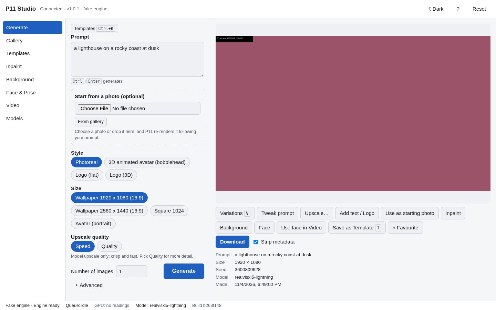

# Project_1111 (P11)

P11 is a fully local image-generation system for Omarchy Linux, tuned for a laptop with an 8 GB NVIDIA GPU. **P11 Studio** is its own browser form UI (Vite, React, TypeScript) with a Python service (FastAPI, Typer CLI, SQLite) that drives a pinned, headless ComfyUI engine reachable only on `127.0.0.1`. Features: photoreal text-to-image at wallpaper resolutions, one-click templates, inpainting, background replacement with your own photos, face-swap, pose and reference control, short-video face-swap, and a curated, hash-pinned model set.

> **Status: feature-complete, pre-release.** Every planned feature is built: Generate with wallpaper presets and Speed/Quality upscaling, templates, inpainting, background replacement, face swap, pose and reference control, short-video face-swap, logo text, the Models page and the installer. Phase 16 hardened and measured it on the reference laptop (threat model, scanners, guard-bypass review, success criteria: [`docs/P11_BENCHMARKS.md`](docs/P11_BENCHMARKS.md)); v1.0.0 is next. Progress is tracked in [`P11_IMPLEMENTATION_PLAN.md`](P11_IMPLEMENTATION_PLAN.md).



## Development quick start
```bash
make setup        # uv sync, npm ci, pinned tools (see CONTRIBUTING.md)
make build        # builds the frontend into src/p11/web/
uv run p11 start && uv run p11 open   # Studio in the background, app window with a one-time session link
uv run p11 status / stop / doctor     # state, stop, health checks with fix hints
uv run p11 serve --fake  # foreground, with the FakeEngine and a demo gallery (no GPU or ComfyUI needed)
uv run p11 models list   # curated models and their state; `p11 models install default` (14.6 GB)
make check        # all quality gates (no GPU)
make e2e          # Playwright walkthroughs on the fake engine (action counts, axe, network guard)
```

## Target hardware
- Reference machine: HP Omen laptop, Omarchy (Arch + Hyprland), NVIDIA GeForce RTX 2070 Mobile / Max-Q (8 GB, Turing), driver via `nvidia-open-dkms`, 31 GB RAM.
- Budget: about 7 GB of VRAM for generation; the desktop uses the rest.

## Install
```bash
git clone https://github.com/antonizick/project1111.git
cd project1111
./install.sh            # add --dry-run to look first, --models none to skip the 14.6 GB download
p11 open                # or launch "P11 Studio" from the app menu
```
Arch Linux / Omarchy, NVIDIA GPU with driver 580 or newer. The installer will not install GPU drivers, asks before any `pacman` step, and refuses to run from a pipe unless it is a pinned release tag. Update with `p11 update`, remove with `p11 uninstall`. Details: [`docs/P11_USER-GUIDE.md`](docs/P11_USER-GUIDE.md) section 11.

## Privacy
Everything runs on your machine. The service listens on `127.0.0.1` only, has no telemetry, loads no network assets in the UI, and downloads only the pinned models you approve (spec S1). Your prompts, uploads and outputs are never committed to this repository.

## Content stance
Image generation is unfiltered: P11 makes fictional imagery without a content filter. Face-swap, video face-swap and the face reference require that you have the consent of the person pictured. They refuse sexual target material, and so does any picture made from such a result. That guard cannot be turned off (spec S5, ADR-0037).

## Documentation
- [Specification](docs/P11_SPECIFICATION.md) (the Amendments section overrides earlier sections)
- [Decisions (ADR log)](docs/P11_DECISIONS.md)
- [Architecture](docs/P11_ARCHITECTURE.md)
- [User guide](docs/P11_USER-GUIDE.md)
- [Benchmarks and measured success criteria](docs/P11_BENCHMARKS.md) · [Threat model](docs/P11_THREAT-MODEL.md) · [Publication readiness](docs/P11_PUBLICATION-READINESS.md)
- [Implementation plan](P11_IMPLEMENTATION_PLAN.md)
- [Security policy](SECURITY.md) · [Contributing](CONTRIBUTING.md) · [Code of conduct](CODE_OF_CONDUCT.md) · [Changelog](CHANGELOG.md) · [Third-party notices](THIRD_PARTY_NOTICES.md)

## Repository
The repository is **private**: <https://github.com/antonizick/project1111>. It stays private until the owner decides otherwise.

## Licence
MIT, see [LICENSE](LICENSE) and [NOTICE](NOTICE). Third-party engine components, custom nodes and models are installed separately under their own licences; some restrict commercial use (see [THIRD_PARTY_NOTICES.md](THIRD_PARTY_NOTICES.md)).
