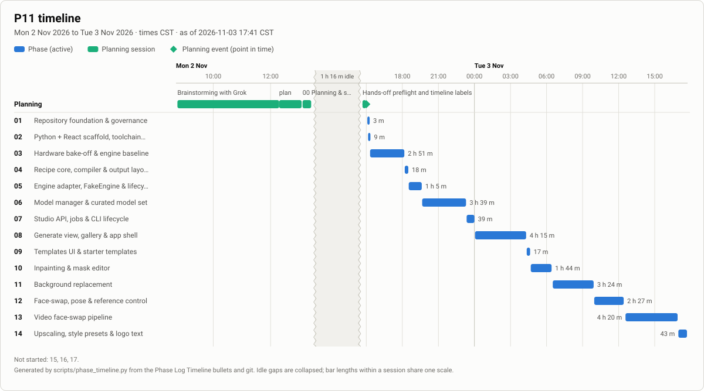
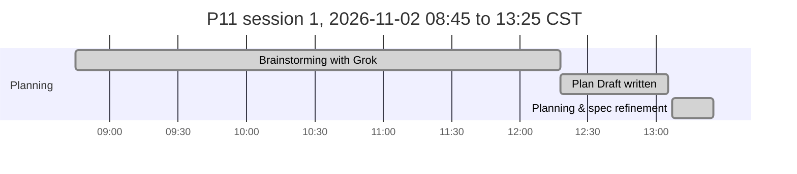
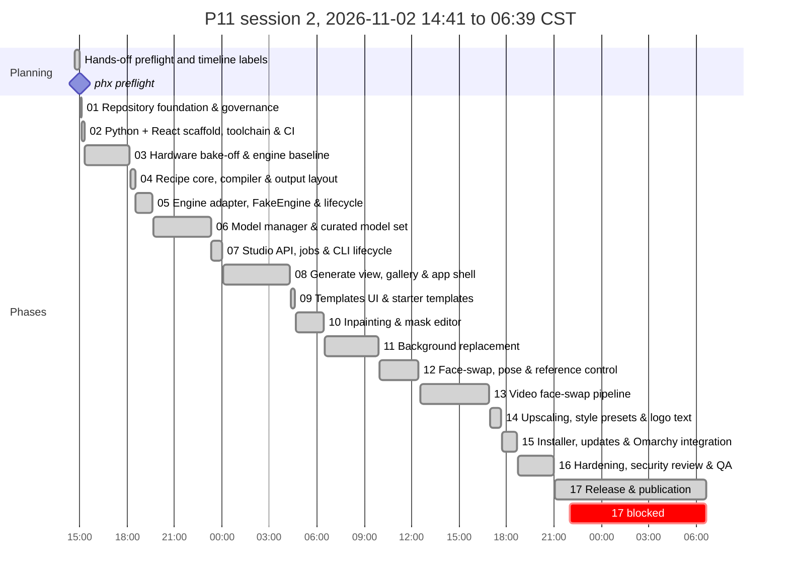

# P11: Final Report (v1.0.0)

Project_1111 (P11) is a fully local image-generation system for Omarchy Linux on an 8 GB RTX 2070 Mobile laptop. **P11 Studio** (Vite + React + TypeScript, FastAPI, Typer, SQLite, Python 3.12 via uv) drives a pinned headless ComfyUI on 127.0.0.1. This report covers phases 00–16 as shipped in v1.0.0. The repository is private (spec H13, ADR-0016).

## What was built against the spec
| Spec goal (§1, §10) | Result | Phase |
|---|---|---|
| Photoreal text-to-image at wallpaper resolution (1920×1080, 2560×1440) on 8 GB | Native bucket + upscale chain, Speed and Quality modes, `--lowvram` OOM retry | 03, 04, 05, 14 |
| One-click templates (recipes compiled to engine graphs) | Save as Template in 2 actions, re-run in 1, six starters, import/export | 04, 09 |
| Inpainting | Mask editor, crop-and-stitch, unmasked pixels byte-identical | 10 |
| Background replacement with photos | BiRefNet-lite mask on the CPU, LAB colour match, harmonize pass | 11 |
| Face-swap, pose and reference control | CPU face pipeline, ControlNet Union, IP-Adapter through P11's own node pack | 12 |
| Short video face-swap | Per-frame pipeline, audio kept, resumable after a kill | 13 |
| Upscale, logo text, Models page | Exact text overlay with five OFL fonts, logo pack ZIP, hash-pinned model manager UI | 14 |
| Installer and Omarchy integration | `install.sh`, `uninstall.sh`, `p11 update`, desktop entry, container install test | 15 |
| Security baseline S1–S10, threat model, QA | `docs/P11_THREAT-MODEL.md`, scanners, fuzz corpus, axe on every view | 16 |
| Unfiltered generation (A5); face-swap NSFW guard (S5) | Plain generation has no filter; the guard cannot be configured off (ADR-0005, ADR-0029, ADR-0034, ADR-0037) | 12, 13, 16 |

## Measured results against targets
Full tables: `docs/P11_BENCHMARKS.md` → "Success criteria (Phase 16 …)".

| Criterion | Target | Measured |
|---|---|---|
| Time to first image after the default-set download | ≤ 5 min | 37.7 s |
| Wallpaper presets in a row without OOM | 50 each | 50/50 at 1920×1080 and 50/50 at 2560×1440 |
| Stability on 8 GB | no crash, no leak | 30-minute mixed soak, 105 jobs, 0 OOM, 0 crashes, RSS flat |
| Daily workflow | ≤ 5 actions | 5 (generate → download is 2) |
| Save as Template / re-run | ≤ 3 / 1 | 2 / 1 |
| Warm wallpaper time, Speed | recorded | 16.2 s (1080p), 17.8 s (1440p) |
| Warm wallpaper time, Quality | recorded | 35.6 s (1080p), 59.4 s (1440p) |
| Thermal plateau | below the 87 °C pause | 80–81 °C |
| Video face-swap, 30 s 1080p Fast | usable file with audio, resume works | 2.75 s/frame, killed and resumed to completion |

## Decisions
37 ADRs are indexed in `docs/P11_DECISIONS.md`. The ones that shape the product:
- **ADR-0002, 0013:** a form UI over headless ComfyUI, with a local-only security posture.
- **ADR-0003, 0016:** MIT for P11's own code, no weights in git, a private v1.0.0 release.
- **ADR-0005, 0029, 0034, 0037:** unfiltered generation; the S5 guard on face-swap targets and results, video frames and every picture that carries a person's likeness.
- **ADR-0006, 0021:** a hash-pinned model manifest with a verified downloader.
- **ADR-0007, 0019:** templates are versioned recipes compiled to engine graphs.
- **ADR-0018:** the default model set (RealVisXL V5.0 Lightning, Juggernaut XL v9, fp16-fix VAE, NomosWebPhoto RealPLKSR; about 14.6 GB).
- **ADR-0028, 0031:** the face pipeline runs on the CPU in P11; the IP-Adapter node pack is P11's own code.
- **ADR-0036:** the installer is an editable `uv tool` install from the checkout, with tag-based updates.

## Deviations
Recorded per phase in the Phase Log of `P11_IMPLEMENTATION_PLAN.md`. The notable ones: no Forge-family engine was measured because ComfyUI passed every hard requirement (Phase 03); face detection, swap and restore run in P11 instead of a ReActor node (ADR-0028); the gitleaks hook is a local system hook (ADR-0017); logo starters were mark-only until Phase 14 (ADR-0024).

## Known limitations and residual risks
From `docs/P11_THREAT-MODEL.md` §3 and `docs/P11_PUBLICATION-READINESS.md`:
- **T6:** ComfyUI has no authentication. Another local process that can reach the engine port can run graphs, and can use the face adapter without the S5 guard.
- **T7, T8:** the S5 classifiers can miss. There are two models and either one refusing is enough. A re-uploaded picture of someone's likeness is only caught when its sidecar carries the `likeness` flag.
- **Licences:** the InsightFace models (`arcface-w600k-r50`, `inswapper-128`) are non-commercial research only, so face-swap output is not cleared for commercial use. The CreativeML OpenRAIL-M checkpoints carry use-based restrictions. Both are flagged in `THIRD_PARTY_NOTICES.md`, the installer and the Models page.
- **Hardware:** built and measured on one machine (RTX 2070 Max-Q, 31 GB RAM). Other GPUs are untested. Good-quality video runs at about 7 s/frame on the CPU.
- **Not tested against a real tag:** the pinned-tag one-liner and `p11 update` need the public tag and a public repo.

## Deferred follow-ups
The full list is the plan's "Deferred follow-ups (Phase 16, H12)" table. None is a security item. The ones that need the owner's eye: avatar/LoRA tuning, the 10-prompt defaults review, and the by-eye `latent` vs `both` comparison. AUR packaging and an Omarchy shell status indicator are candidates for `/phase-add`.

## Timeline
<!-- phase-timeline:start (generated by scripts/phase_timeline.py; do not edit) -->

*Generated from the Phase Log Timeline bullets and git, as of 2026-11-04 06:39 CST. ≈ marks a time inferred from git or a heading. Idle gaps over 60 min start a new chart below and are collapsed in the image. Regenerate with `python3 scripts/phase_timeline.py --write`; do not edit by hand.*

| Phase | Name | Started | Finished | Merged | Active | Blocked | Claim |
|---|---|---|---|---|---:|---:|---|
| plan | Brainstorming with Grok | 2026-11-02 08:45 CST | 12:18 |  | 3 h 33 m |  | n/a |
| plan | Plan Draft written | 2026-11-02 12:18 CST | 13:05 |  | 47 m |  | n/a |
| 00 | Planning & spec refinement | 2026-11-02 13:07 CST | 13:25 |  | 18 m |  | n/a |
| plan | Hands-off preflight and timeline labels | 2026-11-02 14:41 CST | 14:59 |  | 18 m |  | n/a |
| plan | phx preflight | 2026-11-02 15:00 CST |  |  |  |  | n/a |
| 01 | Repository foundation & governance | 2026-11-02 15:05 CST | 15:08 | 15:08 | 3 m |  | `9f87dd5` |
| 02 | Python + React scaffold, toolchain & CI | 2026-11-02 15:09 CST | 15:18 | 15:18 | 9 m |  | `d55b209` |
| 03 | Hardware bake-off & engine baseline | 2026-11-02 15:19 CST | 18:10 | 18:10 | 2 h 51 m |  | `54750e3` |
| 04 | Recipe core, compiler & output layout | 2026-11-02 18:12 CST | 18:30 | 18:30 | 18 m |  | `53422fc` |
| 05 | Engine adapter, FakeEngine & lifecycle | 2026-11-02 18:32 CST | 19:37 | 19:37 | 1 h 5 m |  | `e36ab9a` |
| 06 | Model manager & curated model set | 2026-11-02 19:39 CST | 23:18 | 23:18 | 3 h 39 m |  | `bdbeccf` |
| 07 | Studio API, jobs & CLI lifecycle | 2026-11-02 23:21 CST | 2026-11-03 00:00 CST | 00:00 | 39 m |  | `6009af1` |
| 08 | Generate view, gallery & app shell | 2026-11-03 00:03 CST | 04:18 | 04:18 | 4 h 15 m |  | `a702d75` |
| 09 | Templates UI & starter templates | 2026-11-03 04:21 CST | 04:38 | 04:38 | 17 m |  | `0515720` |
| 10 | Inpainting & mask editor | 2026-11-03 04:41 CST | 06:25 | 06:25 | 1 h 44 m |  | `5e1064b` |
| 11 | Background replacement | 2026-11-03 06:31 CST | 09:55 | 09:55 | 3 h 24 m |  | `89dbdf8` |
| 12 | Face-swap, pose & reference control | 2026-11-03 09:58 CST | 12:25 | 12:25 | 2 h 27 m |  | `3e1ff86` |
| 13 | Video face-swap pipeline | 2026-11-03 12:34 CST | 16:54 | 16:54 | 4 h 20 m |  | `5f38c9b` |
| 14 | Upscaling, style presets & logo text | 2026-11-03 16:58 CST | 17:41 | 17:41 | 43 m |  | `0a15840` |
| 15 | Installer, updates & Omarchy integration | 2026-11-03 17:45 CST | 18:42 | 18:40 | 57 m |  | `7bb52d8` |
| 16 | Hardening, security review & QA | 2026-11-03 18:46 CST | 21:00 | 21:00 | 2 h 14 m |  | `3d4afd8` |
| 17 | Release & publication | 2026-11-03 21:04 CST | 2026-11-04 06:39 CST | 06:39 | 58 m | 8 h 37 m | `5c2ba2a` |

**Totals:** elapsed 1 d 21 h (first recorded start to 2026-11-04 06:39 CST) · active phase time 1 d 6 h (sum over phases) · blocked or paused 8 h 37 m · idle 1 h 16 m in 1 gap(s) over 60 min.
<!-- phase-timeline:end -->
