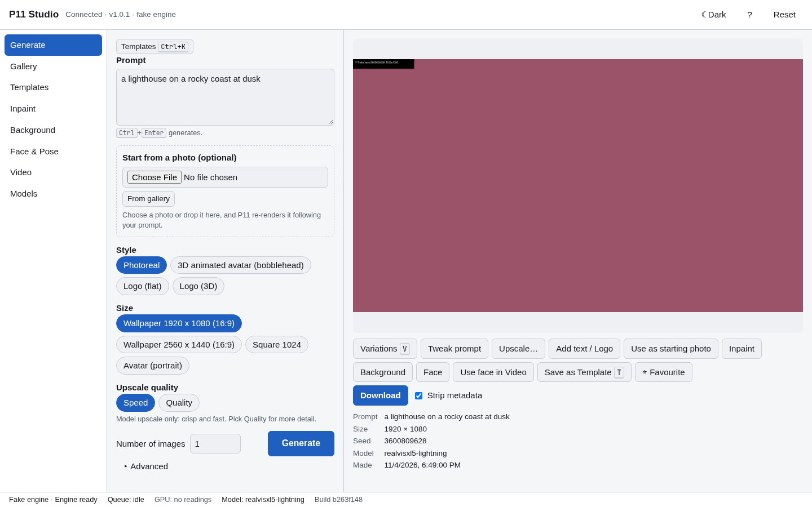
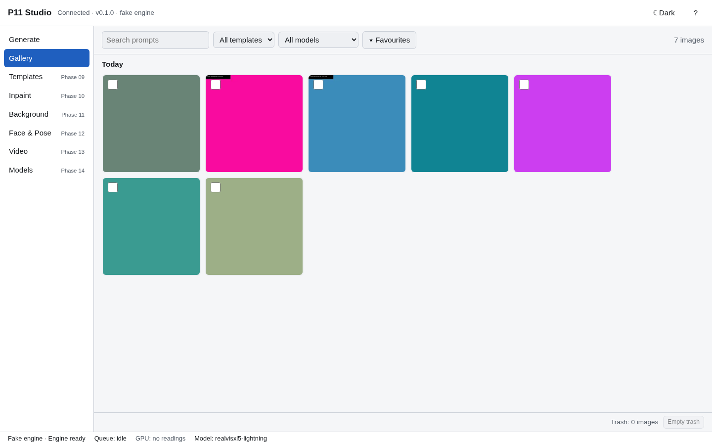
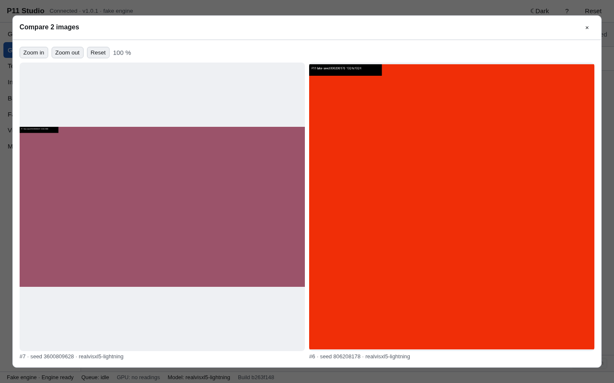

# P11 User Guide (outline)

Outline only; written out as features land (finished in Phase 15).

1. Install (`./install.sh`) and first run (`p11 doctor`, `p11 open`); running the Studio (below)
2. Generate: Simple and Advanced modes, wallpaper presets, seeds and variations
3. Gallery: compare, export, re-run
4. Templates: save, apply, slots, import/export
5. Inpainting and the mask editor
6. Background replacement
7. Face-swap, pose and reference control (consent, NSFW target guard)
8. Video face-swap
9. Models: curated set, licence flags, adding your own
10. Troubleshooting: out-of-memory, thermals, `p11 doctor`
11. Uninstall and data locations

## 1. Running P11 Studio (written in Phase 07)
P11 Studio is a small local web service plus the engine it drives. Everything stays on `127.0.0.1`.

```bash
p11 start          # start the Studio in the background (the engine starts with the first job)
p11 open           # open it in an app window (starts the Studio first if needed)
p11 status         # Studio, engine, GPU temperature/VRAM and queue; exit 3 when not running
p11 stop           # stop the Studio and the engine
p11 serve          # run in the foreground instead (Ctrl+C to stop); --port, --debug
p11 doctor         # check GPU, engine, models, ports, disk space and permissions
p11 doctor --quick # skip the PyTorch/CUDA check (a few seconds)
```

`p11 open` uses the same app-mode window as Omarchy web apps (`omarchy-launch-webapp`), otherwise a Chromium-family browser with `--app`, otherwise your default browser. Set `P11_BROWSER="firefox --new-window"` to choose one. The link it opens contains a one-time code that works once, for two minutes; to get another window, run `p11 open` again. `p11 open --print-url` prints the link instead of opening it.

**The engine and the GPU.** The engine is started for the first job and stopped after 5 minutes without work (`engine_idle_stop = 300` in `~/.config/p11/config.toml`), so P11 does not hold on to the GPU while idle. After an "out of GPU memory" retry P11 runs in low-memory mode for that job and switches back to the faster mode after a minute of idle time. Long jobs pause while the GPU is above 87 °C and continue at 80 °C.

**Try it without a GPU.** `p11 serve --fake` (or `p11 start --fake`) uses a stand-in engine that draws placeholder images, with a demo gallery in `~/.cache/p11/fake/`, separate from your real pictures.

**Scripts.** The API is at `http://127.0.0.1:8111/api/` and needs the session token: `curl -H "Authorization: Bearer $(cat "$(p11 status --token-file)")" http://127.0.0.1:8111/api/system`. The schema is at `/api/openapi.json`.

**Logs.** `~/.cache/p11/logs/studio.log` (the Studio; never contains prompt text unless you run with `--debug`) and `engine.log` (ComfyUI).

**`p11 doctor` problems and what to do.**

| Message | Do this |
|---|---|
| No NVIDIA driver found / nvidia-smi cannot talk to the GPU | Check `nvidia-smi`; reboot after a driver update. P11 never installs drivers. |
| The engine is not installed / is ComfyUI x, P11 is pinned to v0.43.0 | `scripts/engine_setup.sh` (later: `./install.sh`) |
| The engine's PyTorch cannot use the GPU / has no kernels for sm_75 | `scripts/engine_setup.sh` reinstalls the pinned CUDA build |
| Default model … is not installed (for example after renaming a file) | `p11 models install default` (only missing files are downloaded) |
| Port 8111 / 8188 is used by another program | stop it, or set `studio_port` / `engine_port` in `config.toml` |
| Some P11 data is readable by other users | run the `chmod` command it prints |

## 2. Generate (written in Phase 08)


1. Type what you want to see in **Prompt**.
2. Pick a **Style** (Photoreal, 3D animated avatar, Logo flat, Logo 3D). The style also picks a sensible size, for example square for logos.
3. Pick a **Size**: Wallpaper 1920 × 1080 or 2560 × 1440, Square, or Avatar (portrait). Wallpapers are drawn at the model's native size and upscaled.
4. Press **Generate** or <kbd>Ctrl</kbd>+<kbd>Enter</kbd>. **Number of images** makes up to 4 at once.

While it runs you see the stage (Generating, Refining), the step, the percentage and an estimate of the time left; <kbd>Esc</kbd> or **Cancel** stops it. The first job after a pause takes about 15 s longer because the engine starts. If the GPU runs out of memory P11 says so and retries in low-memory mode.

**What you can do with a result:** **Variations** (<kbd>V</kbd>, same prompt, next seeds), **Tweak prompt** (one small wording change, same seed), **Upscale ×2**, **Favourite**, and **Download** (with **Strip metadata** on, the file carries no recipe, prompt or timestamps). **Save as Template** (<kbd>T</kbd>) is described under Templates. Inpaint, Background and Face show the phase that adds them.

**Advanced** (click "▸ Advanced"): model (with its family and a "default" badge), LoRAs and their weights, negative prompt, sampler, scheduler, steps, CFG, seed with **Lock seed**, and the upscale method. Empty fields use the model's tested defaults, shown as grey placeholders; **Reset to model defaults** clears your changes. With the seed locked, a batch uses seed, seed + 1, …

The status bar shows the engine state, the queue, GPU memory in use and the GPU temperature (green below 70 °C, yellow from 70, orange from 80, red from 87 °C when long jobs pause), and the model of your last job.

## 3. Gallery (written in Phase 08)


Every image is listed newest first, grouped by day. **Search prompts** matches word beginnings ("mount" finds "mountain"); filter by template, model or ★ favourites. Click an image to open it: zoom with the mouse wheel or <kbd>+</kbd>/<kbd>−</kbd> (<kbd>0</kbd> resets, drag or arrow keys to pan), go to the previous/next image, make variations, download, or **Open as recipe**, which loads its settings into Generate with the seed locked, so Generate makes the same picture again.

Tick the box on two or more images to **Compare** them side by side (zoom and pan move together), **Export** them as one ZIP (with or without metadata) or **Delete** them. Deleting moves the files to P11's trash folder (`~/.local/share/p11/trash/`); nothing is gone until you press **Empty trash** and confirm. To bring an image back before that, move its `.png` and `.json` back under `~/Pictures/P11/` and run a reindex (Phase 16 adds a button).



**Keyboard shortcuts** (press <kbd>?</kbd> in the app): <kbd>Ctrl</kbd>+<kbd>Enter</kbd> generate · <kbd>Esc</kbd> cancel the job or close a dialog · <kbd>V</kbd> variations · <kbd>T</kbd> save as template · <kbd>Ctrl</kbd>+<kbd>K</kbd> find and run a template · <kbd>G</kbd> gallery · <kbd>?</kbd> shortcuts. Letter keys do nothing while you are typing in a field. The theme button in the top bar switches light and dark.

## 4. Templates (written in Phase 09)
A template is a saved recipe you can run again with one click.

**Save one:** make an image you like, press **Save as Template** (<kbd>T</kbd>) under the result or in the gallery detail view, check the name (it starts from your prompt) and press **Save**. That is two actions. Optional: a folder (up to three levels, like `Logos/Dark`), tags, **A new seed** (more like this, the default) or **This seed** (exactly this), and **Ask for the prompt each time**, which turns the prompt into an input. If the image was made from a photo (a face, a background), that photo becomes an input to fill in; the photo itself is never stored in the template. A chain (for example generate, then upscale) is saved whole.

**Run one:** open **Templates**, press **Run** on a card. Press **Inputs…** to change the template's inputs first. A template whose required input is empty (a face photo, say) opens a small form: choose a photo or drop one on the field, tick *Remember* to reuse it next time, then **Run**. The result appears on the card, in Generate if you are there, and in the gallery under the template's name. In Generate, <kbd>Ctrl</kbd>+<kbd>K</kbd> opens a finder (type a few letters, <kbd>Enter</kbd> runs), and the last five templates you ran are buttons above the prompt.

**Manage:** search by name, tag or prompt; filter by folder and tag. **Edit** opens the recipe in Generate (the template itself is unchanged: save the result as a new template), **Duplicate**, **Rename**, **Move**, **Export** (a `.p11template.json` file) and **Delete** (a toast offers **Undo**). **Import…** reads a template file; P11 checks it and refuses files that are damaged or from a newer P11. Imported templates get a new ID, so they never overwrite yours.

**Starter templates** are added to your templates folder (`~/.config/p11/templates/starter/`) the first time P11 Studio starts: *Wallpaper photoreal 16:9 1080p* and *1440p*, *Software logo dark*, *Software logo light*, *Indie game logo* and *3D animated avatar (bobblehead)*. Each runs in one click and has a text input you can change. Until the text overlay arrives (Phase 14) the logo templates make the mark without text; the avatar's face photo input is optional and is used once face swap arrives (Phase 12). If you delete a starter it does not come back. To undo everything: delete the folder `~/.config/p11/templates/` (including `.starter-installed.json`, which makes the starters install again).

## 5. Inpainting and the mask editor (written in Phase 10)
Inpainting repaints the part of an image you paint over and leaves the rest untouched.

**Fix a result in four actions:** press **Inpaint** under a result (or in the gallery detail view), paint over the part to change with one stroke, press **Apply**, then **Download** (or **Save as Template**). The prompt starts as the image's own prompt; change it to say what should be there ("a red wool scarf"). To start from your own photo, open **Inpaint** in the left nav and choose **Upload photo** (PNG, JPEG or WebP; location data is removed on upload).

**Strength** (pick one):
- **Subtle fix** keeps the shapes and fixes details: skin, small artefacts, a smoother patch.
- **Change** (the default) changes what is there but keeps the layout: an expression, a colour, a material.
- **Replace** paints something new in the area: a different object, a new sky.

**Only masked area at full resolution** (on by default) paints a box around your mask at the model's working size and pastes it back, so small fixes keep their detail and run faster (about 11–15 s for a face on a 1920×1080 image instead of about 30 s for the whole frame). Turn it off to repaint with the whole image in view.

**Mask editor:** **Brush** (<kbd>B</kbd>) and **Eraser** (<kbd>E</kbd>), **Size** (<kbd>[</kbd> smaller, <kbd>]</kbd> bigger), **Hardness** (soft or hard edge), **Opacity** (a lighter mask changes the area less), **Feather** (how softly the new part blends in; the preview shows it), **Invert** (<kbd>I</kbd>: paint the part to keep instead), **Clear**, **Undo** (<kbd>Ctrl</kbd>+<kbd>Z</kbd>), **Redo** (<kbd>Ctrl</kbd>+<kbd>Shift</kbd>+<kbd>Z</kbd>) and **Show mask** (<kbd>H</kbd>). Zoom with the mouse wheel or a touchpad pinch, pan by holding <kbd>Space</kbd> and dragging (or with the middle mouse button). A pen's pressure makes the brush thinner when you press lightly. <kbd>Ctrl</kbd>+<kbd>Enter</kbd> applies.

**Advanced:** an exact **Denoise** (overrides the strength buttons), **Mask blur**, **Padding** around the mask (more context for the model), **Steps** and a fixed **Seed**.

**After applying:** the result is saved as a child of the original in the gallery. **Keep editing this result** loads it into the editor for another fix. **Save as Template** asks whether to **Keep this mask in the template** (the mask shape is stored in the template; the run asks only for the image) or **Ask for a mask each time** (the run asks for a mask image, white = repaint). The photo itself is never stored in a template.

## 6. Background replacement (written in Phase 11)
Background replacement cuts the subject out of a photo and puts it on a new background - a photo,
a described scene, a flat colour or plain transparency (PNG with alpha). It matters most for
product shots and logos.

**The daily path in four actions:** press **Background** under a result (or in the gallery detail
view), choose **Photo...** and pick the new background, press **Replace Background**, then
**Download**. P11 finds the subject automatically (a few seconds; the model runs on the CPU so it
never fights the generator for GPU memory) and the stage previews exactly what Apply will save.

**The subject mask.** When the image opens, P11 segments the subject and shows the mask as an
overlay (toggle it with **Show mask overlay**). Not perfect on your image? Press **Refine mask**:
the mask editor opens with the found mask already in it (brush/eraser, <kbd>[</kbd>/<kbd>]</kbd>
size, <kbd>I</kbd> invert, <kbd>Ctrl</kbd>+<kbd>Z</kbd> undo - see section 5) and **Use this mask**
takes it back. To start from your own photo, open **Background** in the left nav and choose
**Upload photo**.

**New background:**
- **Photo...** any PNG, JPEG or WebP (location data is removed on upload).
- **Describe**: type a scene ("a sunny beach") and press **Generate**; P11 makes the background and
  puts the subject on it.
- **Colour / transparent** a flat colour, or **Transparent** for a PNG with an alpha channel you
  can drop into other tools.

**Blend:**
- **Harmonize** unifies the light: **Off** keeps the subject's own light, **Light** (the default)
  matches the light near the edge, **Strong** matches harder across the subject. Each runs a
  low-strength image pass on the graphics card.
- **Match the colours of the background** (on by default) shifts the subject's colours towards the
  background's, so the two look like one photo.
- **Edge feather** softens the cut-out edge (the preview shows it).
- **Drop shadow** adds a soft shadow under the subject.

**Advanced:** **Fill frame** (crop the background to cover) or **Fit inside**, position sliders for
the background and the subject, and the subject's size.

**After applying:** the result is a child of the original in the gallery. **Keep editing this
result** loads it back in. **Save as Template** asks where the subject comes from each run:
**Find the subject each time** (the default: the template re-runs on any new subject), **Keep this
mask in the template**, or **Ask for a mask each time**. The background photo becomes a template
input ("Background photo"), so a template like "product on my studio background" asks for two
photos and runs. Photos are never stored in a template.

## 9. Models (written in Phase 06)
P11 ships a list of tested models (`models/manifest.toml`), not the models themselves. Each one is downloaded from its original host and checked against a pinned SHA-256 before P11 uses it.

```bash
p11 models list                       # what P11 knows and what is installed
p11 models licences                   # licence, "commercial use" flag, your acknowledgements
p11 models install default --dry-run  # size before downloading (default set: 14.4 GB)
p11 models install default            # asks you to accept licences with terms (or --accept-licences)
p11 models install full               # adds the SD 1.5 low-VRAM model
p11 models verify                     # re-hash every installed file; exit 1 if one is damaged
```
An interrupted download resumes when you run the same command again. A file that does not match its hash is deleted and reported, never used. Licence acknowledgements are kept in `~/.config/p11/licences.toml` with the time you accepted them; delete an entry to be asked again.

**Licences.** Several models use OpenRAIL-family licences: commercial use is allowed, but the licence lists uses you agree not to make. CC-BY models need credit when you share results. `p11 models licences` shows the flags for each.

**Adding your own models.**
```bash
p11 models add ~/Downloads/MyLora.safetensors          # copied into the right folder
p11 models add ~/Models/big.safetensors --link         # symlink instead of copying
p11 models add https://huggingface.co/<repo>/resolve/<commit>/<file>.safetensors
p11 models add file.safetensors --kind upscale --id my-upscaler   # when detection cannot tell
p11 models disable my-upscaler / enable my-upscaler
p11 models remove my-upscaler                          # forget it; --delete-file also deletes it
```
P11 recognises the file type by its content, not its name. `.safetensors` and GGUF files are accepted. Pickle-based files (`.ckpt`, `.pt`, `.pth`, `.bin`) can run code on your computer when loaded, so P11 refuses them unless you pass `--allow-pickle`; prefer a `.safetensors` version. If the file you add is one of the curated models, P11 installs it as that model. Files you drop into a model folder by hand show up as `unregistered` until you `add` them.

**Optional models that need a login.** The curated set needs no account. For a model behind a login, put a token in `~/.config/p11/secrets.toml` (mode `600`, or P11 refuses it):
```toml
[tokens]
"huggingface.co" = "hf_…"
```
The token is only sent to that exact host, never to the CDN the host redirects to, and never logged.

**Moving models to another disk:** set `models_root = "/path"` in `~/.config/p11/config.toml`, move the folders, then run `p11 models install default` once (it checks the files and updates the engine's `extra_model_paths.yaml`).

## 7. Face & Pose (written in Phase 12)

Open **Face & Pose** in the left nav, or press **Face** on any result or gallery picture.

**Swap face.** Choose the picture to change (or open one from the gallery), then the photo whose face
you want to use. When the picture has more than one person, pick the face to swap onto from the
list. **Blend** softens the pasted face; **Restore the face afterwards** runs GFPGAN to clean up
small or blurry faces (Strength controls how much of the restored face is used). Press **Swap face**.
The result is saved as a child of the picture in the gallery, so you can swap again or undo by going
back to the parent.

> **Use faces of people who agreed.** P11 refuses to put a face onto a nude or sexual picture, and
> there is no way to switch that off: the check runs before every swap and again on the result.

**Apply pose.** Write the prompt as usual, then choose where the pose comes from: **The editor**
(drag the joints, **Mirror**, pick a stock pose — standing, sitting, waving, arms crossed, headshot —
and add a second person if you need one) or **A photo** (P11 reads the pose out of it). **Control**
picks what is matched: the body **Pose**, the **Depth** of the picture, or its **Lines**. **Strength**
decides how closely the generation follows it.

**Use as reference.** Generate in a picture's style: choose the reference image, keep **Style and
colours** or **The person or character**, and set the strength. Lower strengths keep more of your
prompt; near 1.0 the picture's look dominates. **The person or character** carries a real face into
the picture, so it gets the same content check as a face swap, and so does anything you later make
from such a picture (an inpaint, a new background, an upscale) or from a face-swapped one. That needs
the `face` models too.

**Restore faces.** For an existing picture: every face, or just one, at a chosen strength. Use it on
old photos, small faces or an avatar that came out soft.

**Models.** These tools need their models, which are installed with
`p11 models install face` (swap, restore and the content check) and `p11 models install control`
(pose, depth and reference). P11 tells you exactly which one is missing if you skip them. The
InsightFace face models are licensed for **non-commercial research only**, so the install asks you
to acknowledge their licence first (`--accept-licences` in a script).

## 8. Video face-swap (written in Phase 13)

Open **Video** in the left nav. Choose a short clip and the photo whose face you want to use (or
press **Use face in Video** on a result or gallery picture — that picture becomes the face photo).
P11 shows the clip's first frame with the faces it found: click the one to swap onto (P11 follows it
across the clip), or leave **Largest face in every frame** selected. Press **Swap faces**. The
finished MP4 keeps the clip's own sound.

- **Quality**: **Fast** skips the face restore and works at 720p; **Good** restores the swapped
  faces at full size. **Frame size** can cap the frames further (smaller is faster).
- **Start/End** trim the clip before processing; **Smooth the face over time** blends the face with
  the previous frame where it barely moves (less flicker, slightly softer).
- **Keep the frames** leaves the extracted frames on disk — also needed to resume a run you
  cancelled yourself. Cancelled runs without it are cleaned up.
- **Progress** shows the frame count, an ETA, the GPU temperature and a **Cooling down** note when
  the laptop gets hot; **Cancel** stops the job, **Esc** cancels too. If P11 is killed mid-job
  (crash, power loss), the job appears in **Recent video swaps** as *interrupted* with a **Resume**
  button that continues at the last finished frame.

> **Use faces of people who agreed.** P11 refuses nude or sexual clips and refuses to save a swap
> that looks nude or sexual; the check runs on every swapped frame and there is no switch to turn it
> off.

**Limits.** Clips up to **60 s and 1080p** are the recommended size. Longer or larger clips work
after you tick **I understand, run it anyway** (P11 shows a rough time estimate first): face-swapping
is seconds of work per frame, so a 30 s clip is tens of minutes on the laptop. Trimming the clip or
picking **Fast** is the way to shorten a run. A finished video is saved next to your pictures
(`~/Pictures/P11/…`) with a sidecar describing how it was made.

**Models.** The video path uses the same face models as **Swap face**:
`p11 models install face` (they are licensed for non-commercial research, so the install asks you to
acknowledge that first).

## 10. Upscaling, logos and the Models page (written in Phase 14)
**Upscale: Speed or Quality.** On any result or gallery image press **Upscale…**, pick ×1.5, ×2, **To 1920 × 1080** or **To 2560 × 1440**, and **Speed** or **Quality**. Speed uses only the model upscaler: crisp and quick (about 16 s at wallpaper size on the reference laptop). Quality adds a refinement pass that invents fine detail (about 35 s at 1920 × 1080, about 77 s at 2560 × 1440). For a new wallpaper, the **Upscale quality** chips in Generate do the same during generation. Neither mode ran out of GPU memory in testing.

**Logos with exact text.** Picture models misspell words, so P11 draws the wording itself. The software and game logo starters ask for **Text on the logo**; the picture is made by the model and the words are laid on top in a bundled font. On any image, **Add text / Logo** opens the editor: type the text (new lines allowed), choose a font (Inter, Space Grotesk, Playfair Display, Bebas Neue, JetBrains Mono, all open-licence and bundled), weight, size, colour or gradient, outline, shadow, alignment and an anchor, or **drag the preview** to place it. The preview is exactly what is saved, at full resolution. **Let the model try the text** keeps the picture's own lettering instead. The same dialog makes **6 logo variations** and a **logo pack** (a ZIP with transparent PNGs at 512, 256, 128, 64 and 32 pixels and a `favicon.ico`; the background is cut out with the Background tool's subject finder, or, if that model is not installed, by removing the border colour).

*Updating starters.* P11 installs each starter template once and never overwrites one you changed. If you used P11 before Phase 14, your logo starters still make the mark only: delete them in Templates (the folder is `~/.config/p11/templates/starter/`) and the file `~/.config/p11/templates/.starter-installed.json`, and restart P11 to get the new ones.

**3D animated avatar.** The avatar starter has an optional **Face photo**; fill it to swap the face in afterwards (the face tools and their consent notice are in section 7), leave it empty to get the avatar only.

**The Models page.** Open **Models** in the left bar. Models are grouped by kind with their state (Installed, Not installed, Damaged, Yours), size, sets and licence, with a plain "commercial OK" or "non-commercial" label. **Install a set** (default, full, optional, face, control) or **Install** on one model shows the download size and, where a licence has terms, the licence and a checkbox to accept it; progress then shows in the page. **Verify** re-checks the file's hash, **Disable** hides a model from recipes without deleting it, **Remove** deletes the file (a model you added can be only forgotten), and **Add model** takes a file path or an https link, with the same safe-format rule as `p11 models add` (pickle files need the explicit opt-in).

## 11. Install, update and uninstall (written in Phase 15)
**Supported:** Arch Linux and Omarchy on x86_64 with an NVIDIA GPU (8 GB or more) and driver 580 or newer (the pinned PyTorch uses CUDA 13). Other distributions and GPUs are not supported. P11 never installs or changes drivers.

**Install.**
```bash
git clone https://github.com/antonizick/project1111.git
cd project1111
./install.sh                 # asks before anything that needs sudo
./install.sh --dry-run       # show every step, change nothing
```
Options: `--yes` (do not ask; the pacman packages are still listed), `--models default|face|control|full|none` (comma-separated; default `default`, 14.6 GB), `--accept-licences` (accept the licences of the chosen models; otherwise `p11 models install` asks, and fails without a terminal), `--prefix DIR` (where the `p11` command, desktop entry and icon go; default `~/.local`), `--keybinding "SUPER + ALT + I"` (also add an Omarchy launch binding; it refuses a combination that is already in your `bindings.lua`), `--no-desktop`, `--skip-engine`.

What it does, in order: checks the OS and the NVIDIA driver (and stops with a link if either is missing or too old); lists missing pacman packages (`git ffmpeg curl diffutils xdg-utils`, plus `nodejs npm` to build the UI and `uv` if the distribution has it) and asks before `sudo pacman -S --needed`; installs uv from a pinned, checksummed release when the distribution has none; creates `~/.config/p11`, `~/.local/share/p11` and `~/.cache/p11` with mode `0700`; builds the UI; installs `p11` with `uv tool install --editable` on the managed Python 3.12 (the checkout is the app: keep it); sets up the pinned engine (`scripts/engine_setup.sh`); shows the size of each model set and downloads it; runs `p11 doctor`; installs the desktop entry. Run it again any time: it changes nothing that is already right and prints "Nothing to do".

The **face** model set contains two InsightFace models that are for non-commercial research only (`p11 models licences` shows them). The installer never accepts them for you: you either answer the prompt or pass `--accept-licences` yourself.

**One-liner (tags only).** `curl -fsSL https://raw.githubusercontent.com/antonizick/project1111/v1.0.0/install.sh | P11_INSTALL_TAG=v1.0.0 bash -s -- --dry-run` clones that tag and runs the installer from it. The script refuses to run from a pipe without a `vX.Y.Z` tag, and the repository is private until Nick publishes it, so this works only after release. The clone path above is the recommended one.

**Start.** Launch **P11 Studio** from the app menu, press the keybinding if you added one, or run `p11 open`. The desktop entry runs `p11 open`, which starts the Studio and opens an app window like an Omarchy web app. For a Hyprland window rule, the window class is the one Omarchy gives web apps (on the reference laptop: class `brave-127.0.0.1__-Default`, title `P11 Studio`; `hyprctl clients` shows yours while P11 is open).

**Update.** `p11 update` fetches the release tags, shows the CHANGELOG difference, asks, checks out the newest tag (`--to vX.Y.Z` for a specific one, `--dry-run` to only look) and re-runs the installer steps that changed (dependencies, engine pin, desktop entry). It refuses when tracked files in the checkout are modified. Your settings, templates, models and images are kept. New models are not downloaded silently: see `p11 models list`.

**Uninstall.** `p11 uninstall` (or `./uninstall.sh`) stops P11, removes the command, the engine, the desktop entry, the icon and the caches, and **asks separately** about the models (size shown), your settings/templates/gallery index and your generated images. The default for all three is to keep them; `--models`, `--config` and `--outputs` delete them without asking, `--dry-run` shows the plan. It never removes pacman packages, drivers, or a keybinding you added (delete the `P11 Studio launch` line in `~/.config/hypr/bindings.lua`).

**Laptop power and heat.** Generation is much faster plugged in with the performance profile (`powerprofilesctl set performance`). On battery or the power-saver profile the GPU clocks drop; the Studio still pauses long jobs at 87 °C and resumes at 80 °C. Keep the vents clear.

**Troubleshooting.**

| Symptom | Do this |
|---|---|
| "No NVIDIA driver found" / "driver is too old" | Install or update the driver yourself (https://wiki.archlinux.org/title/NVIDIA), reboot, run `./install.sh` again. |
| "Required packages are missing" | Run the `sudo pacman -S --needed …` line it prints, or re-run with a terminal so it can ask. |
| "Port 8111 is already in use" | `p11 status`; stop the other program or set `studio_port` in `~/.config/p11/config.toml`. |
| Out of GPU memory | P11 retries in low-memory mode; pick a smaller preset and close other GPU programs (`nvidia-smi`). |
| `p11 open` shows nothing / opens the wrong browser | `p11 open --print-url` and open the link yourself, or set `P11_BROWSER="chromium --app"`. On Wayland the Omarchy web-app launcher is used when present. |
| `p11: command not found` | Add `~/.local/bin` (or your `--prefix`/bin) to `PATH`. |
| Model download stopped | Run `./install.sh` or `p11 models install default` again; downloads resume and are checked by SHA-256. |
| `p11 update` says the checkout is modified | `git status`; commit, stash or discard your edits first. |
